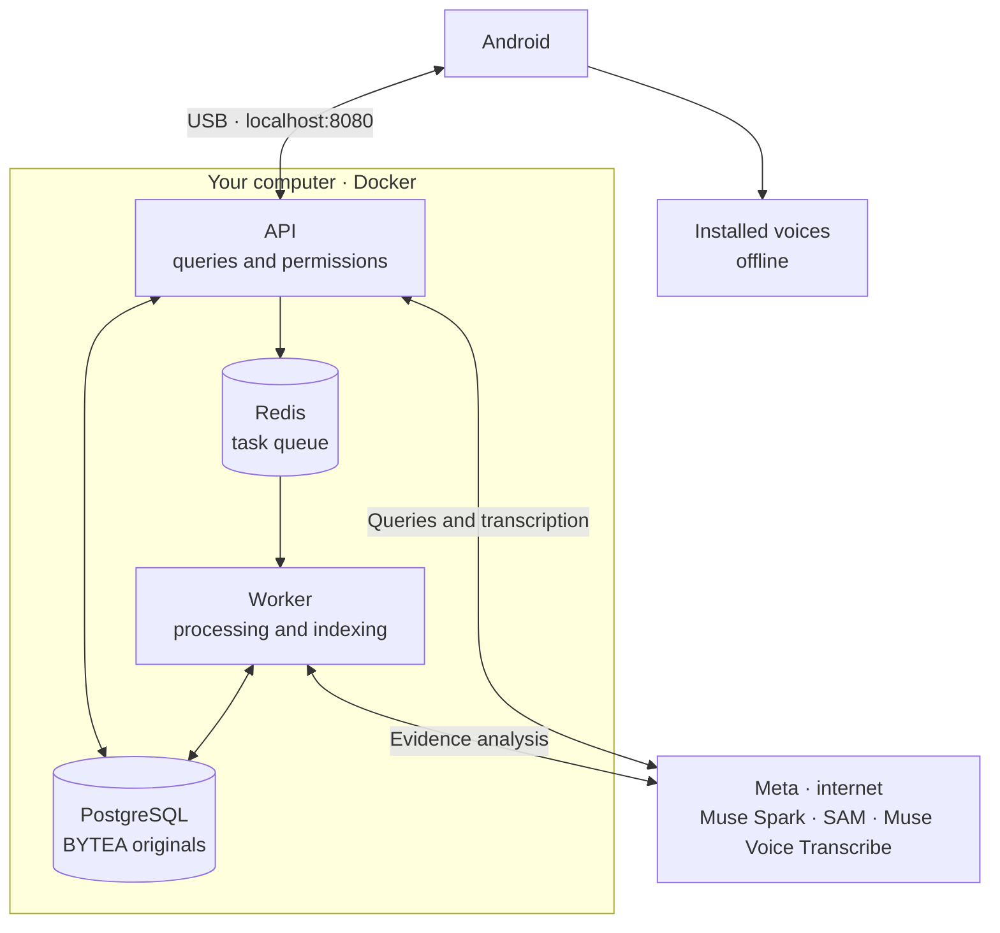

<a id="top"></a>

<p align="center">
  <a href="README.md"></a>
  <a href="../es/README.md"></a>
</p>

# RealityOS

<p align="center">
  
</p>

Android app for saving photos, videos and records in groups and searching evidence with AI. The local server runs PostgreSQL, Redis, API and worker in Docker.

## Requirements

- Windows x64 with [Docker Desktop](https://docs.docker.com/desktop/setup/install/windows-install/) and WSL2, or Linux x64 with [Docker Engine and Compose](https://docs.docker.com/engine/install/). Allocate **4 CPU cores, 8 GiB RAM and 25 GiB free storage** to Docker.
- Android 12+, USB cable and USB debugging; [Platform Tools (`adb`)](https://developer.android.com/tools/releases/platform-tools) on your `Path`.
- Internet and your own Meta `MODEL_API_KEY` with access to Muse Spark, SAM and Muse Voice Transcribe.

<a id="evaluate"></a>
<a id="deploy"></a>

## 1. Start

Download and extract the [repository](https://github.com/Luxisoft/realityos-spatial-memory/archive/refs/heads/main.zip), start Docker and run from the project folder:

**Windows — PowerShell**

```powershell
powershell.exe -NoProfile -ExecutionPolicy Bypass -File .\scripts\local\Start-RealityOS.ps1
```

**Linux**

```bash
bash scripts/local/start.sh
```

Enter your Meta key when prompted. The launcher generates `.env.local`; keep it private. The first run downloads dependencies and prepares the data. Restarting preserves edits and deletions.

<a id="android"></a>

## 2. Install and use Android

Download [app-debug.apk](https://github.com/Luxisoft/realityos-spatial-memory/releases/download/local-evaluation/app-debug.apk) into the project folder. Connect the phone by USB, accept its debugging prompt and run:

```bash
adb reverse tcp:8080 tcp:8080
adb install -r app-debug.apk
```

<a id="cases"></a>

Open the app and choose one of the **9 accounts across 3 groups: police, nursing and memory**. Explore the gallery and records; to publish, select a group, category and tag. Wait for indexing to finish before searching.

| Preview / video | Use |
| --- | --- |
| <a href="../../demo-video/policial_case.mp4"></a> | **Police:** consult group records and evidence. |
| <a href="../../demo-video/nurse_case.mp4"></a> | **Nursing:** review authorized records, notes and attachments. |
| <a href="../../demo-video/memory.mp4"></a> | **Memory:** find where and when an object was last seen. |
| <a href="../../demo-video/profile_found.mp4"></a> | **Profiles:** open a face candidate's authorized information. |

Images and videos are [conceptual illustrations](project/GRAPHICS.md). Click a thumbnail to open its video.

<a id="biometrics"></a>

### Face search

Face search requires explicit consent and enrollment. InsightFace returns candidates for human review; profiles or records open according to permissions.


For spoken replies, install an offline ES/EN voice on Android. Repeat `adb reverse` after reconnecting the phone.

<a id="architecture"></a>

### Local architecture



## 3. Diagnostics, shutdown and Postman

From the project folder:

| Action | Windows — PowerShell | Linux |
| --- | --- | --- |
| Diagnostics | `powershell.exe -NoProfile -ExecutionPolicy Bypass -File .\scripts\local\Test-RealityOS.ps1` | `bash scripts/local/test.sh` |
| Stop | `powershell.exe -NoProfile -ExecutionPolicy Bypass -File .\scripts\local\Stop-RealityOS.ps1` | `bash scripts/local/stop.sh` |

API: [documentation](http://localhost:8080/docs) · [health](http://localhost:8080/health/ready). Stopping preserves data; `down -v` deletes it. If the Meta key fails, correct `MODEL_API_KEY` in `.env.local` and start again.

**Postman:** import the [collection](../postman/RealityOS.postman_collection.json), choose **No environment → Localhost requests → 00 Quick start** or **00 Local scenarios**. Sign-in is automatic; enable `enable_write_requests=true` to write. **Server requests** is disabled, with no URL or credentials.

<a id="java-windows"></a>

## 4. Build Android (optional)

Use **JDK 21 LTS** and **Android SDK 36**. On Windows:

1. Install [Temurin 21 x64](https://adoptium.net/temurin/releases/?version=21&os=windows&arch=x64&package=jdk), choosing the **JDK** package and MSI installer.
2. In **Environment Variables**, set `JAVA_HOME` to the installed JDK directory, without quotes or `\bin`. **The user variable takes precedence over the system variable**: if both exist, use the same valid path. Also correct `JDK_HOME` if it points to an old installation.
3. Place `%JAVA_HOME%\bin` before other Java entries in `Path`. Fully close the editor and terminals, then open a new PowerShell:

```powershell
$env:JAVA_HOME
Test-Path "$env:JAVA_HOME\bin\java.exe"
& "$env:JAVA_HOME\bin\java.exe" -version
java -version
javac -version
```

Expect `True` and version **21**. If the editor retains an old path, remove it from `java.home` or `java.jdt.ls.java.home`. In Android Studio, select JDK 21 under **Settings → Build, Execution, Deployment → Build Tools → Gradle → Gradle JDK**.

Build from the project folder:

| Windows — PowerShell | Linux |
| --- | --- |
| `.\android\gradlew.bat -p android :app:assembleDebug` | `./android/gradlew -p android :app:assembleDebug` |

Output: `android/app/build/outputs/apk/debug/app-debug.apk`. Install it with `adb install -r android/app/build/outputs/apk/debug/app-debug.apk`.

<a id="hackathon"></a>

[](https://github.com/Luxisoft/realityos-spatial-memory/actions/workflows/ci.yml)

[Technical reference](INDEX.md) · [Verified status](project/IMPLEMENTATION_STATUS.md) · [Third-party licenses](project/THIRD_PARTY.md) · [Apache 2.0](../../LICENSE)
