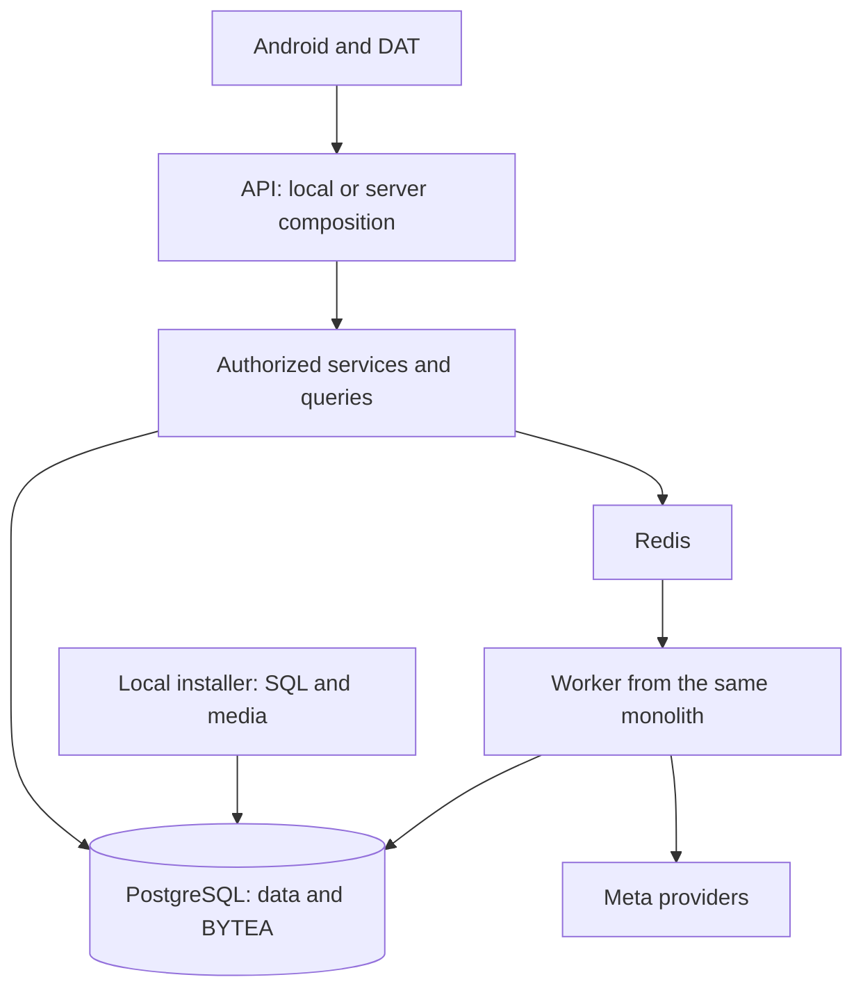

# Architecture

[Español](../../es/architecture/ARCHITECTURE.md) · [Documentation](../INDEX.md) · [API / Postman](../api/API.md)

RealityOS maintains a modular monolith with two explicit compositions: **local**, installed on the judge's Windows/Linux PC, and **server**, for the RealityOS server. API and worker run the same code, contracts, services and models; separate processes do not create additional data authorities. FRONTEND is the separate, restricted remote Meta gateway.

## Composition and dependencies

| Layer | Responsibility |
| --- | --- |
| `app.runtime` | Selects routers and tasks by environment; initializes the PostgreSQL schema. |
| `app.http`, account/social/record routers | Authentication, HTTP validation and response adaptation. |
| `app.processing`, services in `app.social_features`, `app.workspaces` | Operations, queries and workspace authorization. They do not depend on HTTP handlers. |
| `app.providers` | Model contracts and clients; they do not import the `app.meta` facade. |
| SQLAlchemy models and `app.db` | Persistence shared by API and worker. |
| `app.local` | Database-backed local access, with installation modules separated from operational requests. |
| `android/` | The only app, Kotlin/Compose and native DAT Display; data repositories and shared components. |

`app.runtime.routers` composes routes without filtering names or URL fragments. The local worker does not register Facebook importers, bucket synchronization or remote scheduling. The server includes its routers and tasks through explicit composition. OpenAPI contracts are checked for each environment.

## Single data authority

Account, workspace, record, publication and classification queries read PostgreSQL. `simulator/database/*.sql` is consumed during local initialization; `simulator/media/` stores images, videos and provenance for that installation. Runtime queries do not read parallel JSON catalogs. The CSV manifest describes files, licenses and hashes; it does not replace operational records. Imported originals remain in BYTEA.

Capture and publication are explicit; Query does not register evidence. Workspace membership is checked when reading, modifying or downloading resources. Services share gallery, classification, permission and media-response logic. Existing facades retain compatible imports where needed.

The `faces.py` / `face_setup.py` biometric arm remains isolated and protected, with consent checks and private references. It is not integrated into object processing.

## Configuration and distribution

There is no implicit `.env` read. Commands select a private file through `REALITYOS_ENV_FILE`; Compose injects container variables. `make api`, `make migrate` and `make seed` use `ENV_FILE`, defaulting to `.env.local`. Selecting a nonexistent file is an error. FRONTEND follows the same rule with `META_GATEWAY_ENV_FILE`; `make gateway-api` selects the gateway's private `runtime.env` explicitly.

The `local` Docker image includes installation SQL and media; the `server` image does not include `simulator/`. Localhost has four services: PostgreSQL, Redis, API and worker. It uses direct Meta with the judge's private key and installed Android voices. The server can enable Facebook, buckets, email, scheduler and ElevenLabs through private configuration; FRONTEND remains the restricted fallback gateway.

`make architecture-check` checks dependencies through AST, prohibits operational JSON catalogs and limits module size. Exceptions for protected biometric code and historical migrations are explicit. Tests verify boundaries and environment composition. Selected handlers with synchronous queries use FastAPI's thread pool; this is not a load-test result.

[Data](DATABASE.md) · [Local installation](../deployment/DEPLOYMENT_LOCALHOST.md) · [Verified status](../project/IMPLEMENTATION_STATUS.md)
