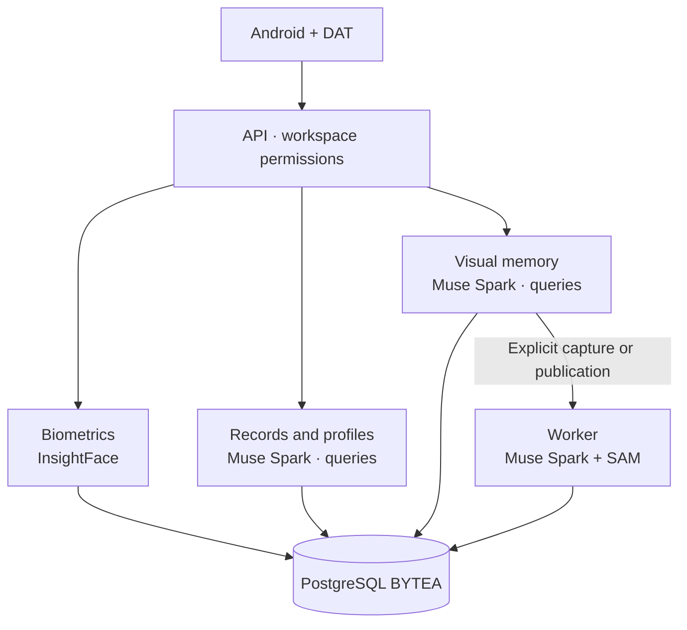

<p align="center"><a href="ARCHITECTURE.md"></a> <a href="../../es/architecture/ARCHITECTURE.md"></a></p>

# Architecture

[← Documentation](../INDEX.md) · [API / Postman](../api/API.md)

## Reading guide

| Topic | What to know |
| --- | --- |
| **Client** | Android Kotlin/Compose and native DAT Display; browser panel and web Display retired. |
| **API** | FastAPI enforces authentication, roles and membership. API and worker share contracts and SQLAlchemy models. |
| **Visual memory** | Explicit capture → BYTEA original → Celery/Redis → facts and evidence. Muse Spark also interprets queries from the API, without starting capture or evidence indexing. |
| **Biometrics** | Isolated InsightFace arm: consent, enrollments, candidates and authorized context. Separate from object processing. |
| **Records and profiles** | Muse Spark answers questions about previously authorized context from the API. Record reads/imports retain their own contract and do not always require AI. |
| **Modules** | `app.http`, `app.providers`, `app.processing`, `app.social_features`, `app.accounts`, `app.workspaces` and `app.storage`; facades preserve compatibility. |
| **Scaling** | Synchronous SQLAlchemy in async handlers; evaluate replicas or an async driver for high concurrency. |



## Commands

Run from the root with dependencies installed. Migrations and processing require the chosen environment and authorized data.
```bash
make architecture-check
make lint
make test
```

[DATABASE ](DATABASE.md) · [META INTEGRATION ](../integrations/META_INTEGRATION.md) · [WEARABLES ](../integrations/WEARABLES.md)

Connected buckets are account-private sources. `app.storage` authorizes downloads/imports; imported originals remain in BYTEA. Celery Beat (`scheduler`) schedules synchronization and the worker reuses publication analysis. [Connection flow](../guides/STORAGE_CONNECTIONS.md).
