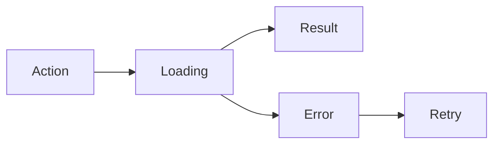

 

# Design and interaction

[← Documentation](../INDEX.md) · [API / Postman](../api/API.md)

## Reading guide

| Topic | What to know |
| --- | --- |
| **Visual system** | Android keeps gray/blue tokens, system typography and native controls; DAT uses supported styles and capabilities. |
| **States** | Separate loading, empty, error, progress and retry states; do not announce an empty list before a query completes. |
| **Evidence** | Complete highlighted image with date, source and confidence; longer details in separate actions. |
| **Forms** | Inline errors, focus on the first one, appropriate keyboard, autofill and optional password visibility; loading blocks duplicate sends. |
| **Accessibility** | 48 dp touch targets, text up to 200%, labelled controls and decorative graphics excluded from screen readers. EN/ES. |
| **Evaluation** | Robolectric screenshots and Compose tests cover states and widths; they do not replace physical keyboard, camera or glasses checks. |

## Required consistency across the app

Standing owner preference (November 3, 2026): every screen, view and component
must maintain the same quality and visual language without another reminder.
Compare adjacent screens before implementation and reuse `RealityOsTheme` and
shared components. Preserve system typography, the gray/blue palette, 12 dp
corners, spacing and action hierarchy; do not invent a separate style per screen.

Account entry and setup use `EntryBrandHeader`, `EntryPrimary` and the shared
`AccountMuted` and `AccountFieldSurface` colors. Content has 24 dp horizontal
padding and a maximum width of 528 dp; primary buttons grow from 56 dp and touch
targets from 48 dp. Long content must scroll and adapt to larger text without
fixed text heights.

Recognition setup presents three actual steps: consent, profile photo and private
references. It highlights the current step, summarizes completed steps and shows
how many accepted photos are still needed for the minimum of three, up to a
maximum of 25. The visible photo is distinguished from private references.
Loading, recoverable errors and submissions have explicit states, without
enabling actions before consent or completing registration automatically.

Profile and reference photos selected on Android apply all eight EXIF
orientations before upload as JPEGs bounded to 1600 px. Email-account setup
validates a recognizable face and references of the same person; saved photos
are not subject to the live-capture texture heuristic. Those references cannot
serve as Facebook login proof. Facebook captures retain their validation and
scale normalization. Publications keep
their original bytes; thumbnails, previews and overlays honor photo orientation.
Upload errors explain missing groups, unsupported formats/sizes or failed face
validation instead of showing only an HTTP code.

Before delivering UI changes, review relevant state screenshots in English and
Spanish, at 320–480 dp and 200% text, alongside interaction tests and an APK build.
`AccountBiometricSetupTest` generates this screen's captures in
`android/app/build/outputs/recognition-design/`.

[WEARABLES ](../integrations/WEARABLES.md) · [DEMO ](../guides/DEMO.md) · [IMPLEMENTATION STATUS ](../project/IMPLEMENTATION_STATUS.md)

Email-account profile editing adds a personal-information section with native icons, inline validation and a calendar for birth date. Facebook profiles show the same details read-only with a synchronization explanation; existing biography, contact, social links and CV remain editable. The editor keeps the app theme, supports the keyboard and 200% text, and disables edits while saving.

## November 3 interaction correction

Publication media shows load/buffer progress and expanded scrollable details above system navigation. Skeletons represent initial server-data loading only. Search and connections own keyboard/system insets at the root panel. Group administration fills the window; unchanged dismissal does not reload the feed. Toolbar: add group and selector left, cloud-upload publishing and actions right; history inside the dropdown; invitations use Android sharing. The right menu puts Connections above About and ES/EN above logout. Menu icons and text share the same margins. Name and email sit together in the compact header. Profile detail rows show an icon and value (`-` when missing), retaining accessible labels. Friends, likes, photos, videos and Facebook links appear only for viewed Facebook profiles, including other accounts. At 320 dp or with enlarged text, information uses one column. Transient notices use a bottom alert with immediate close, 4-second info/success or 8-second warning/error, extended by accessibility settings. Field validation and persistent workflow states stay beside their controls.

## Unified gallery and navigation

The gallery is the main view and contains work-group publications. Tapping the bottom avatar returns to that same view without changing the group or applying a personal filter; Edit remains a separate action. Create group, group selector, filters, publish and options keep their existing order above the content. Menu, avatar, edit, expandable information, glasses and chat share a fixed bottom bar. Information expands upward and chat stays at the far right. Meta controls sit beside the local view title; there is no global top bar.

Publication filters apply on every category, tag, author, date or text change.
The menu stays open and the Clear text button shares the title row; there is no
Apply button. Clear immediately restores the unfiltered query. An invalid date
interval shows an inline error and preserves the last valid query until it is
corrected. Filter changes reset pagination and discard outdated responses;
selecting another group resets the filters. Selecting the current group again
preserves its results.
