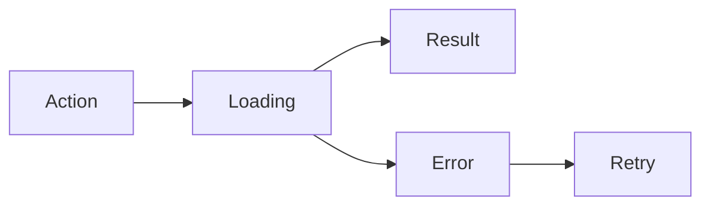

 

# Design and interaction

[← Documentation](../INDEX.md) · [API / Postman](../api/API.md)

## Reading guide

| Topic | What to know |
| --- | --- |
| **Visual system** | Android keeps gray/blue tokens, system typography and native controls; DAT uses supported styles and capabilities. |
| **States** | Separate loading, empty, error, progress and retry states; do not announce an empty list before a query completes. |
| **Evidence** | Complete highlighted image with date, source and confidence; longer details in separate actions. |
| **Forms** | Inline errors, focus on the first one, appropriate keyboard, autofill and optional password visibility; loading blocks duplicate sends. |
| **Accessibility** | 48 dp touch targets, text up to 200%, labelled controls and decorative graphics excluded from screen readers. EN/ES. |
| **Evaluation** | Robolectric screenshots and Compose tests cover states and widths; they do not replace physical keyboard, camera or glasses checks. |

[WEARABLES ](../integrations/WEARABLES.md) · [DEMO ](../guides/DEMO.md) · [IMPLEMENTATION STATUS ](../project/IMPLEMENTATION_STATUS.md)

Email-account profile editing adds a personal-information section with native icons, inline validation and a calendar for birth date. Facebook profiles show the same details read-only with a synchronization explanation; existing biography, contact, social links and CV remain editable. The editor keeps the app theme, supports the keyboard and 200% text, and disables edits while saving.
