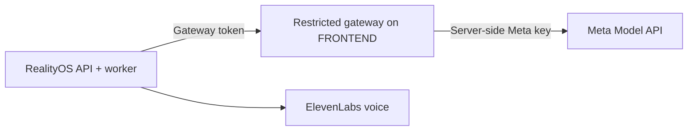

<p align="center">
  <a href="DEPLOYMENT_GATEWAY.md"></a>
  <a href="../../es/deployment/DEPLOYMENT_GATEWAY.md"></a>
</p>

# Deploy with a restricted Meta gateway

**Route Meta requests through an approved egress host, or keep it as standby.**

[← Project](../README.md) · [Direct server](DEPLOYMENT_DIRECT.md) · [Windows local](DEPLOYMENT_LOCALHOST.md)



**FRONTEND is the name of the gateway host.** It is independent of the retired browser applications. This service remains active and is not a general-purpose proxy.

## Choose the route

| Mode | Private server `.env` settings |
| --- | --- |
| Gateway only | `META_CONNECTION_MODE=gateway` and `META_GATEWAY_FALLBACK_ENABLED=false` |
| Direct with standby | `META_CONNECTION_MODE=direct` and `META_GATEWAY_FALLBACK_ENABLED=true` |

```dotenv
META_CONNECTION_MODE=gateway
META_GATEWAY_FALLBACK_ENABLED=false
META_API_BASE_URL=https://api.meta.ai/v1
META_GATEWAY_BASE_URL=https://meta.luxisoft.com/v1
MODEL_API_KEY=<your-private-meta-key>
META_GATEWAY_TOKEN=<your-independent-gateway-token>
```

Install the same active Meta key privately on RealityOS and the gateway so temporary file IDs belong to the same account. Keep the gateway token independent. Restart API/worker after changing their environment; CI preserves the configured route.

## Only these routes are forwarded

| Route | Purpose |
| --- | --- |
| `GET /v1/models` | Model catalog preflight. |
| `POST /v1/responses` | Muse Spark and SAM requests. |
| `POST /v1/asr/transcribe` | Muse Voice Transcribe. |
| `POST /v1/files` | Temporary video uploads. |
| `DELETE /v1/files/{id}` | Delete temporary files. |

Nginx enforces an IP allowlist **and** the service checks its token. Requests stream up to the configured 1 GiB limit without storing bodies. ElevenLabs speech synthesis is called directly by RealityOS, outside this gateway.

<details>
<summary><strong>Failure and retry behavior</strong></summary>

Fallback applies to connection failures, 401/403/404, 408/429 and 5xx. Responses 400/422 pass through. Each new request starts with the configured primary route.

File/video operations can replay only after definite rejection or failure before submission. Accepted or ambiguous submissions remain `uncertain`; they are not silently repeated.

</details>

<a id="production"></a>

## Production setup

Point `meta.luxisoft.com` to the approved gateway host. The [production workflow](../../../.github/workflows/deploy-production.yml) installs its loopback-only service, Nginx allowlist and TLS certificate. API/worker and gateway deployment jobs are independent.

| GitHub `production` secret group | Names |
| --- | --- |
| Providers and egress | `MODEL_API_KEY`, `META_GATEWAY_TOKEN`, `GATEWAY_ALLOWED_CIDRS` |
| Gateway SSH | `FRONTEND_SSH_HOST`, `FRONTEND_SSH_USER`, `FRONTEND_SSH_PRIVATE_KEY`, `FRONTEND_SSH_KNOWN_HOSTS` |
| RealityOS SSH | `REALITYOS_SSH_HOST`, `REALITYOS_SSH_USER`, `REALITYOS_SSH_PRIVATE_KEY`, `REALITYOS_SSH_KNOWN_HOSTS` |
| Installation | `REALITYOS_DEPLOY_PATH`, `ACME_EMAIL` |

These are setting names, not values to publish. `GATEWAY_ALLOWED_CIDRS` must include RealityOS's egress address. When using Cloudflare, trust only its published proxy ranges and use **Full (strict)** after the origin certificate exists.

Check allowlisting, token rejection and multipart forwarding before changing gateway deployment behavior. Rollback selects an existing immutable `release_tag`; it does not restore data. See the full [gateway contract](../integrations/GATEWAY.md) and [operations guide](DEPLOYMENT.md).

[← Project](../README.md) · [Español](../../es/deployment/DEPLOYMENT_GATEWAY.md)
