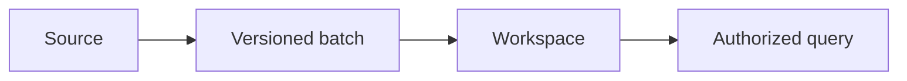

 

# Accounts, records and imports

[← Documentation](../INDEX.md) · [API / Postman](../api/API.md)

## Reading guide

| Topic | What to know |
| --- | --- |
| **Account** | Register with username, email, name and password; confirm email before access. Login accepts email or username in `email`. |
| **Correct email** | `POST /v1/auth/change-pending-email` accepts the existing username or current email in `username`, verifies its password, preserves its ID and invalidates previous links. Confirmed, active and provisioned accounts are excluded. |
| **Personal details** | Email accounts edit their name, current location, hometown, birthday and gender in `PATCH /v1/me/profile`. Facebook identities keep these fields read-only and refresh them at each Facebook login. Birthday uses `YYYY-MM-DD`; age is derived. Omitted PATCH fields are preserved. |
| **Connection** | An admin creates a connection; the integration key is shown once and sent in `X-RealityOS-Integration-Key`. |
| **Batch** | Up to 100 records and 2 MiB; increasing versions, external-ID relations and atomic transaction. Same key/content returns the original result; different content returns 409. |
| **Kinds** | `person`, `case`, `encounter`, `event`, `object`, `prescription`, `allergy`, `administration`. Draft/deleted records are excluded from queries. |
| **Biometrics** | Importing a person creates neither a user nor an enrollment. Traceable authorization and explicit portrait enrollment are required. |
| **Clinical comparison** | Compares explicit fields, validity, allergies and related history. Does not calculate doses, convert units, prescribe or record administration. |
| **Fixtures** | 47 records, 27 attachments and six fictional portraits. Labelled static-scene videos do not prove temporal tracking. Windows starts empty. |

[API ](../api/API.md) · [DEMO ](DEMO.md) · [DATABASE ](../architecture/DATABASE.md)

To bring photos, videos or a CV from R2/S3, use [My connections](STORAGE_CONNECTIONS.md). That media connection belongs to the account; the record integrations described above import structured records into a workspace. Both retain their permission checks.

Prepared data uses natural titles and descriptions, without “Demo” prefixes or
test labels in record and publication views. Internal provenance is preserved.
`scripts/normalize_scenario_text.py` previews pending corrections without writing;
`--apply --journal <private-path.json>` saves previous values and applies the copy
correction. `--rollback --journal <private-path.json>` restores only fields that
have not changed since. It does not create groups, modify originals, or change
evidence versions or biometric authorizations.
