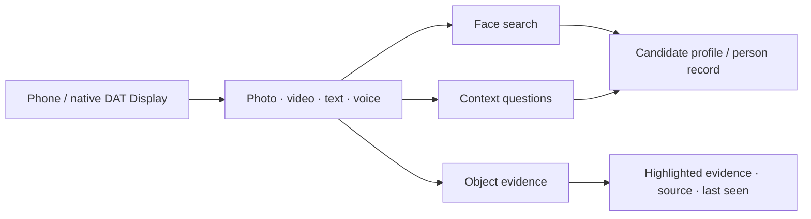

<a id="top"></a>

<p align="center">
  <a href="ANDROID.md"></a>
  <a href="../../es/integrations/ANDROID.md"></a>
</p>

# RealityOS for Android and glasses

[API / Postman](../api/API.md) · [All guides](../INDEX.md)

**Facial recognition, person records, social context and visual memory in one Android app.**
The phone and native Meta Display connect a face to authorized context, open workspace records and retrieve dated visual evidence.

[← Project](../README.md) · [Build](#build) · [Phone preview](#preview) · [Real glasses](#glasses) · [Local Windows](../deployment/DEPLOYMENT_LOCALHOST.md)



| Capability | Where it leads |
| --- | --- |
| **Biometric face search** | Choose a workspace and photo/video; inspect candidate evidence and open a profile or authorized person record. |
| **Work records** | Cases, people, events, notes and attachments scoped to the selected group. |
| **Social profiles** | Authorized profile information, posts and group context; the CV has separate privacy rules. |
| **Visual memory** | Ask by text or voice and inspect a stored photo/frame with its source and last-seen date. |

[Police and Meta Social Media walkthroughs →](../guides/DEMO.md). Face search uses the isolated InsightFace service; user matches and person-record matches remain distinct, and both require human confirmation.

## Choose an experience

| Regular Android app | Debug phone preview | Physical Meta Ray-Ban Display |
| --- | --- | --- |
| Profile, Work, Search and workspace records. | Official Mock Device Kit with the phone's camera and microphone. | Official DAT integration with compatible paired hardware. |
| Sign in with email or Facebook. | Available in the regular Debug build; excluded from Release. | Requires pairing, developer setup and DAT permissions. |

**Android is the only app.** The hosted browser panel and web Display have been retired. The glasses experience remains native to Android.

## Sign in with a test account

Install the canonical Debug APK and open the local selector. Its six accounts belong to Police or Meta Social Media; their avatars and group publications are prepared in the local database. Person portraits remain linked to Police records. No password is published. [Installation and sign-in steps →](../README.md#evaluate)

When opening **My connections**, profile requests, resources and uploads share a single session refresh. Temporary errors and permission failures preserve sign-in; a refresh rejected because credentials expired or were revoked requires signing in again. Pending responses from a previous account are discarded when switching accounts or signing out.

Restoring a saved account now offers **Try again** when verification is unavailable, without admitting an unverified account or discarding its credentials. Leaving the screen cancels verification without signing out. Downloads and response audio also share session renewal. A resource that still rejects access after a successful renewal shows an error without erasing the whole session. Delayed sign-in/sign-out callbacks cannot clear a newer account.

Android regression coverage includes simultaneous requests, expired and revoked access, permission errors, server failures, account switching, cancelled restoration, downloads, uploads and audio. `RestoredAccountSessionTest` checks recovery controls in EN/ES, at 320 dp and 200% text; the complete unit suite runs with `./gradlew :app:testDebugUnitTest` from `android/`. These checks do not replace physical phone or glasses acceptance.

<a id="build"></a>

## Build and install

<a id="android-build"></a>

If you change Android, generate a new APK on the server or on a computer with [JDK 21 and Android SDK 36](#java-windows). A downloaded APK only contains the code from its build; Docker prepares the backend. From the repository root:

**Windows — PowerShell**

```powershell
$env:REALITYOS_API_BASE_URL = "http://localhost:8080/v1"
.\android\gradlew.bat -p android -PlocalDevelopment=true :app:assembleDebug
if ($LASTEXITCODE -ne 0) { throw "Android build failed. Do not install an older APK." }
```

Wait for **BUILD SUCCESSFUL**. This replaces `android/app/build/outputs/apk/debug/app-debug.apk`. Install and open it from the repository root:

In Git Bash, use the [README installation commands](../README.md#android).

<a id="java-windows"></a>

### Java and the Android SDK — for building only

To [build from source](#android-build), use **JDK 21 LTS** and **Android SDK 36**. Skip this section when installing the published APK. On Windows:

1. Install [Temurin 21 x64](https://adoptium.net/temurin/releases/?version=21&os=windows&arch=x64&package=jdk), choosing the **JDK** package and MSI installer.
2. In **Environment Variables**, set `JAVA_HOME` to the installed JDK directory, without quotes or `\bin`. **The user variable takes precedence over the system variable**: if both exist, use the same valid path. Also correct `JDK_HOME` if it points to an old installation.
3. Place `%JAVA_HOME%\bin` before other Java entries in `Path`. Fully close the editor and terminals, then open a new PowerShell:

```powershell
$env:JAVA_HOME
Test-Path "$env:JAVA_HOME\bin\java.exe"
& "$env:JAVA_HOME\bin\java.exe" -version
java -version
javac -version
```

Expect `True` and version **21**. If the editor retains an old path, remove it from `java.home` or `java.jdt.ls.java.home`. In Android Studio, select JDK 21 under **Settings → Build, Execution, Deployment → Build Tools → Gradle → Gradle JDK**.

Install Android SDK Platform 36, Build-Tools 36.0.0 and Platform Tools through Android Studio's SDK Manager. Set `ANDROID_HOME` to your SDK directory, or set `sdk.dir` in the ignored `android/local.properties`. For installation, use `C:\platform-tools\adb.exe` as shown in the README.

Once these tools are ready, follow [Build from source](#android-build). Gradle uses the existing Wrapper; no separate Gradle installation is needed.

<details>
<summary><strong>Server URL and private developer configuration</strong></summary>

The API URL is selected at build time: `REALITYOS_API_BASE_URL`, then the `realityosApiBaseUrl` Gradle property. Debug defaults to `localDevelopment=true` and, without an explicit URL, `http://localhost:8080/v1`. With `localDevelopment=false`, the default is `https://realityos.luxisoft.com/v1` and HTTPS is required. It is not an editable account setting.

For local DAT Developer Mode, the ignored `android/local.properties` can contain:

```properties
sdk.dir=/opt/android-sdk
mwdat_application_id=0
mwdat_client_token=0
```

For a Meta release channel, use the Wearables Developer Center values in that private file. Model API keys and RealityOS device credentials remain outside Git and are never placed in this README. Live virtual-device credentials are issued by the server at runtime.

</details>

<a id="preview"></a>

## Try the Display on your phone

| Step | Action |
| --- | --- |
| **1 · Enter** | Install the Debug APK, select a local account or sign in for your environment, and open Meta Ray-Ban Display. |
| **2 · Preview** | After Bluetooth permission is granted, the preview starts virtual glasses automatically when no physical Display is available. The Controls menu allows retrying or changing modes. Localhost uses the profile issued during account selection; the server environment requires `META_MODE=live` for virtual-device provisioning. |
| **3 · Capture** | Grant camera/audio permission when requested. Phone preview uses real CameraX photos/video and phone speech services. |
| **4 · Query** | Search existing evidence by photo or voice. The result keeps its source and last-seen date. |

The virtual transport simulates glasses; its sensor inputs and authorized server processing are real. Captures are uploaded only after an explicit action. Local Debug starts the same Display simulator while retaining its local accounts and API. Opening the preview does not start the camera, microphone or capture.

<details>
<summary><strong>Chrome SDK preview and camera lifecycle</strong></summary>

If the Debug preview offers Chrome, select it, connect the phone by USB and run the port-forward command displayed by the app:

```bash
adb forward tcp:<port> tcp:<port>
```

Open the displayed localhost URL with Meta Ray-Ban Display Simulator enabled. This is the SDK's local development preview, separate from the retired hosted web Display. Stopping Developer Preview closes its local server.

Search and capture keep the host navigation available. Closing the viewfinder releases sensors; late callbacks must not reopen an old camera session. Pending uploads remain scoped to their account, retain their destinations and use the existing duplicate-confirmation/retry flow.

</details>

<a id="glasses"></a>

## Use physical glasses

1. Have an administrator provision the device identity through the supported setup flow.
2. Pair compatible Meta Ray-Ban Display hardware, enable Meta AI Developer Mode and grant DAT permissions.
3. Register with Meta AI and connect Display to use its native capture, query and evidence screens.

Physical glasses use DAT camera/speech capabilities; the Debug preview uses phone sensors. Spoken responses use the authenticated server speech flow, with audio played on the active phone/Bluetooth route. See the [wearables guide](WEARABLES.md) for the complete behavior and hardware validation still required.

<details>
<summary><strong>Navigation, evidence viewer and languages</strong></summary>

The phone's bottom navigation groups **Profile / Work / Search**. The drawer provides the Meta Display experience, settings and sign out. Profile contains publications and the private CV; Work contains workspace records.

The evidence viewer keeps the complete image visible and limits its expandable information panel to 45% of the height. Publication date and visual confidence precede title and notes; results are ordered by visual confidence.

English and Spanish information is persisted with publications and reused by search/history. Opening a result reads the prepared information. Older missing text has an explicit preparation/retry flow with a visible pending/error state. The selected language must not silently fall back to another language.

</details>

## Verify a build

From the repository root:

```bash
make android-check
```

With an eligible emulator or device connected, from `android/`:

```bash
./gradlew :app:connectedDebugAndroidTest
./gradlew :app:testDebugUnitTest --tests com.luxisoft.realityos.PhoneCaptureTouchTest
```

Mock Device Kit and Compose/Robolectric tests do not replace physical camera, microphone, Bluetooth or glasses validation. Actual completed checks are recorded in [implementation status](../project/IMPLEMENTATION_STATUS.md).

## Independent Windows installation

Use [Windows + Docker Desktop](../deployment/DEPLOYMENT_LOCALHOST.md). The local build uses `-PlocalDevelopment=true`, loopback HTTP and the separate application ID `com.luxisoft.realityos.local`. It requires the backend to confirm its local realm and uses local password entry. Production and local accounts remain separate; facial features retain their own authorization requirements.

[← Project](../README.md) · [Español](../../es/integrations/ANDROID.md) · [↑ Back to top](#top)
