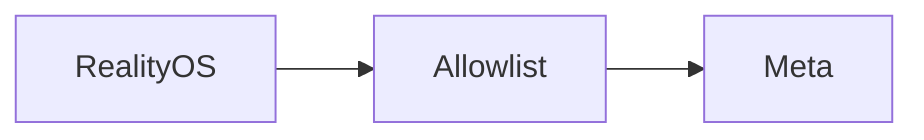

<p align="center"><a href="GATEWAY.md"></a> <a href="../../es/integrations/GATEWAY.md"></a></p>

# Meta gateway

[← Documentation](../INDEX.md) · [API / Postman](../api/API.md)

## Reading guide

| Topic | What to know |
| --- | --- |
| **Purpose** | Restricted egress on FRONTEND; neither a general proxy nor the retired browser UI. |
| **Routes** | Only `GET /v1/models`, `POST /v1/responses`, `POST /v1/asr/transcribe`, `POST /v1/files`, `DELETE /v1/files/{id}`. |
| **Credentials** | Independent `X-RealityOS-Gateway-Token` and IP allowlist. Gateway adds Meta Bearer; request bodies are not stored. |
| **Selection** | `META_CONNECTION_MODE=direct` or `gateway`; `META_GATEWAY_FALLBACK_ENABLED=true` enables fallback. Restart API/worker after runtime changes. |
| **Retries** | Never replay accepted streams or ambiguous uploads. Return 400/422 failures; inspect the cause before resending. |
| **Uploads** | Up to 1 GiB at the gateway; a CDN may impose less. Large files need an authorized private or DNS-only route. |



## Commands

Run from the root with dependencies installed. Migrations and processing require the chosen environment and authorized data.
```bash
make gateway-api
```

[DEPLOYMENT GATEWAY ](../deployment/DEPLOYMENT_GATEWAY.md) · [DEPLOYMENT DIRECT ](../deployment/DEPLOYMENT_DIRECT.md) · [TTS ](TTS.md)
