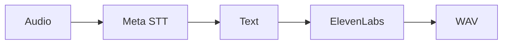

> **Current direction: localhost is primary.** Windows/Linux x64 run PostgreSQL, Redis, API and worker. Meta uses the judge’s own key; speech output uses installed Android voices. Gateway, buckets, Facebook, SMTP, scheduler and ElevenLabs are outside the local walkthrough. Remote configuration in this guide is historical. [Current installation](../deployment/DEPLOYMENT_LOCALHOST.md).

 

# Speech and transcription

[← Documentation](../INDEX.md) · [API / Postman](../api/API.md)

## Reading guide

| Topic | What to know |
| --- | --- |
| **Input** | Muse Voice Transcribe turns audio into text; Muse Spark interprets context. |
| **Server output** | `POST /v1/tts`, `{text, language}` with `en`/`es`, returns 24 kHz mono PCM WAV. Authenticated user or device. |
| **Provider** | The server uses ElevenLabs for synthesis. With the local Windows/Linux installation, Android uses its installed voices. No speech model or weights run in the local backend. |
| **Configuration** | Private `ELEVENLABS_API_KEY`; selection through `ELEVENLABS_VOICE_ID`, `ELEVENLABS_MODEL_ID`, `TTS_TIMEOUT_SECONDS`. |
| **Limits** | Two concurrent generations per process; 30 s HTTP budget, up to 300 s audio and 16 MiB WAV. |
| **Persistence** | Synthesis stores no captures, messages or caches. No automatic ambiguous retries; distinct from routes that store chat audio. |

[API ](../api/API.md) · [META INTEGRATION ](META_INTEGRATION.md) · [DEPLOYMENT LOCALHOST ](../deployment/DEPLOYMENT_LOCALHOST.md)
