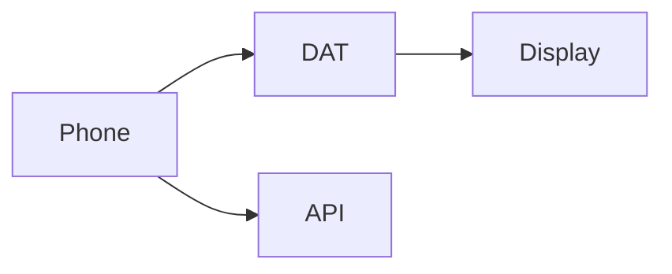

<p align="center"><a href="WEARABLES.md"></a> <a href="../../es/integrations/WEARABLES.md"></a></p>

# Android and Meta glasses

[← Documentation](../INDEX.md) · [API / Postman](../api/API.md)

## Reading guide

| Topic | What to know |
| --- | --- |
| **Host** | Android manages Bluetooth, permissions, networking and state. DAT 1.0.1 provides camera, voice and native Display. |
| **Search** | Object/face photo and spoken query; ephemeral probes and authorized results. Does not open a capture session. |
| **Capture** | Explicit photo/video; private original in Profile and duplicate-review flow. Glasses capture does not inherit a previous group. |
| **Debug** | Mock Device Kit simulates hardware; CameraX and speech use the phone. Live processing can be real. Release excludes Mock Device Kit. |
| **Evidence** | Temporary authorized links, highlighted image, last-observed date and visual confidence. Show partial/simulated states. |
| **Physical validation** | Check Meta registration, denied permissions, camera, microphone, Bluetooth audio, disconnect and recovery on real hardware. Compilation does not establish those checks. |



## Commands

Run from the root with dependencies installed. Migrations and processing require the chosen environment and authorized data.
```bash
make android-check
```

[API ](../api/API.md) · [UI DESIGN ](../architecture/UI_DESIGN.md) · [IMPLEMENTATION STATUS ](../project/IMPLEMENTATION_STATUS.md)
