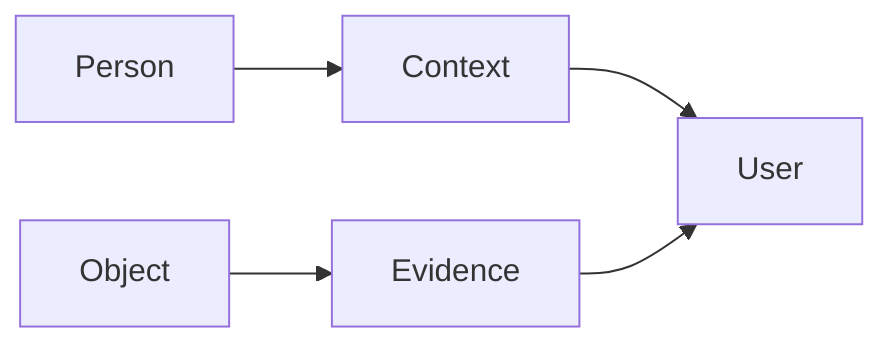

 

# Purpose and capabilities

[← Documentation](../INDEX.md) · [API / Postman](../api/API.md)

## Reading guide

| Topic | What to know |
| --- | --- |
| **Purpose** | Facial recognition, authorized context and visual memory across domains. |
| **Examples** | Police, nursing, social and memory are independent, non-exhaustive examples; they do not automatically share data. |
| **Evidence** | Answer with source, date and geometry; say last seen and acknowledge missing or ambiguous evidence. |
| **Biometrics** | Deliberate feature with consent, authorization and human confirmation. Separate from the object flow. |
| **Current scope** | Android and native Display; Muse/SAM/STT and ElevenLabs. Do not restore retired browser panel, web Display or local synthesis. |
| **Submission** | Identify baseline and event contributions, demonstrate real execution and review hackathon requirements. |

[API ](../api/API.md) · [DEMO ](../guides/DEMO.md) · [HACKATHON ](HACKATHON.md)
