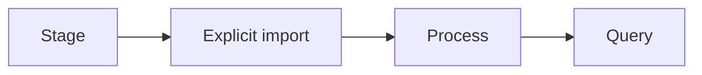

<p align="center"><a href="MANUAL_PHOTO_TEST.md"></a> <a href="../../es/testing/MANUAL_PHOTO_TEST.md"></a></p>

# Test with your own photos

[← Documentation](../INDEX.md) · [API / Postman](../api/API.md)

## Reading guide

| Topic | What to know |
| --- | --- |
| **Prepare** | `make runtime-dirs` creates private folders; staging a file does not register, capture or call Meta. |
| **Choose** | Use only authorized material for an object test, without secrets or unrelated private data. JPEG, PNG, WebP; video according to contract. |
| **Import** | The importer prompts for password and consent; it uses the regular API and explicitly opens/closes a session. |
| **Process** | `--process` starts Muse analysis; per-observation SAM is a later explicit refinement. `--wait-seconds` adjusts waiting. |
| **Verify** | Query from Android or Postman; repeat in another location to test history. Confirm date and source without claiming current location. |



## Commands

Run from the root with dependencies installed. Migrations and processing require the chosen environment and authorized data.
```bash
make runtime-dirs
.venv/bin/python scripts/import_manual_photos.py --help
```

[API ](../api/API.md) · [DEMO ](../guides/DEMO.md) · [SECURITY ](../architecture/SECURITY.md)

## Explicit import example

Stage your own/authorized photo in the private folder and use an account with register permission. The script prompts for its password; consent is confirmed explicitly.

```bash
make runtime-dirs
.venv/bin/python scripts/import_manual_photos.py \
  --api-url https://realityos.luxisoft.com \
  --email your-registered-account --workspace "Your workspace" --zone "QA" \
  --confirm-consent --process --wait \
  .runtime/manual-captures/incoming/photo.jpg
```
