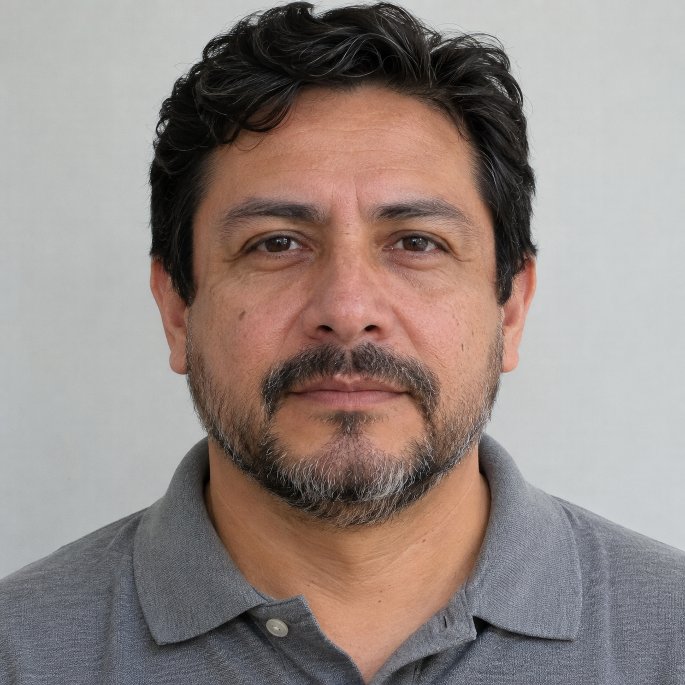
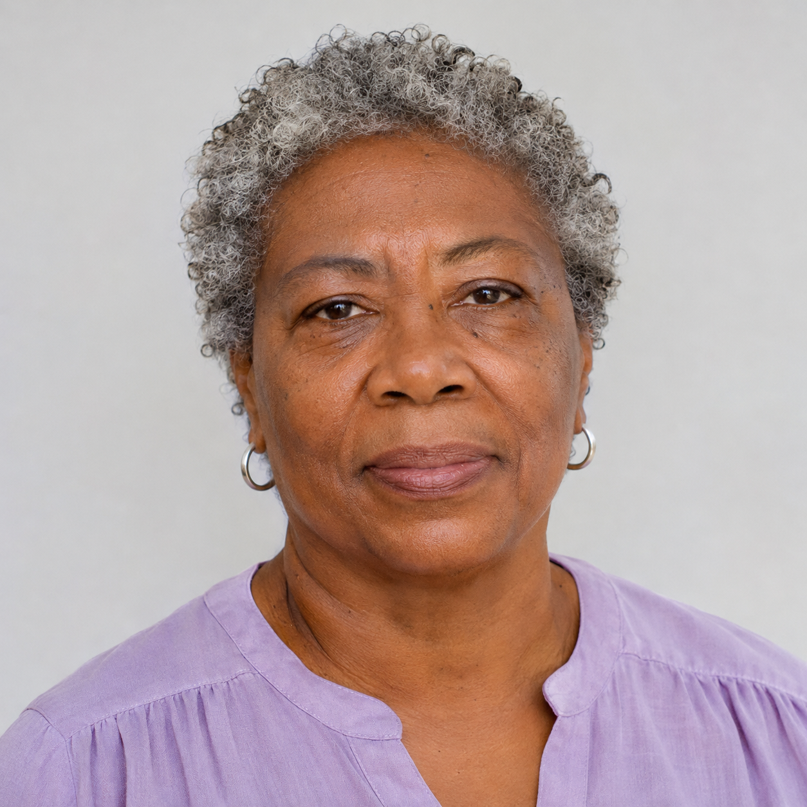

# Test cards — open on the computer
[Checklist](IMPLEMENTATION_CHECKLIST.md) · [English](QA_VISUAL_FIXTURES.md) · [Español](../../es/testing/QA_VISUAL_FIXTURES.md)

Open this rendered GitHub page on the computer. Click an image to enlarge it; point the phone camera at the screen. Do not download portraits to the phone. For three faces, show the whole table at a suitable zoom. Avoid glare and frame only the photos.

**Synthetic data.** Reusing an enrolled portrait verifies integration, not representative accuracy. Permissions and quality controls remain enforced. These images are not for impersonating Facebook login; that flow uses your own account and face.

## Meta Social Media

Sign in as Elena Marquez, Mateo Rios or Sarah Chen, select Meta Social Media and grant search consent when prompted. Open any avatar below on the computer and use the existing person search. These ten additional profiles differ from Police people and selector accounts.

Each profile has three distinct private reference photos and a separate avatar. The avatars below are not enrolled; the 30 references are never published in the gallery or displayed as result thumbnails. Search retains its existing engine, thresholds, permissions and logic.

Meta registration and import are represented by local synthetic data; no OAuth or Facebook import was performed. Internal provenance and scenario consent are retained. The three access accounts keep their own search consent unchanged.

| Profile | Open avatar to query | Activity |
| --- | --- | --- |
| Valentina Rojas | [Avatar](../../../simulator/media/meta-social/avatars/valentina-rojas.png) | Sustainable architect |
| Mateo Silva | [Avatar](../../../simulator/media/meta-social/avatars/mateo-silva.png) | Sound engineer |
| Samira Haddad | [Avatar](../../../simulator/media/meta-social/avatars/samira-haddad.png) | Product designer |
| Thiago Costa | [Avatar](../../../simulator/media/meta-social/avatars/thiago-costa.png) | Chef and entrepreneur |
| Lucía Fernández | [Avatar](../../../simulator/media/meta-social/avatars/lucia-fernandez.png) | Rural physician |
| Noah Williams | [Avatar](../../../simulator/media/meta-social/avatars/noah-williams.png) | Documentary photographer |
| Camila Torres | [Avatar](../../../simulator/media/meta-social/avatars/camila-torres.png) | Marine biologist |
| Diego Mendoza | [Avatar](../../../simulator/media/meta-social/avatars/diego-mendoza.png) | Robotics technician |
| Amina Diallo | [Avatar](../../../simulator/media/meta-social/avatars/amina-diallo.png) | Data analyst |
| Ren Ito | [Avatar](../../../simulator/media/meta-social/avatars/ren-ito.png) | Editorial illustrator |

## Police: search query scenes

The four scenes from `Personas/cases` are preserved in full, unchanged. According to the owner, each includes three characters from `Personas/profile`, alongside other background people. The ten reference portraits already belong to Police records; the new scenes are **query inputs only**, outside every group's publications and records.

| Scene | Open image |
| --- | --- |
| Coastal park through a single lens | [Case 01](../../../simulator/media/regression/search/police/case-01.png) |
| Urban park through the right lens | [Case 02](../../../simulator/media/regression/search/police/case-02.png) |
| Urban park through a right lens | [Case 03](../../../simulator/media/regression/search/police/case-03.png) |
| Urban life by the river | [Case 04](../../../simulator/media/regression/search/police/case-04.png) |

Select Police with an authorized account and open a scene on the computer for an explicit query capture. Do not use Publish or Register. No per-scene identities were assigned: that mapping was not supplied with the files. The [manifest](../../../simulator/media/manifest.csv) records provenance, hashes and separation from seed content; it grants no permissions or consent and creates no enrollments.

## Memoria / Memory
**noah-brooks → Sonoran Neurological Institute**

Expected: record candidates from this workspace, with similarity and a record link. The searching user still needs consent.

### Luis Moreno

### Grace Wilson

### Hiro Tanaka

### Three faces in one capture

| Luis Moreno | Grace Wilson | Hiro Tanaka |
| --- | --- | --- |
|  |  |  |

## QA users — profile candidate

**qa-hackathon-admin → QA Hackathon — disposable tests**

The organizer prepares two explicit enrollments. The member portrait represents synthetic Maya, not a Facebook account. qa-hackathon-reader remains without consent for the negative test.

### qa-hackathon-admin

### qa-hackathon-member

## Object scenes and no-face negative

### Pacific Ridge Police Department

Sixteen fictional person records each have one owner-provided portrait and a linked group publication. Five have active arrest warrants and two of those have active proceedings. Samuel Ortega, Elena Duarte, Isabel Mora and Natalia Campos have separate missing-person search orders, with no arrest warrants or criminal history. The three access accounts remain unchanged.

| Person / Persona | Portrait / Retrato | Status / Estado |
| --- | --- | --- |
| Adrián Salcedo | [PRP-0001](../../../simulator/media/police/portraits/person-01.png) | Active arrest warrant and judicial proceedings |
| Esteban Pardo | [PRP-0002](../../../simulator/media/police/portraits/person-02.png) | Active arrest warrant and judicial proceedings |
| Valeria Navarro | [PRP-0003](../../../simulator/media/police/portraits/person-03.png) | Active arrest warrant; no active proceedings registered |
| Lucía Cárdenas | [PRP-0004](../../../simulator/media/police/portraits/person-04.png) | No criminal record, warrants or proceedings |
| Tomás Beltrán | [PRP-0005](../../../simulator/media/police/portraits/person-05.png) | No criminal record, warrants or proceedings |
| Nicolás Acosta | [PRP-0006](../../../simulator/media/police/portraits/person-06.png) | No criminal record, warrants or proceedings |
| Mariana Solano | [PRP-0007](../../../simulator/media/police/portraits/person-07.png) | No criminal record, warrants or proceedings |
| Rafael Méndez | [PRP-0008](../../../simulator/media/police/portraits/person-08.png) | No criminal record, warrants or proceedings |
| Camila Fuentes | [PRP-0009](../../../simulator/media/police/portraits/person-09.png) | No criminal record, warrants or proceedings |
| Asha Mehta | [PRP-0010](../../../simulator/media/police/portraits/person-10.png) | No criminal record, warrants or proceedings |
| Bruno Escobar | [PRP-0011](../../../simulator/media/police/portraits/person-11.png) | Active arrest warrant; no convictions or active proceedings |
| Daniel Serrano | [PRP-0012](../../../simulator/media/police/portraits/person-12.png) | Active arrest warrant; no convictions or active proceedings |
| Samuel Ortega | [PRP-0013](../../../simulator/media/police/portraits/person-13.png) | Missing person with active search order; no arrest warrant, criminal history or proceedings |
| Elena Duarte | [PRP-0014](../../../simulator/media/police/portraits/person-14.png) | Missing person with active search order; no arrest warrant, criminal history or proceedings |
| Isabel Mora | [PRP-0015](../../../simulator/media/police/portraits/person-15.png) | Missing person with active search order; no arrest warrant, criminal history or proceedings |
| Natalia Campos | [PRP-0016](../../../simulator/media/police/portraits/person-16.png) | Missing person with active search order; no arrest warrant, criminal history or proceedings |

### noah-brooks → Sonoran Neurological Institute
Carpeta roja / red folder; llaves de latón / brass keys; cuaderno azul / blue notebook

## Files only for the CV replacement test

[Synthetic CV v1](../../../simulator/media/regression/documents/cv-v1.pdf) · [Synthetic CV v2](../../../simulator/media/regression/documents/cv-v2.pdf). For F03/K11 they are already in **Menu → My connections → Demo qa**: select one PDF and press **Use as CV**. These links are references; no download to the phone is needed. Version 1 says “Inventory assistant”; version 2 says “Equipment coordinator”. No real personal information is included.
