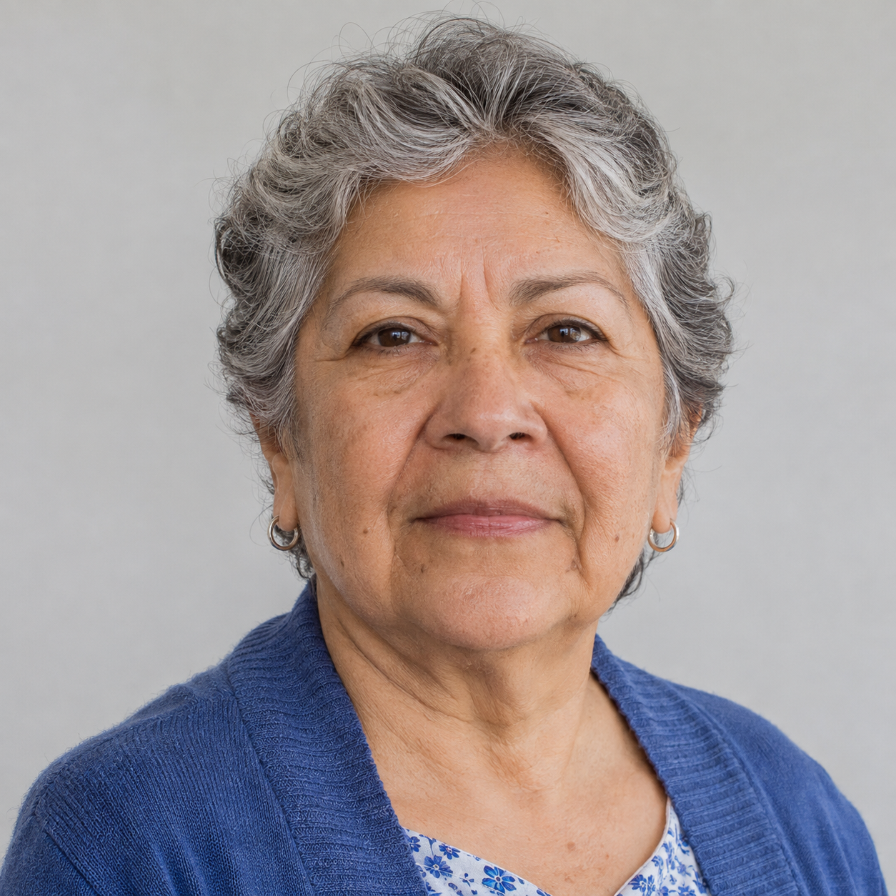
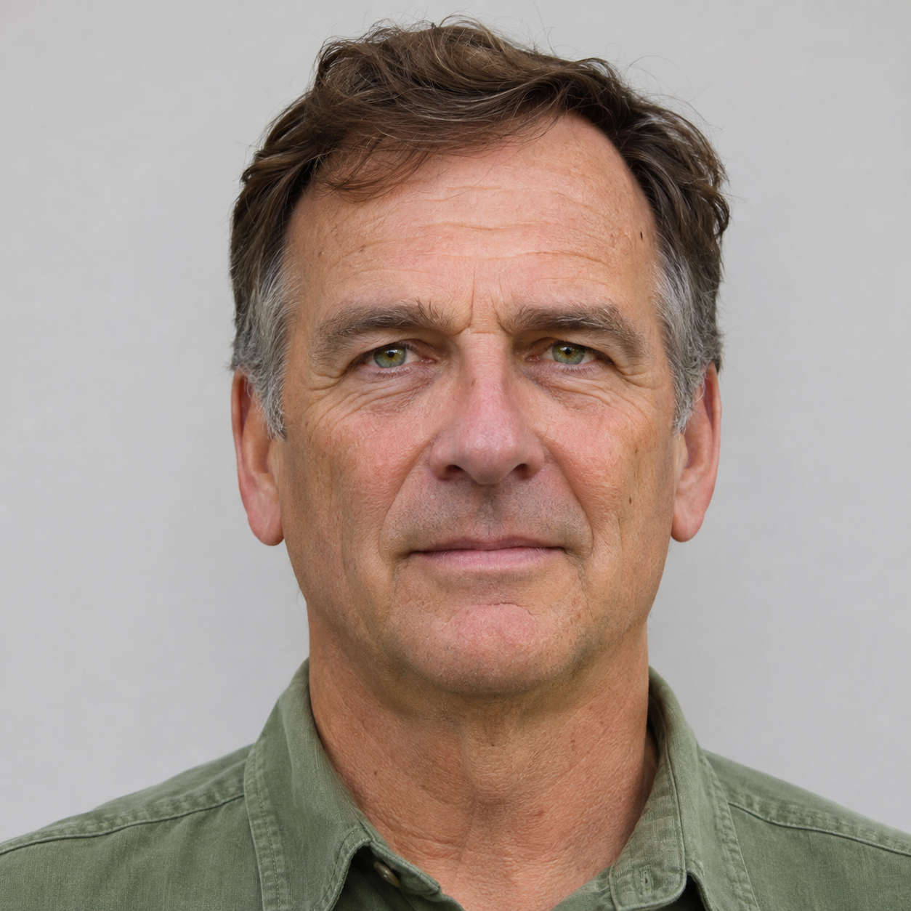
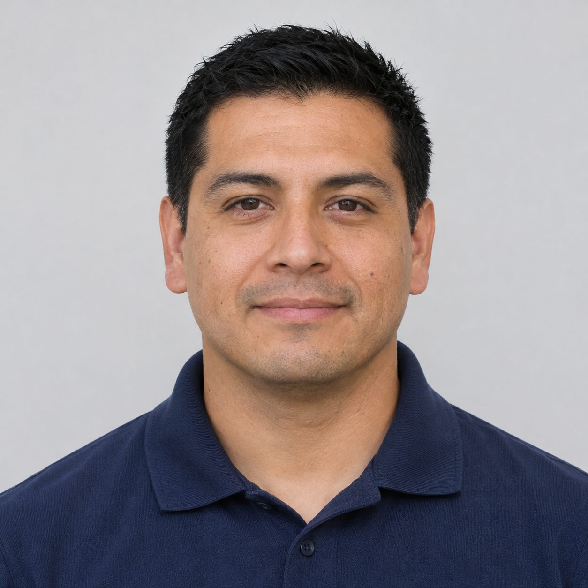
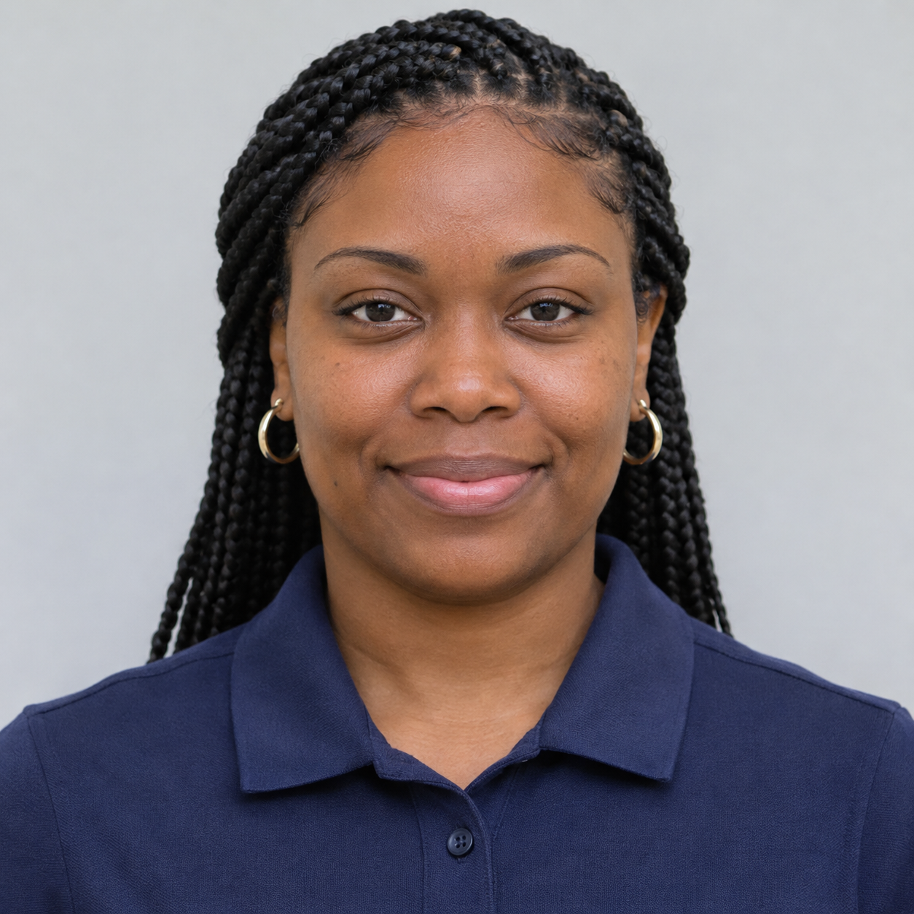
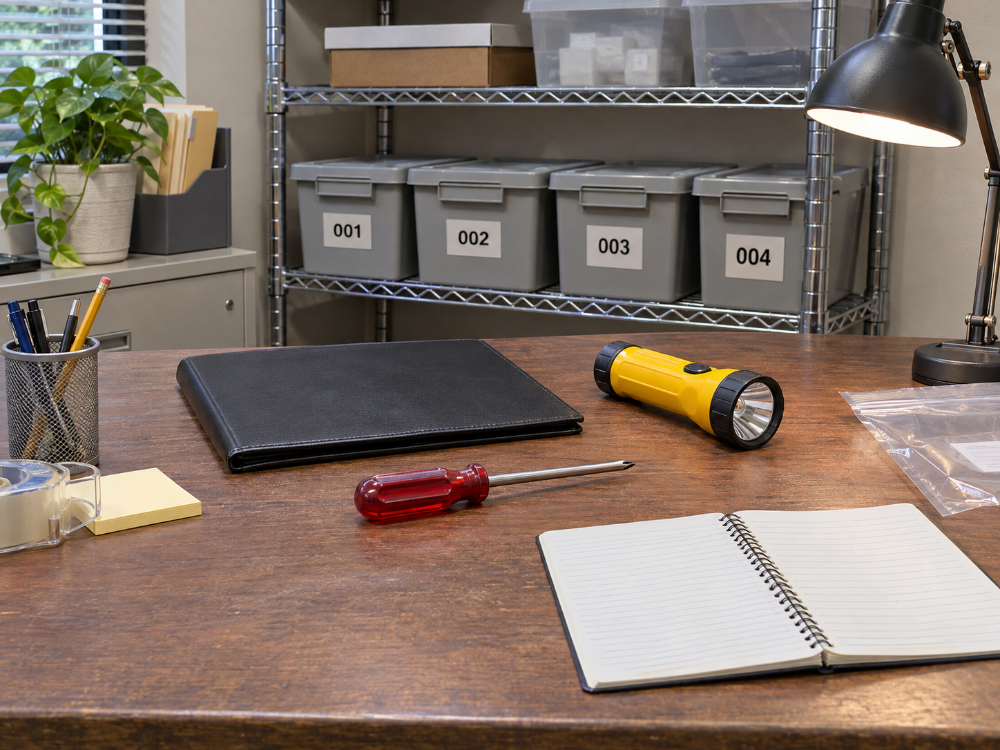
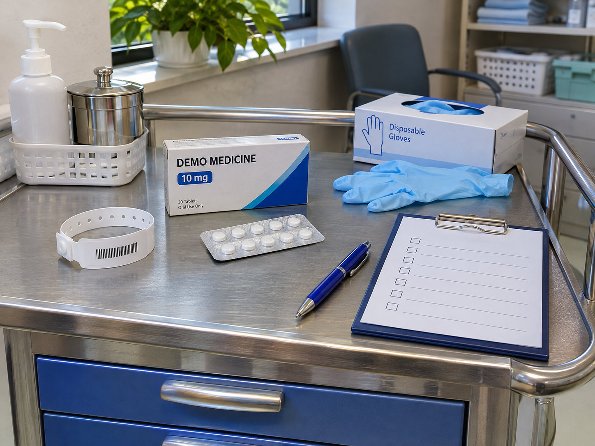

# Test cards — open on the computer
[Checklist](IMPLEMENTATION_CHECKLIST.md) · [English](QA_VISUAL_FIXTURES.md) · [Español](../../es/testing/QA_VISUAL_FIXTURES.md)

Open this rendered GitHub page on the computer. Click an image to enlarge it; point the phone camera at the screen. Do not download portraits to the phone. For three faces, show the whole table at a suitable zoom. Avoid glare and frame only the photos.

**Synthetic data.** Reusing an enrolled portrait verifies integration, not representative accuracy. Permissions and quality controls remain enforced. These images are not for impersonating Facebook login; that flow uses your own account and face.

## Clínica / Nursing
**elena-marquez → California Valley Medical Center**

Expected: record candidates from this workspace, with similarity and a record link. The searching user still needs consent.

### Ana Solis

### Robert Lane

### Fatima Nasser

### Three faces in one capture

| Ana Solis | Robert Lane | Fatima Nasser |
| --- | --- | --- |
|  |  |  |

## Memoria / Memory
**noah-brooks → Sonoran Neurological Institute**

Expected: record candidates from this workspace, with similarity and a record link. The searching user still needs consent.

### Luis Moreno

### Grace Wilson

### Hiro Tanaka

### Three faces in one capture

| Luis Moreno | Grace Wilson | Hiro Tanaka |
| --- | --- | --- |
|  |  |  |

## QA users — profile candidate

**qa-hackathon-admin → QA Hackathon — disposable tests**

The organizer prepares two explicit enrollments. The member portrait represents synthetic Maya, not a Facebook account. qa-hackathon-reader remains without consent for the negative test.

### qa-hackathon-admin

### qa-hackathon-member

## Object scenes and no-face negative

### alex-rivera → Pacific Ridge Police Department
Linterna amarilla / yellow flashlight; destornillador rojo / red screwdriver

### elena-marquez → California Valley Medical Center
Carro de medicación / medicine cart; bolígrafo azul / blue pen; guantes / gloves

### noah-brooks → Sonoran Neurological Institute
Carpeta roja / red folder; llaves de latón / brass keys; cuaderno azul / blue notebook

## Files only for the CV replacement test

[Synthetic CV v1](../../../simulator/acceptance/cv-v1.pdf) · [Synthetic CV v2](../../../simulator/acceptance/cv-v2.pdf). For F03/K11 they are already in **Profile → My connections → Demo qa**: select one PDF and press **Use as CV**. These links are references; no download to the phone is needed. Version 1 says “Inventory assistant”; version 2 says “Equipment coordinator”. No real personal information is included.
