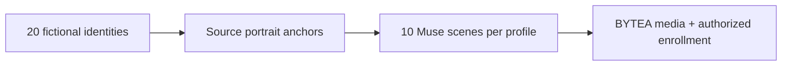

  
  

# Synthetic social directory

[API / Postman](../api/API.md) · [All guides](../INDEX.md)

**Fictional identities for evaluation, processed through the real authorized pipeline.**

[← Project](../README.md) · [Evaluation scenarios](../README.md#evaluate) · [Implementation status](../project/IMPLEMENTATION_STATUS.md)

| Location | What it contains |
| --- | --- |
| [`source/`](../../../simulator/social-directory/source/) | Synthetic identity anchors. |
| `muse/` — ignored | Ten different Muse-anchored scenes per profile, validated with InsightFace. |
| `generated/` — ignored | Generated avatars. |
| [`workshop/`](../../../simulator/social-directory/workshop/) | Fifteen views of the same workshop: nine day and six night, plus its original video. |

[`PROFILE_ROWS`](../../../scripts/seed_social_directory.py) defines the 20 deterministic test identities. The [photo generator](../../../scripts/generate_directory_photos.py) creates their scenes; the importer uses the BYTEA and InsightFace path used for authorized social media. Directory profiles ship without synthetic videos.

The “Mechanic Workshop” scenario has five members with day/night shifts. All identities are fictional and must remain identified as simulated. Membership, authorization and biometric permissions remain active; synthetic data does not bypass them.

[Español →](../../es/testing/SOCIAL_DIRECTORY.md)
