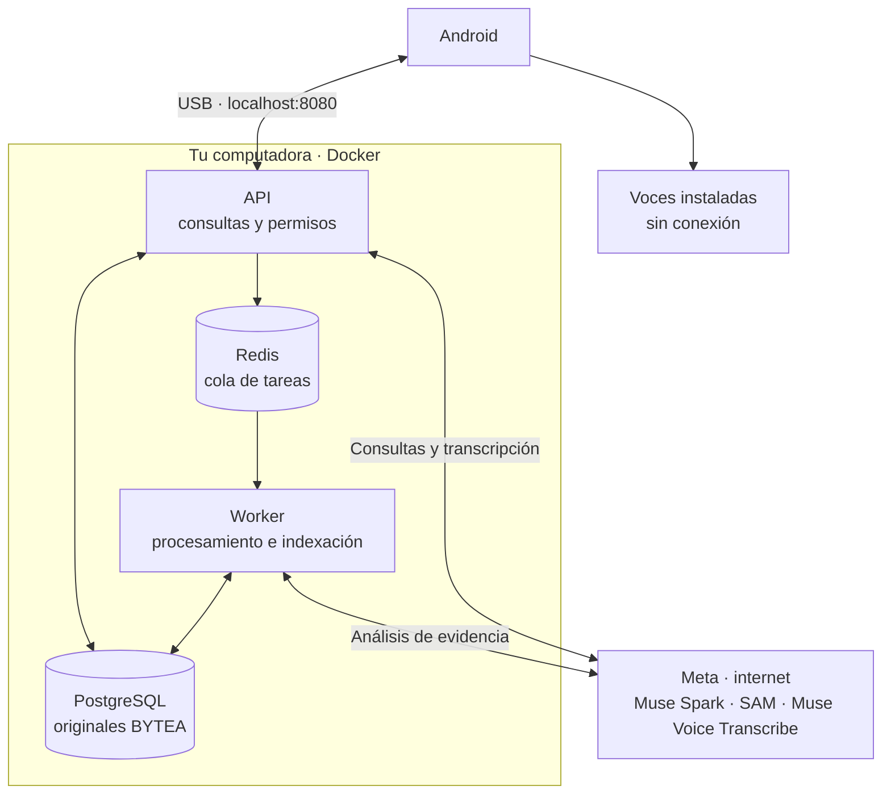

<a id="top"></a>

<p align="center">
  <a href="README.md"></a>
  <a href="../en/README.md"></a>
</p>

# RealityOS

<p align="center">
  
</p>

App Android para guardar fotos, videos y expedientes en grupos y consultar evidencia con IA. El servidor local ejecuta PostgreSQL, Redis, API y worker en Docker.

**[Demo de la hackathon — 3:00](https://media.githubusercontent.com/media/Luxisoft/realityos-spatial-memory/main/demo-video/realityos-demo.mp4) · [Video para X — 2:15](https://media.githubusercontent.com/media/Luxisoft/realityos-spatial-memory/main/demo-video/realityos-x.mp4)** — Descargas con narración y subtítulos en inglés. Build for Your World · categoría Indie Developer.

<p align="center">
  <a href="deployment/DEPLOYMENT_LINUX.md"></a>
</p>

## Windows · Git Bash

Ejecuta esta guía en **Git Bash**, desde la carpeta del proyecto. Copia los comandos sin el símbolo `$` y sin añadir `\` al final. La guía de Linux está en el botón superior.

### Preparar una vez

- Instala [Git for Windows](https://gitforwindows.org/) con su componente Git LFS. Git obtiene el proyecto y LFS obtiene el APK y los videos locales incluidos.
- Instala [Docker Desktop](https://docs.docker.com/desktop/setup/install/windows-install/) con WSL2 y completa su primer inicio. Usa contenedores Linux y asigna **4 CPU, 8 GiB de RAM y 25 GiB libres**.
- Extrae [Platform Tools para Windows](https://dl.google.com/android/repository/platform-tools-latest-windows.zip) en `C:\`, de modo que exista **`C:\platform-tools\adb.exe`**. Si ya tienes esa carpeta, este paso está terminado. Los comandos usan esa ruta directamente.
- Conecta un celular Android 12+ por USB, activa la depuración USB y acepta la autorización en su pantalla.
- Ten tu clave Meta `MODEL_API_KEY` con acceso a Muse Spark, SAM y Muse Voice Transcribe.

Verifica ADB en Git Bash:

```bash
/c/platform-tools/adb.exe version
```

Debe mostrar su versión. Usar la ruta completa evita el error `adb: command not found` sin modificar el `PATH`.

<a id="evaluate"></a>
<a id="deploy"></a>

## 1. Obtener e iniciar el proyecto

**Solo si todavía no tienes el repositorio**, abre Git Bash en la carpeta donde lo guardarás:

```bash
git lfs install &&
git clone https://github.com/Luxisoft/realityos-spatial-memory.git &&
cd realityos-spatial-memory
```

Si ya lo tienes, abre Git Bash en la raíz del proyecto, donde está `README.md`, y continúa aquí. Actualiza el código, el APK y los videos locales:

```bash
git lfs install &&
git pull --ff-only &&
git lfs pull
```

Espera a que termine sin errores. `git lfs pull` descarga también los videos de `simulator/media/` necesarios para inicializar los datos locales. Si Git informa un conflicto con cambios locales, resuélvelo antes de continuar; conserva tus archivos privados.

Si ya completaste la instalación en este PC, usa la [actualización rápida](#local-updates)
para aplicar correcciones. Para la primera instalación, ejecuta desde la carpeta del proyecto:

**Windows — Git Bash**

Instala Docker Desktop primero. En su primer inicio, abre la aplicación y completa su configuración, usando contenedores Linux con WSL2. El siguiente comando abre Docker Desktop si está instalado y el motor no está disponible, y espera hasta dos minutos a que responda.

```bash
powershell.exe -NoProfile -ExecutionPolicy Bypass -File ./scripts/local/Start-RealityOS.ps1
```

Si aparece `docker_engine` / `The system cannot find the file specified` o se agota la espera, abre Docker Desktop y resuelve los avisos de inicio o WSL2. Ejecuta `docker info`: debe mostrar la sección **Server** sin errores de conexión. Revisa `docker context ls` si sigue fallando y selecciona tu contexto local de Docker Desktop antes de repetir el comando. Tener instalada la terminal de Docker no basta; el motor debe estar funcionando.

Introduce tu clave Meta cuando se solicite. El instalador genera `.env.local`; mantenlo privado. La primera ejecución descarga dependencias y prepara los datos. Reiniciar conserva cambios y eliminaciones.

Los comandos de inicio, diagnóstico y parada muestran una barra de progreso en inglés basada en etapas completadas. La consola se limita a resúmenes, advertencias, errores y confirmaciones de éxito; oculta las líneas de descarga de paquetes. Una etapa larga puede mantener el mismo porcentaje mientras trabaja. El 100 % indica que terminó el comando; la indexación en segundo plano puede continuar después.

<a id="deploy-muse"></a>

<details>
<summary><strong>Muse · ejecutar esta instalación</strong></summary>

Pega este prompt en Muse con acceso a la terminal:

```text
Instala RealityOS en Windows siguiendo docs/es/README.md desde este repositorio.
Lee AGENTS.md y MUSE.md. Usa C:\platform-tools\adb.exe y el APK incluido en
android/app/build/outputs/apk/debug/app-debug.apk, obtenido con Git LFS.
Ejecuta scripts/local/Start-RealityOS.ps1 y Test-RealityOS.ps1 con PowerShell.
Pídeme la clave Meta solo en la terminal o .env.local, nunca en el chat.
Conserva mis cambios, credenciales, datos y otros servicios. No operes servidores
remotos. Comprueba el teléfono autorizado antes de instalar y abrir la app.
Informa las comprobaciones realizadas y cualquier paso pendiente.
```

</details>

<a id="android"></a>

## 2. Instalar y abrir Android

El APK ya viene en `android/app/build/outputs/apk/debug/app-debug.apk`, preparado para `http://localhost:8080/v1`. Para instalar esta compilación no necesitas Java ni Android Studio.

Con el backend iniciado y el teléfono conectado, comprueba:

```bash
/c/platform-tools/adb.exe devices
```

Debe aparecer **un solo teléfono** con estado `device`. Si aparece `unauthorized`, desbloquéalo y acepta la autorización. Si USB no detecta el teléfono, sigue [Depuración inalámbrica](#android-wifi). Desconecta otros dispositivos o emuladores antes de continuar por USB.

Desde la raíz del proyecto:

```bash
/c/platform-tools/adb.exe reverse tcp:8080 tcp:8080 &&
/c/platform-tools/adb.exe install -r android/app/build/outputs/apk/debug/app-debug.apk &&
/c/platform-tools/adb.exe shell am start -n com.luxisoft.realityos.local/com.luxisoft.realityos.MainActivity
```

Espera `Success` en la instalación. Los `&&` impiden ejecutar el siguiente comando si falla el anterior. Repite el comando `reverse` al reconectar el USB; puedes abrir la app tocando su icono.

<a id="android-wifi"></a>

<details>
<summary><strong>Si USB no funciona: depuración inalámbrica</strong></summary>

Conecta el computador y el teléfono a la **misma red Wi-Fi**. Este recorrido no necesita cable; la app sigue requiriendo Android 12+. Mantén el backend iniciado.

**Antes de vincular, comprueba la conexión existente:**

```bash
/c/platform-tools/adb.exe devices
```

Si tu teléfono ya aparece con estado `device`, **ve directamente al paso 4**. No repitas `pair`: la vinculación anterior sigue siendo válida. Si un nuevo intento muestra `protocol fault` pero el teléfono sigue listado como `device`, también puedes continuar al paso 4. Ese error por sí solo no permite identificar la causa del intento fallido.

1. En el celular, abre **Opciones de desarrollador → Depuración inalámbrica**, actívala y selecciona **Vincular dispositivo con código de vinculación**. Mantén esa ventana abierta.
2. En **Git Bash**, desde la raíz del proyecto, ejecuta lo siguiente. Introduce la **IP y puerto de esa ventana**, separados por `:`, y después el código cuando ADB lo pida:

```bash
read -r -p 'Pairing IP:port from phone: ' pairing_address
/c/platform-tools/adb.exe pair "$pairing_address"
```

3. Tras `Successfully paired`, comprueba si ADB ya conectó automáticamente:

```bash
/c/platform-tools/adb.exe devices
```

Si el teléfono aparece con estado `device`, **pasa al paso 4**. El identificador puede terminar en `._adb-tls-connect._tcp`; es válido.

**Solo si no aparece**, vuelve a la pantalla principal de **Depuración inalámbrica** y usa su **Dirección IP y puerto**. Es el puerto de conexión, distinto del que mostraba la ventana del código de vinculación:

```bash
read -r -p 'Connection IP:port from phone: ' connection_address
/c/platform-tools/adb.exe connect "$connection_address" &&
/c/platform-tools/adb.exe devices
```

4. Deja **un solo dispositivo conectado** en `adb devices` y comprueba que su estado sea `device`. Desconecta otros teléfonos y cierra los emuladores. Desde la raíz del proyecto, copia este bloque completo para instalar y abrir la app; ADB selecciona el dispositivo conectado automáticamente:

```bash
/c/platform-tools/adb.exe reverse tcp:8080 tcp:8080 &&
/c/platform-tools/adb.exe install -r android/app/build/outputs/apk/debug/app-debug.apk &&
/c/platform-tools/adb.exe shell am start -n com.luxisoft.realityos.local/com.luxisoft.realityos.MainActivity
```

Mantén la conexión inalámbrica activa para usar el backend. Si se desconecta o abres otra terminal, repite los pasos 3–4 con la dirección actual; no hace falta vincular de nuevo mientras el computador siga guardado. Si la conexión se agota, comprueba que la red permita comunicación entre dispositivos; las redes de invitados pueden bloquearla. [Referencia oficial de ADB](https://developer.android.com/tools/adb#connect-to-a-device-over-wi-fi).

</details>

### Elegir modo e IPv4 desde el archivo de entorno

En el PC, edita `.env.local` (sin reemplazar sus claves ni contraseñas) y añade
o actualiza estas líneas; no dupliques las variables:

```dotenv
ANDROID_CONNECTION_MODE=hotspot
ANDROID_HOTSPOT_PC_IP=10.108.140.109
ANDROID_ADB_PATH=C:\platform-tools\adb.exe
```

Ejecuta siempre desde CMD, en la raíz del repositorio:

```bat
powershell -NoProfile -ExecutionPolicy Bypass -File scripts\local\Connect-Android.ps1
```

El modo `localhost` es el predeterminado y conserva la conexión ADB USB/Wi-Fi
habitual. El modo `hotspot` usa la IPv4 indicada para encontrar la puerta de enlace
del celular. Para reconectar sin USB, añade `-Reconnect`. Antes de volver a
`ANDROID_CONNECTION_MODE=localhost`, ejecuta el mismo comando con `-Stop`, todavía
en modo `hotspot`, y reconecta USB o tu ADB inalámbrico habitual. Si cambia la IPv4,
actualiza únicamente `ANDROID_HOTSPOT_PC_IP`. No necesitas recompilar el APK ni
reiniciar Docker para estos cambios. El puerto del backend se lee de `LOCAL_HTTP_PORT`.

Si prefieres guardar estas opciones literalmente en `.env`, usa el parámetro
`-EnvFile .env`; por defecto se lee exclusivamente `.env.local`. No copies
credenciales del servidor. El helper solo configura ADB, no cambia el entorno del backend.

<a id="android-hotspot"></a>

### Prueba puntual con el hotspot del celular

Conecta el PC al Wi-Fi compartido por el celular. Este script separado conserva
el APK y localhost:8080 mediante ADB por red; no cambia `.env.local`, Docker ni
el firewall. No configura acceso HTTP directo a la IP del PC.

Inicia el backend normalmente, instala el APK local y conecta inicialmente un solo
celular por USB con depuración autorizada. Desde **CMD**, en la raíz del repositorio:

```bat
powershell -NoProfile -ExecutionPolicy Bypass -File scripts\local\Connect-Hotspot.ps1 -PcIp 10.108.140.109
```

Usa la puerta de enlace de esa interfaz (en este caso `10.108.140.192`) como IP del
celular, con puerto ADB 5555. No usa la IP WSL `172.28.128.1`. Tras `[SUCCESS]`,
puedes retirar USB. Si ADB está en otra carpeta, añade `-Adb "C:\ruta\adb.exe"`.
Para un puerto del backend distinto, añade `-ApiPort`.

Para reconectar sin USB mientras ADB siga activo en el celular:

```bat
powershell -NoProfile -ExecutionPolicy Bypass -File scripts\local\Connect-Hotspot.ps1 -PcIp 10.108.140.109 -Reconnect
```

Para terminar y volver al modo USB:

```bat
powershell -NoProfile -ExecutionPolicy Bypass -File scripts\local\Connect-Hotspot.ps1 -PcIp 10.108.140.109 -Stop
```

Reconecta USB y ejecuta `C:\platform-tools\adb.exe -d reverse tcp:8080 tcp:8080`.
Si cambia la IP, consulta `ipconfig` y actualiza `-PcIp`. Algunos celulares bloquean
ADB desde su propio hotspot; conserva USB y usa ese último comando si ocurre.
Sin USB ni una sesión ADB ya habilitada, este método no puede iniciar la conexión.
Usa tu hotspot de confianza y termina con `-Stop`; si perdiste la conexión,
desactiva depuración USB o reinicia el celular para cerrar ADB por red.
[Procedimiento oficial de ADB](https://developer.android.com/tools/adb#wireless).

<a id="android-build"></a>
<a id="java-windows"></a>

Si modificas Android, sigue la [guía de compilación](integrations/ANDROID.md#build). Docker solo compila el backend.

<a id="android-updates"></a>

**Para cada actualización:**

| Qué cambió | Qué ejecutar |
| --- | --- |
| Código o recursos Android | El servidor compila y sube el APK al repositorio. Repite los comandos de actualización e instalación anteriores; para cambios propios, sigue la [guía de compilación](#android-build). |
| Código del backend o configuración de API/worker | Usa la [actualización rápida](#local-updates): reutiliza la imagen instalada y reinicia API/worker con el código actual. |
| Expedientes, publicaciones o medios locales preparados | Usa la [actualización rápida](#local-updates). Las adiciones SQL versionadas conservan ediciones, eliminaciones y membresías. |
| Dependencias Python, Dockerfile o imagen base | Usa `Start-RealityOS.ps1` (Windows) o `make local-start` (Linux) para reconstruir la imagen. Las capas de dependencias y modelos se reutilizan cuando sus entradas no cambian. |
| Contrato de la API que utiliza Android | Actualiza tanto el backend como el APK. |
| Solo documentación | No hace falta reconstruir la app ni los contenedores. |

<a id="local-updates"></a>

**Actualización rápida de una instalación existente — Windows / Git Bash:**

```bash
git pull --ff-only &&
git lfs pull &&
powershell.exe -NoProfile -ExecutionPolicy Bypass -File ./scripts/local/Update-RealityOS.ps1
```

En Linux, usa `git pull --ff-only && git lfs pull && make local-update`.

Este comando reutiliza la imagen y los modelos ya instalados. Comprueba primero
la instalación local y la compatibilidad de dependencias. Si el worker está
procesando tareas, conserva los servicios en marcha y pide reintentar cuando
termine. Cuando está disponible, detiene API/worker, aplica las migraciones
pendientes e inicia ambos con el código actual.
PostgreSQL, Redis, sus volúmenes y `.env.local` se conservan. El código, los scripts
y los recursos locales se montan en lectura desde este repositorio; conserva la
carpeta mientras uses los contenedores.

Si falta la instalación o cambian las dependencias, el comando lo indica antes de
detener servicios y remite al instalador completo. No ejecuta compilaciones,
descargas de modelos ni comprobaciones externas de proveedores. La duración
depende de las migraciones y del arranque; no se ha medido en tu PC. Al terminar,
cierra y vuelve a abrir la app para renovar sus datos.

Si falla una migración o el arranque, el comando muestra el error y conserva los
volúmenes. El worker solo arranca después de que la API esté lista; si el fallo
ocurre más tarde, los procesos nuevos ya iniciados se conservan para no cortar
tareas. Corrige el error indicado y repite la actualización. No borres los
volúmenes ni repitas la instalación desde cero.

Si una interrupción deja el worker pausado y el comando avisa que no pudo
restaurarlo, comprueba que no haya otra actualización en curso y ejecuta
`powershell.exe -NoProfile -ExecutionPolicy Bypass -File ./scripts/local/Update-RealityOS.ps1 -ResumeWorker`
(Linux: `bash scripts/local/update.sh --resume-worker`). Esto solo recupera la
pausa registrada por el actualizador; después repite la actualización normal.

`/c/platform-tools/adb.exe install -r` conserva los datos con el mismo identificador y firma. Las compilaciones publicadas desde este servidor mantienen esa firma; una compilación de otra computadora o CI puede usar otra. No desinstales automáticamente ante un conflicto. Consulta [instalación con ADB](https://developer.android.com/tools/adb#move).

`git pull` trae el APK actualizado con Git LFS activo; `/c/platform-tools/adb.exe install -r` actualiza el celular. La versión Debug incluye la fecha de compilación. Cada cambio Android requiere compilar y subir el APK junto con el código.

<a id="cases"></a>

[Fotografías para probar búsquedas](testing/QA_VISUAL_FIXTURES.md): cuatro escenas de Policía y trece avatares para consultar el directorio preparado de Meta Social Media. Ábrelas en la computadora para una captura de consulta explícita. Las cuatro escenas quedan fuera de publicaciones y expedientes; los avatares sociales están separados de las referencias privadas.

Abre la app y elige una de las **6 cuentas de los 2 grupos: Policía y Meta Social Media**. Los grupos aparecen contraídos: toca uno para ver sus cuentas. Meta Social Media conserva Elena Marquez, Mateo Rios y Sarah Chen como sus tres cuentas de acceso y añade trece perfiles sociales sintéticos, cada uno con un avatar separado y tres fotos privadas de referencia. Usa la búsqueda de personas existente después de otorgar consentimiento; la galería contiene tres presentaciones con avatar y texto, una por cuenta de acceso, además de tres videos. Policía contiene 16 expedientes de personas con una publicación de retrato por expediente, además de tres videos. Cinco personas tienen orden de captura vigente; dos de ellas también tienen procesos activos. Cuatro expedientes independientes de personas desaparecidas tienen órdenes de búsqueda vigentes, sin órdenes de captura ni antecedentes. Las otras siete fichas no tienen antecedentes, órdenes ni procesos. Explora galería y expedientes; para publicar, selecciona grupo, categoría y etiqueta. Espera a que termine la indexación para buscar.

| Vista / video | Uso |
| --- | --- |
| <a href="../../demo-video/policial_case.mp4"></a> | **Policía:** consultar expedientes y evidencia del grupo. |
| <a href="../../demo-video/profile_found.mp4"></a> | **Perfiles:** abrir la información autorizada de un candidato facial. |

Las imágenes y los videos son [ilustraciones conceptuales](project/GRAPHICS.md). Pulsa una miniatura para abrir su video.

<a id="biometrics"></a>

### Búsqueda facial

La búsqueda facial requiere consentimiento y enrolamiento explícitos. InsightFace devuelve candidatos para revisión humana; se abre su perfil o expediente según los permisos.


Para las respuestas habladas, instala una voz ES/EN sin conexión en Android. Repite `/c/platform-tools/adb.exe reverse tcp:8080 tcp:8080` al reconectar el teléfono.

<a id="architecture"></a>

### Arquitectura local



## 3. Diagnóstico, detención y Postman

Desde la carpeta del proyecto:

| Acción | Git Bash |
| --- | --- |
| Diagnóstico | `powershell.exe -NoProfile -ExecutionPolicy Bypass -File ./scripts/local/Test-RealityOS.ps1` |
| Detener | `powershell.exe -NoProfile -ExecutionPolicy Bypass -File ./scripts/local/Stop-RealityOS.ps1` |

API: [documentación](http://localhost:8080/docs) · [salud](http://localhost:8080/health/ready). Detener conserva los datos; `down -v` los elimina. Si falla la clave Meta, corrige `MODEL_API_KEY` en `.env.local` y vuelve a iniciar.

**Postman:** importa la [colección](../postman/RealityOS.postman_collection.json), elige **No environment → Localhost requests → 00 Quick start** o **00 Local scenarios**. El acceso es automático; para escribir, activa `enable_write_requests=true`. **Server requests** está desactivado, sin URL ni credenciales.

<a id="hackathon"></a>

[](https://github.com/Luxisoft/realityos-spatial-memory/actions/workflows/ci.yml)

[Referencia técnica](INDEX.md) · [Estado verificado](project/IMPLEMENTATION_STATUS.md) · [Licencias de terceros](project/THIRD_PARTY.md) · [Apache 2.0](../../LICENSE)

## Otros usos posibles

La plataforma también puede atender estos otros dos casos y muchos más. Son ilustraciones conceptuales; no son grupos ni datos instalados en la evaluación local.

| Vista previa / video | Uso |
| --- | --- |
| <a href="../../demo-video/nurse_case.mp4"></a> | **Enfermería:** revisar registros, notas y adjuntos autorizados. |
| <a href="../../demo-video/memory.mp4"></a> | **Memoria:** encontrar dónde y cuándo se vio un objeto por última vez. |
