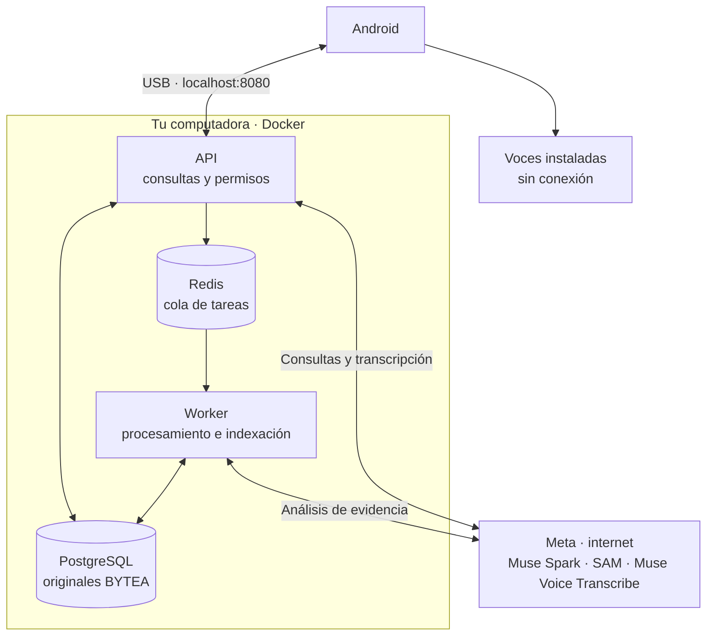

<a id="top"></a>

<p align="center">
  <a href="README.md"></a>
  <a href="../en/README.md"></a>
</p>

# RealityOS

<p align="center">
  
</p>

App Android para guardar fotos, videos y expedientes en grupos y consultar evidencia con IA. El servidor local ejecuta PostgreSQL, Redis, API y worker en Docker.

## Requisitos

- Windows x64 con [Docker Desktop](https://docs.docker.com/desktop/setup/install/windows-install/) y WSL2, o Linux x64 con [Docker Engine y Compose](https://docs.docker.com/engine/install/). Asigna a Docker **4 CPU, 8 GiB de RAM y 25 GiB libres**.
- Android 12+, cable y depuración USB; [Platform Tools (`adb`)](https://developer.android.com/tools/releases/platform-tools) en el `Path`.
- Internet y tu `MODEL_API_KEY` de Meta con acceso a Muse Spark, SAM y Muse Voice Transcribe.

<a id="evaluate"></a>
<a id="deploy"></a>

## 1. Iniciar

Descarga y extrae el [repositorio](https://github.com/Luxisoft/realityos-spatial-memory/archive/refs/heads/main.zip), abre Docker y ejecuta desde la carpeta del proyecto:

**Windows — PowerShell**

```powershell
powershell.exe -NoProfile -ExecutionPolicy Bypass -File .\scripts\local\Start-RealityOS.ps1
```

**Linux**

```bash
bash scripts/local/start.sh
```

Introduce tu clave Meta cuando se solicite. El instalador genera `.env.local`; mantenlo privado. La primera ejecución descarga dependencias y prepara los datos. Reiniciar conserva cambios y eliminaciones.

<a id="android"></a>

## 2. Instalar y usar Android

Descarga [app-debug.apk](https://github.com/Luxisoft/realityos-spatial-memory/releases/download/local-evaluation/app-debug.apk) en la carpeta del proyecto. Conecta el teléfono por USB, acepta la depuración y ejecuta:

```bash
adb reverse tcp:8080 tcp:8080
adb install -r app-debug.apk
```

<a id="cases"></a>

Abre la app y elige una de las **9 cuentas de los 3 grupos: policía, enfermería y memoria**. Explora galería y expedientes; para publicar, selecciona grupo, categoría y etiqueta. Espera a que termine la indexación para buscar.

| Vista / video | Uso |
| --- | --- |
| <a href="../../demo-video/policial_case.mp4"></a> | **Policía:** consultar expedientes y evidencia del grupo. |
| <a href="../../demo-video/nurse_case.mp4"></a> | **Enfermería:** revisar registros, notas y adjuntos autorizados. |
| <a href="../../demo-video/memory.mp4"></a> | **Memoria:** encontrar dónde y cuándo se vio un objeto por última vez. |
| <a href="../../demo-video/profile_found.mp4"></a> | **Perfiles:** abrir la información autorizada de un candidato facial. |

Las imágenes y los videos son [ilustraciones conceptuales](project/GRAPHICS.md). Pulsa una miniatura para abrir su video.

<a id="biometrics"></a>

### Búsqueda facial

La búsqueda facial requiere consentimiento y enrolamiento explícitos. InsightFace devuelve candidatos para revisión humana; se abre su perfil o expediente según los permisos.


Para las respuestas habladas, instala una voz ES/EN sin conexión en Android. Repite `adb reverse` al reconectar el teléfono.

<a id="architecture"></a>

### Arquitectura local



## 3. Diagnóstico, detención y Postman

Desde la carpeta del proyecto:

| Acción | Windows — PowerShell | Linux |
| --- | --- | --- |
| Diagnóstico | `powershell.exe -NoProfile -ExecutionPolicy Bypass -File .\scripts\local\Test-RealityOS.ps1` | `bash scripts/local/test.sh` |
| Detener | `powershell.exe -NoProfile -ExecutionPolicy Bypass -File .\scripts\local\Stop-RealityOS.ps1` | `bash scripts/local/stop.sh` |

API: [documentación](http://localhost:8080/docs) · [salud](http://localhost:8080/health/ready). Detener conserva los datos; `down -v` los elimina. Si falla la clave Meta, corrige `MODEL_API_KEY` en `.env.local` y vuelve a iniciar.

**Postman:** importa la [colección](../postman/RealityOS.postman_collection.json), elige **No environment → Localhost requests → 00 Quick start** o **00 Local scenarios**. El acceso es automático; para escribir, activa `enable_write_requests=true`. **Server requests** está desactivado, sin URL ni credenciales.

<a id="java-windows"></a>

## 4. Compilar Android (opcional)

Usa **JDK 21 LTS** y **Android SDK 36**. En Windows:

1. Instala [Temurin 21 x64](https://adoptium.net/temurin/releases/?version=21&os=windows&arch=x64&package=jdk), paquete **JDK**, instalador MSI.
2. En **Variables de entorno**, configura `JAVA_HOME` con la carpeta instalada, sin comillas ni `\bin`. **La variable de usuario tiene prioridad sobre la del sistema**: si existen ambas, usa la misma ruta válida. Corrige también `JDK_HOME` si apunta a una instalación vieja.
3. Coloca `%JAVA_HOME%\bin` primero entre las entradas de Java del `Path`. Cierra completamente el editor y las terminales; abre una PowerShell nueva:

```powershell
$env:JAVA_HOME
Test-Path "$env:JAVA_HOME\bin\java.exe"
& "$env:JAVA_HOME\bin\java.exe" -version
java -version
javac -version
```

Debe aparecer `True` y versión **21**. Si el editor conserva una ruta vieja, elimínala de `java.home` o `java.jdt.ls.java.home`. En Android Studio, selecciona JDK 21 en **Settings → Build, Execution, Deployment → Build Tools → Gradle → Gradle JDK**.

Compila desde la carpeta del proyecto:

| Windows — PowerShell | Linux |
| --- | --- |
| `.\android\gradlew.bat -p android :app:assembleDebug` | `./android/gradlew -p android :app:assembleDebug` |

Resultado: `android/app/build/outputs/apk/debug/app-debug.apk`. Instálalo con `adb install -r android/app/build/outputs/apk/debug/app-debug.apk`.

<a id="hackathon"></a>

[](https://github.com/Luxisoft/realityos-spatial-memory/actions/workflows/ci.yml)

[Referencia técnica](INDEX.md) · [Estado verificado](project/IMPLEMENTATION_STATUS.md) · [Licencias de terceros](project/THIRD_PARTY.md) · [Apache 2.0](../../LICENSE)
