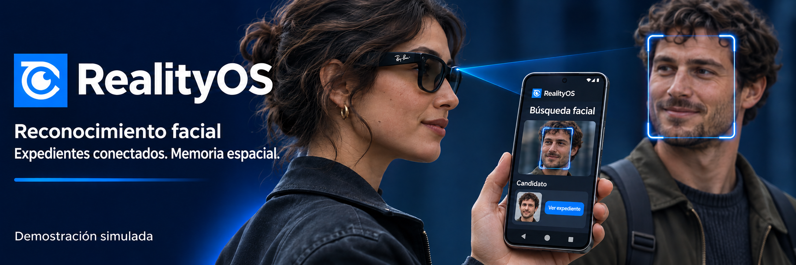
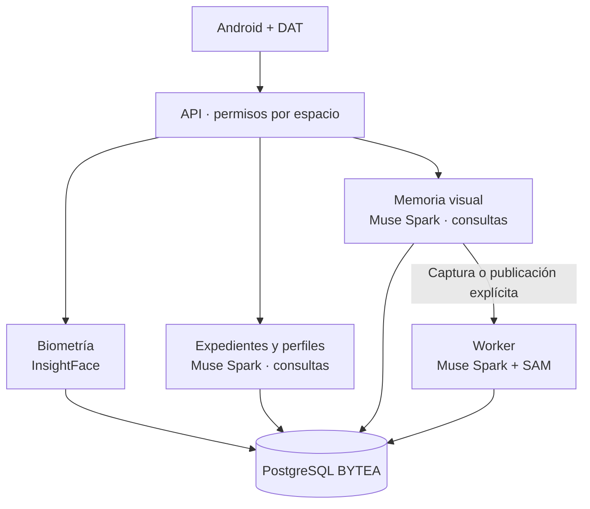

<a id="top"></a>

<p align="center">
  <a href="../en/README.md"></a>
  <a href="README.md"></a>
</p>

# RealityOS

[Entrar a probar](#evaluate) · [Checklist de pruebas](testing/IMPLEMENTATION_CHECKLIST.md) · [API / Postman](api/API.md) · [Todas las guías](INDEX.md)

**Una plataforma de reconocimiento facial, contexto autorizado y memoria visual para Android y gafas Meta.**
Permite encontrar personas y objetos, consultar información relacionada y recuperar evidencia por foto, video, texto o voz. Sus capacidades se aplican a distintos entornos, según los datos y permisos de cada espacio.

<p align="center">
  
</p>

<p align="center">
  <a href="#cases"><strong>Casos de uso</strong></a> · <a href="#biometrics"><strong>Reconocimiento facial</strong></a> · <a href="#evaluate"><strong>Probar</strong></a> · <a href="#architecture"><strong>Arquitectura</strong></a> · <a href="#hackathon"><strong>Hackathon</strong></a>
</p>

<p align="center">
  <a href="https://github.com/Luxisoft/realityos-spatial-memory/actions/workflows/ci.yml"></a>
  · <a href="../../LICENSE">Apache 2.0</a> · <a href="../en/README.md">English</a>
</p>

<a id="evaluate"></a>

## Entrar a probar

**La cuenta de prueba se entrega lista: foto de perfil, publicaciones y grupo de trabajo asignado.** Los expedientes y sus retratos ya están cargados en el servidor. Para el recorrido inicial solo necesitas el APK y tu usuario/contraseña.

1. **Instala la app.** Recibe **app-debug.apk** del responsable o descárgalo de una [compilación exitosa](https://github.com/Luxisoft/realityos-spatial-memory/actions/workflows/ci.yml): abre la ejecución → **Artifacts** → **realityos-android-debug-apk**, descomprime el ZIP e instala el APK en Android 12 o superior. GitHub puede pedir iniciar sesión.
2. **Entra.** Abre RealityOS → **Continuar con correo** → **Iniciar sesión**. En **Usuario o correo**, escribe la cuenta recibida, por ejemplo `elena-marquez`, y pega su contraseña. La cuenta ya está creada y confirmada.
3. **Prueba lo que ya está cargado.** En **Perfil** verás tu foto y publicaciones. En **Trabajo**, elige el grupo asignado → **Registros del espacio** y abre uno de sus expedientes. Los retratos están dentro del expediente.

| Prueba | Cuenta principal | Grupo ya asignado | Abre primero |
| --- | --- | --- | --- |
| Enfermería | `elena-marquez` | California Valley Medical Center | Expediente de Ana Solis: retrato, notas y registros relacionados. |
| Policial | `alex-rivera` | Pacific Ridge Police Department | Caso de prueba 1 y evidencia del turno. |
| Memoria | `noah-brooks` | Sonoran Neurological Institute | Expediente de Luis Moreno y su recordatorio. |

**Las tres cuentas principales y sus contraseñas son públicas:** consulta la [tabla de acceso](api/API.md#quick-start). Usa la cuenta del escenario que quieras evaluar.

[Recorrido paso a paso y las nueve cuentas →](guides/DEMO.md#access)

Los tres escenarios contienen **47 registros, 27 adjuntos y seis retratos de personas enrolados**. Las personas y escenas son ficticias; el servidor y sus proveedores son reales. Los videos sintéticos muestran escenas estáticas.

<details>
<summary><strong>Solo quiero probar la API con Postman</strong></summary>

Importa [la colección pública](https://raw.githubusercontent.com/Luxisoft/realityos-spatial-memory/main/docs/postman/RealityOS.postman_collection.json), abre **Server requests** o **Localhost requests → 00 Quick start** y pulsa **Send**. Los escenarios Police, Nursing y Memory están en **Server requests → 00 Live scenarios**. Las 39 peticiones incluyen las tres cuentas existentes, contraseñas, workspace, IDs y preguntas. Login y renovación son automáticos; se consultan los datos actuales del servidor. [Guía y cuentas públicas →](api/API.md#quick-start)

</details>

La app habitual ya conecta al servidor. [Windows local](deployment/DEPLOYMENT_LOCALHOST.md) es una instalación adicional que empieza vacía.

[Conectar un bucket R2/S3 →](guides/STORAGE_CONNECTIONS.md)

Las cuentas de escenario y QA ya tienen el bucket de prueba conectado en **Perfil → Mis conexiones**; sus recursos están cargados y verificados en R2.

## Capacidades de la plataforma

| Capacidad | Qué aporta |
| --- | --- |
| **Reconocimiento facial** | Busca candidatos entre usuarios o expedientes autorizados a partir de una foto o video. |
| **Expedientes e integración** | Importa registros versionados, relaciona personas y eventos, y conserva notas y adjuntos con su fuente. |
| **Contexto social** | Consulta perfiles, publicaciones y grupos según su visibilidad. |
| **Memoria visual** | Encuentra objetos en evidencia almacenada y muestra dónde y cuándo se observaron. |
| **Interacción multimodal** | Ofrece captura explícita y consultas por imagen, texto o voz desde Android y Display nativo. |

<a id="cases"></a>

## Ejemplos de aplicación

**Son ejemplos independientes, no una lista cerrada de lo que puede hacer RealityOS.** Cada organización configura sus datos y espacios; estos escenarios no comparten información entre sí por defecto.

| Vista previa | Ejemplo | Qué permite hacer | Resultado |
| --- | --- | --- | --- |
| <a href="../../demo-video/policial_case.mp4"></a> | **Policial** | Revisar un caso y consultar una persona previamente enrolada. | Contexto autorizado, notas y evidencia para revisión humana. |
| <a href="../../demo-video/nurse_case.mp4"></a> | **Enfermería** | Localizar el expediente de un paciente y comparar campos registrados. | Historial y discrepancias de datos para verificación profesional. |
| <a href="../../demo-video/profile_found.mp4"></a> | **Social** | Encontrar un perfil autorizado a partir de un rostro. | Información y publicaciones que el usuario puede consultar. |
| <a href="../../demo-video/memory.mp4"></a> | **Memoria** | Preguntar dónde se observó un objeto por última vez. | Foto o fotograma señalado, ubicación, fecha y fuente. |

Las miniaturas y los videos enlazados son conceptuales. [Pruebas disponibles y alcance de cada conjunto de datos →](guides/DEMO.md)

<a id="biometrics"></a>

## Reconocimiento facial y acceso al contexto

**InsightFace compara una foto o video de consulta con enrolamientos autorizados del espacio.** Devuelve candidatos ordenados por similitud, con evidencia facial, y permite abrir el perfil de usuario o el expediente de persona correspondiente.


**1. Consentimiento → 2. Enrolamiento explícito → 3. Sonda foto/video → 4. Candidatos ordenados → 5. Perfil o expediente confirmado por una persona.**

### Consentimiento primero, enrolamiento explícito

| Paso | Qué ocurre |
| --- | --- |
| **Consentimiento** | `POST /v1/faces/consent` con `{"confirm": true}` registra un consentimiento versionado. Enrolar y buscar devuelven `403` sin él, y los invitados siempre están bloqueados. `DELETE /v1/faces/consent` revoca y elimina los enrolamientos del usuario. |
| **Personas** | Los usuarios con sesión enrolan una selfie de un solo rostro (`POST /v1/faces/profile-photo`) o sus propios medios de captura (`POST /v1/faces/enroll`). Los candidatos solo proceden de miembros del espacio con consentimiento activo. |
| **Expedientes** | Los expedientes de persona enrolan medios autorizados del expediente (`POST /v1/faces/record-enroll`); el expediente debe mantenerse activo y con autorización biométrica y base registrada. |

Nada se enrola automáticamente: cada enrolamiento es una llamada explícita sobre medios autorizados. Al entrar, la app toma una captura facial privada obligatoria y la verifica contra las fotos de Facebook sincronizadas de la propia cuenta cuando existen (`POST /v1/faces/verify-identity`: verified, pending, failed o locked, con límite de intentos y bloqueo temporal).

### La búsqueda devuelve candidatos, nunca un veredicto de identidad

`POST /v1/faces/search` recibe un espacio más una sonda efímera subida (foto JPEG/PNG/WebP, o video MP4/MOV/WebM muestreado en fotogramas) o un `media_id` almacenado. Las sondas subidas nunca se guardan. Las sondas con varios rostros conservan los mejores (ordenados por calidad, con límite y conteo de omitidos); la comparación es similitud coseno sobre representaciones faciales (umbral por defecto `0.5`) con filtros de calidad y tamaño de rostro.

Cada candidato incluye `similarity`, `probe_box`, `probe_face_index` y una miniatura de evidencia: `matches` para usuarios (con enlace al perfil) y `matches_records` para expedientes de persona (con enlace al expediente). Las respuestas también indican `probe_faces`, `threshold` y si la salida es `simulated`. Los resultados se limitan a la pertenencia al espacio y a la autorización de cada expediente; los medios sincronizados de Facebook solo se buscan dentro de sus flujos autorizados, nunca como búsqueda global de Facebook.

### Dónde aparece

**Buscar persona** en Android y la acción **Buscar persona** del Display Ray-Ban comparten este endpoint: recuadros numerados de colores sobre la foto grupal (generados desde una sonda efímera en memoria, nunca almacenada), miniaturas por candidato mediante enlaces firmados de corta duración y apertura del perfil o expediente dentro de la app con los mismos permisos.

La similitud es una puntuación de ordenación, no probabilidad de identidad: el profesional confirma al candidato. La biometría es un brazo aislado — solo comparte autenticación, pertenencia y almacenamiento BYTEA — nunca fusionado con el pipeline Register/Query de objetos, e InsightFace se ejecuta localmente en el servidor, independiente de Meta. [Contrato facial →](api/API_REFERENCE.md) · [Guiones de prueba →](guides/DEMO.md)

<a id="architecture"></a>

## Arquitectura y uso de Meta AI



| Tecnología | Aporte al producto | Implementación |
| --- | --- | --- |
| **Muse Spark 1.3** | Interpreta imágenes y preguntas, responde consultas de expedientes y perfiles y prepara textos EN/ES con contexto autorizado. | [Proveedores](../../backend/app/providers/) · [contratos Meta](integrations/META_INTEGRATION.md) |
| **SAM 3.1** | Localiza y segmenta objetos; conserva geometría y evidencia de fotogramas durante procesamiento explícito. | [Procesamiento](../../backend/app/processing/) |
| **Muse Voice Transcribe** | Convierte consultas de voz en texto. | [Integración Meta](integrations/META_INTEGRATION.md) |
| **Meta Wearables DAT** | Conecta cámara, voz y Display nativo de las gafas con Android. | [Android y gafas](integrations/ANDROID.md) |
| **InsightFace · IA biométrica** | Detecta rostros y calcula representaciones faciales para comparar enrolamientos autorizados. Se ejecuta localmente en el servidor; es independiente de Meta. | [API facial](api/API.md) |
| **ElevenLabs** | Genera respuestas habladas desde el servidor. Es un proveedor independiente de Meta. | [TTS](integrations/TTS.md) |

Las consultas contextuales de expedientes, perfiles y memoria visual pueden llamar a Muse Spark desde la API. El worker analiza capturas/publicaciones explícitas con Muse Spark y SAM; consultar evidencia no inicia ese procesamiento. Leer o importar registros no implica por sí solo una llamada a IA.

La API de expedientes importa personas, casos, atenciones, objetos, prescripciones, alergias y administraciones mediante lotes versionados, relaciones y adjuntos. Los conectores HTTPS usan un contrato explícito. [Integración de datos →](guides/WORKSPACE_DATA.md)

**Decisiones de ingeniería:** originales en PostgreSQL BYTEA; permisos por espacio en cada recurso; consentimiento biométrico; consultas de evidencia sin iniciar captura; claves de proveedores solo en servidor; fallos Live visibles y mock rotulado. El gateway Meta restringido es un respaldo de conexión. Android es la única app; el panel del navegador y la web Display están retirados.

<a id="watch"></a>

[▶ Policial](../../demo-video/policial_case.mp4) · [▶ Enfermería](../../demo-video/nurse_case.mp4) · [▶ Personas / social](../../demo-video/profile_found.mp4) · [▶ Memoria](../../demo-video/memory.mp4)

Estos videos y la portada son representaciones conceptuales; no sustituyen una grabación de la app funcionando. Los videos existentes contienen texto en inglés. La prueba HTTP de reconocimiento sobre Ana Solis está documentada; la validación física de teléfono/gafas, las fuentes institucionales reales y la demo final grabada siguen pendientes. [Estado verificado →](project/IMPLEMENTATION_STATUS.md)

<a id="install"></a>

## Instalar y desarrollar

| Android | Servidor | Windows independiente |
| --- | --- | --- |
| [Compilar e instalar APK](integrations/ANDROID.md#build) | [Conexión directa](deployment/DEPLOYMENT_DIRECT.md) · [gateway](deployment/DEPLOYMENT_GATEWAY.md) | [Docker Desktop + app local](deployment/DEPLOYMENT_LOCALHOST.md) |

<details>
<summary><strong>Mapa del repositorio y comprobaciones</strong></summary>

| Ruta | Responsabilidad |
| --- | --- |
| `backend/` | API, contratos, procesamiento, migraciones y biometría. |
| `android/` | App Kotlin/Compose y Display nativo DAT. |
| `meta-gateway/` | Egress permitido a Meta. |
| `simulator/` | Fixtures sintéticos y cargadores de prueba. |
| `tests/` · `gateway-tests/` | Regresiones, aislamiento y contrato OpenAPI. |

Después de `make install`:

```bash
make lint
make test
make architecture-check
make android-check
```

</details>

<a id="hackathon"></a>

## Construido durante la hackathon

El repositorio distingue la **base previa al 27 de octubre (ET)** de las aportaciones posteriores: video y segmentación avanzada, Android/DAT, reconocimiento facial, perfiles sociales e integración de expedientes. [Cambios y commits de referencia →](project/HACKATHON.md#contributions)

**Meta Global AI Developer Hackathon · encaje propuesto: Build for Your World.** El uso de modelos Meta y los ejemplos muestran la aplicación práctica; el track registrado debe confirmarse con la inscripción.

La guía exige repositorio público y una **demo accesible de tres minutos** centrada en lo construido durante el evento. El enlace al video final sigue pendiente; los videos conceptuales anteriores no lo sustituyen.

[Requisitos, revisión de exclusiones y pendientes →](project/HACKATHON.md) · [Guía del evento](https://cerebralvalley.ai/e/meta-ai-developer-hackathon/details)

<a id="docs"></a>

[Arquitectura](architecture/ARCHITECTURE.md) · [API](api/API.md) · [Base de datos](architecture/DATABASE.md) · [Seguridad](architecture/SECURITY.md) · [Gafas](integrations/WEARABLES.md)

[Recursos y prompts](../en/project/GRAPHICS.md) · [Referencia de formato: awesome-readme](https://github.com/matiassingers/awesome-readme) · [Apache 2.0](../../LICENSE) · [↑ Volver arriba](#top)
