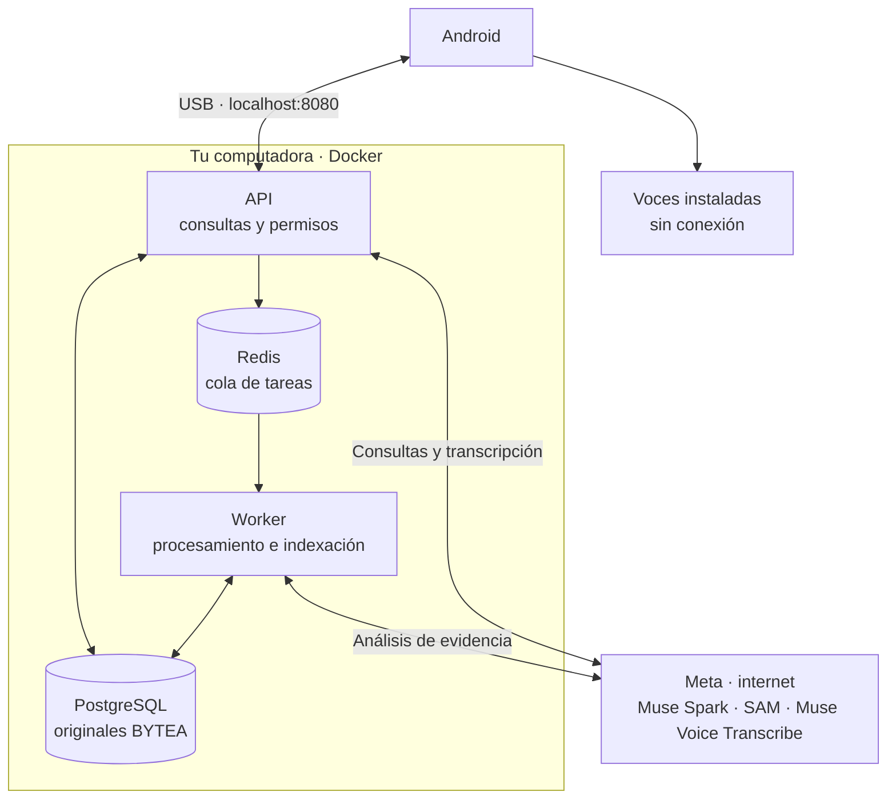

<a id="top"></a>

<p align="center">
  <a href="README.md"></a>
  <a href="../en/README.md"></a>
</p>

# RealityOS

<p align="center">
  
</p>

App Android para guardar fotos, videos y expedientes en grupos y consultar evidencia con IA. El servidor local ejecuta PostgreSQL, Redis, API y worker en Docker.

**[Descargar APK para Android 12+](https://media.githubusercontent.com/media/Luxisoft/realityos-spatial-memory/main/android/app/build/outputs/apk/debug/app-debug.apk)** · [Comandos para el celular](#android)

<p align="center">
  <a href="#linux-server"></a>
</p>

## Requisitos

- Windows x64 con [Docker Desktop](https://docs.docker.com/desktop/setup/install/windows-install/) y WSL2, o Linux x64 con [Docker Engine y Compose](https://docs.docker.com/engine/install/). Asigna a Docker **4 CPU, 8 GiB de RAM y 25 GiB libres**.
- Celular con Android 12+, cable y depuración USB. Descarga Platform Tools (`adb`): [Windows ZIP](https://dl.google.com/android/repository/platform-tools-latest-windows.zip) · [Linux ZIP](https://dl.google.com/android/repository/platform-tools-latest-linux.zip). Extrae el ZIP, añade la carpeta `platform-tools` al `Path` y abre otra terminal.
- Internet y tu `MODEL_API_KEY` de Meta con acceso a Muse Spark, SAM y Muse Voice Transcribe.

<a id="evaluate"></a>
<a id="deploy"></a>

## 1. Iniciar

Con Git y [Git LFS](https://git-lfs.com/) instalados, descarga el proyecto:

```bash
git lfs install
git clone https://github.com/Luxisoft/realityos-spatial-memory.git
cd realityos-spatial-memory
```

Si ya lo tienes, abre su carpeta y sigue los comandos de [actualización e instalación](#android). También puedes extraer el [ZIP](https://github.com/Luxisoft/realityos-spatial-memory/archive/refs/heads/main.zip) y descargar el APK con el enlace de arriba.

<a id="deploy-muse"></a>

<details>
<summary><strong>Muse · instalar todo en localhost (copiar prompt)</strong></summary>

Pega este prompt en una sesión de **Muse con acceso a la terminal de tu computadora**:

```text
Eres Muse, mi agente de instalación. Instala y deja funcionando RealityOS en
localhost en esta computadora. Ejecuta el trabajo hasta verificar el resultado;
respeta los permisos de la sesión y solicita mi intervención cuando sea necesaria.

1. Lee AGENTS.md, MUSE.md, docs/es/README.md, los scripts de scripts/local/ y
   infrastructure/docker-compose.local.yml. Trabaja sobre este checkout y el
   proyecto Docker realityos-local. Conserva mis cambios, credenciales y datos;
   mantén intactos los otros servicios y los servidores remotos.

2. Detecta Windows x64/PowerShell o Linux x64/Bash. Prepara las dependencias que
   falten y comprueba Docker local, contenedores Linux, Compose, al menos 4 CPU,
   8 GiB de RAM y 25 GiB libres para Docker. Usa el puerto 8080; si está ocupado,
   identifica el proceso y explícame el conflicto antes de detener otro servicio.
   En Windows, verifica Docker Desktop con WSL2. Si se necesita un permiso o
   reinicio del sistema, indícalo y continúa después de completarlo.

3. Si falta .env.local, créalo desde .env.local.example. Pídeme introducir mi
   MODEL_API_KEY de Meta en ese archivo privado o en mi terminal local; nunca en
   el chat. No muestres claves ni copies credenciales productivas. El instalador
   genera los secretos internos. Conserva la configuración local existente.

4. Ejecuta desde la raíz el instalador correspondiente:
   Windows: powershell.exe -NoProfile -ExecutionPolicy Bypass -File .\scripts\local\Start-RealityOS.ps1
   Linux: bash scripts/local/start.sh
   Espera a PostgreSQL, Redis, API y worker; revisa los errores y corrige su causa.
   Usa la preparación existente de los tres grupos y nueve cuentas. Conserva
   ediciones y eliminaciones al reiniciar, así como permisos y consentimiento.

5. Prepara Platform Tools (adb). El APK compilado en el servidor está en
   android/app/build/outputs/apk/debug/app-debug.apk. En un checkout Git ejecuta
   git lfs install y git lfs pull para obtenerlo. Si usas el ZIP del proyecto,
   descarga el APK desde el enlace del README a esa misma ruta. Comprueba que
   sea un APK completo y que su SHA-256 coincida con el objeto LFS del commit.
   Este recorrido no requiere instalar Java, Android SDK 36 ni Android Studio.
   Si hay cambios Android o de contrato posteriores al APK publicado, solicita
   una nueva compilación del servidor o usa la sección de compilación del README.

6. Comprueba adb devices. En el teléfono o emulador Android 12+ elegido, ejecuta
   adb reverse tcp:8080 tcp:8080 e instala el APK con adb install -r. Si hay varios
   dispositivos, pide elegir uno y usa adb -s con su identificador. Si falta
   conectar o autorizar el dispositivo, indícame el paso pendiente. Verifica el
   selector local y las voces ES/EN instaladas sin conexión cuando tengas acceso.
   Abre la app con:
   adb shell am start -n com.luxisoft.realityos.local/com.luxisoft.realityos.MainActivity

7. Ejecuta Test-RealityOS.ps1 con PowerShell o bash scripts/local/test.sh.
   Comprueba http://localhost:8080/health/ready, /docs, /v1/openapi.json y
   /v1/auth/local-accounts. Verifica acceso y una consulta de evidencia con los
   datos existentes; espera a la indexación o informa su error real. Distingue
   disponibilidad de modelos de una consulta IA efectivamente ejecutada.

8. Entrega la URL local, ruta del APK, estado de los cuatro servicios, comandos
   para iniciar/detener y comprobaciones realizadas. Señala cualquier validación
   de dispositivo o proveedor pendiente. Deja la instalación funcionando.
```

</details>

Para iniciar manualmente, ejecuta desde la carpeta del proyecto:

**Windows — PowerShell**

Instala Docker Desktop primero. En su primer inicio, abre la aplicación y completa su configuración, usando contenedores Linux con WSL2. El siguiente comando abre Docker Desktop si está instalado y el motor no está disponible, y espera hasta dos minutos a que responda.

```powershell
powershell.exe -NoProfile -ExecutionPolicy Bypass -File .\scripts\local\Start-RealityOS.ps1
```

Si aparece `docker_engine` / `The system cannot find the file specified` o se agota la espera, abre Docker Desktop y resuelve los avisos de inicio o WSL2. Ejecuta `docker info`: debe mostrar la sección **Server** sin errores de conexión. Revisa `docker context ls` si sigue fallando y selecciona tu contexto local de Docker Desktop antes de repetir el comando. Tener instalada la terminal de Docker no basta; el motor debe estar funcionando.

**Linux**

Inicia el servicio local de Docker Engine antes de ejecutar:

```bash
bash scripts/local/start.sh
```

Introduce tu clave Meta cuando se solicite. El instalador genera `.env.local`; mantenlo privado. La primera ejecución descarga dependencias y prepara los datos. Reiniciar conserva cambios y eliminaciones.

Los comandos de inicio, diagnóstico y parada muestran una barra de progreso en inglés basada en etapas completadas. La consola se limita a resúmenes, advertencias, errores y confirmaciones de éxito; oculta las líneas de descarga de paquetes. Una etapa larga puede mantener el mismo porcentaje mientras trabaja. El 100 % indica que terminó el comando; la indexación en segundo plano puede continuar después.

En Windows, añade `-NoCache` al comando de inicio para reconstruir las dependencias sin reutilizar capas de construcción. Esto no reinicia los datos: probar su primera carga también requiere eliminar los contenedores de `realityos-local` y sus volúmenes `postgres_data`/`redis_data`, lo que borra los datos locales. Conserva `.env.local` para reutilizar tu configuración privada. La barra usa texto sencillo para evitar superposiciones en la terminal de VS Code.

<a id="android"></a>

## 2. Descargar, instalar y abrir Android

El APK compilado en el servidor está incluido en `android/app/build/outputs/apk/debug/app-debug.apk`, para Android 12+ y `http://localhost:8080/v1`. Se descarga con Git LFS al clonar o actualizar. Para instalarlo necesitas `adb`; **no necesitas Android Studio, JDK ni SDK 36**.

Con el backend iniciado, conecta el celular por USB y acepta la depuración. Desde **la raíz del proyecto**, actualiza, instala y abre la app:

```powershell
git lfs install
git pull --ff-only
git lfs pull
adb devices
adb reverse tcp:8080 tcp:8080
adb install -r android/app/build/outputs/apk/debug/app-debug.apk
adb shell am start -n com.luxisoft.realityos.local/com.luxisoft.realityos.MainActivity
```

`git lfs install` se configura una vez por computadora. Si Git no reconoce `lfs`, instala [Git LFS](https://git-lfs.com/) y repite los comandos. Si descargaste el ZIP, omite los tres comandos Git y guarda el APK del enlace superior en la ruta indicada; crea sus carpetas si faltan.

El celular debe aparecer como `device`; si indica `unauthorized`, acepta el aviso en su pantalla. Si hay varios dispositivos, añade `-s SERIAL` después de `adb` en cada comando. Para volver a abrir la app basta el último comando o tocar su icono; repite `adb reverse` al reconectar el USB. El mismo APK sirve para el [túnel privado al servidor Linux](#linux-server).

<a id="android-build"></a>

<details>
<summary><strong>Opcional: compilar desde el código actual</strong></summary>

Si modificas Android, genera un APK nuevo en el servidor o en una computadora con [JDK 21 y Android SDK 36](#java-windows). Un APK descargado solo contiene el código de su compilación; Docker prepara el backend. Desde la raíz del repositorio:

**Windows — PowerShell**

```powershell
$env:REALITYOS_API_BASE_URL = "http://localhost:8080/v1"
.\android\gradlew.bat -p android -PlocalDevelopment=true :app:assembleDebug
if ($LASTEXITCODE -ne 0) { throw "Android build failed. Do not install an older APK." }
```

**Linux**

```bash
REALITYOS_API_BASE_URL=http://localhost:8080/v1 ./android/gradlew -p android -PlocalDevelopment=true :app:assembleDebug
```

Espera a **BUILD SUCCESSFUL**. Se reemplaza `android/app/build/outputs/apk/debug/app-debug.apk`. Instálalo y ábrelo desde la raíz del repositorio:

```bash
adb reverse tcp:8080 tcp:8080
adb install -r android/app/build/outputs/apk/debug/app-debug.apk
adb shell am start -n com.luxisoft.realityos.local/com.luxisoft.realityos.MainActivity
```

</details>

<a id="android-updates"></a>

**Para cada actualización:**

| Qué cambió | Qué ejecutar |
| --- | --- |
| Código o recursos Android | El servidor compila y sube el APK al repositorio. Repite los comandos de actualización e instalación anteriores; también puedes [compilar tú](#android-build). |
| Código del backend o configuración del servidor | Ejecuta `Start-RealityOS.ps1` en Windows o `bash scripts/local/start.sh` en Linux para reconstruir/iniciar los servicios locales. Se conservan los datos existentes. |
| Contrato de la API que utiliza Android | Actualiza tanto el backend como el APK. |
| Solo documentación | No hace falta reconstruir la app ni los contenedores. |

`adb install -r` conserva los datos con el mismo identificador y firma. Las compilaciones publicadas desde este servidor mantienen esa firma; una compilación de otra computadora o CI puede usar otra. No desinstales automáticamente ante un conflicto. Consulta [instalación con ADB](https://developer.android.com/tools/adb#move).

`git pull` trae el APK actualizado con Git LFS activo; `adb install -r` actualiza el celular. La versión Debug incluye la fecha de compilación. Cada cambio Android requiere compilar y subir el APK junto con el código.

<a id="cases"></a>

Abre la app y elige una de las **9 cuentas de los 3 grupos: policía, enfermería y memoria**. Explora galería y expedientes; para publicar, selecciona grupo, categoría y etiqueta. Espera a que termine la indexación para buscar.

| Vista / video | Uso |
| --- | --- |
| <a href="../../demo-video/policial_case.mp4"></a> | **Policía:** consultar expedientes y evidencia del grupo. |
| <a href="../../demo-video/nurse_case.mp4"></a> | **Enfermería:** revisar registros, notas y adjuntos autorizados. |
| <a href="../../demo-video/memory.mp4"></a> | **Memoria:** encontrar dónde y cuándo se vio un objeto por última vez. |
| <a href="../../demo-video/profile_found.mp4"></a> | **Perfiles:** abrir la información autorizada de un candidato facial. |

Las imágenes y los videos son [ilustraciones conceptuales](project/GRAPHICS.md). Pulsa una miniatura para abrir su video.

<a id="biometrics"></a>

### Búsqueda facial

La búsqueda facial requiere consentimiento y enrolamiento explícitos. InsightFace devuelve candidatos para revisión humana; se abre su perfil o expediente según los permisos.


Para las respuestas habladas, instala una voz ES/EN sin conexión en Android. Repite `adb reverse` al reconectar el teléfono.

<a id="architecture"></a>

### Arquitectura local



## 3. Diagnóstico, detención y Postman

Desde la carpeta del proyecto:

| Acción | Windows — PowerShell | Linux |
| --- | --- | --- |
| Diagnóstico | `powershell.exe -NoProfile -ExecutionPolicy Bypass -File .\scripts\local\Test-RealityOS.ps1` | `bash scripts/local/test.sh` |
| Detener | `powershell.exe -NoProfile -ExecutionPolicy Bypass -File .\scripts\local\Stop-RealityOS.ps1` | `bash scripts/local/stop.sh` |

API: [documentación](http://localhost:8080/docs) · [salud](http://localhost:8080/health/ready). Detener conserva los datos; `down -v` los elimina. Si falla la clave Meta, corrige `MODEL_API_KEY` en `.env.local` y vuelve a iniciar.

**Postman:** importa la [colección](../postman/RealityOS.postman_collection.json), elige **No environment → Localhost requests → 00 Quick start** o **00 Local scenarios**. El acceso es automático; para escribir, activa `enable_write_requests=true`. **Server requests** está desactivado, sin URL ni credenciales.

<a id="java-windows"></a>

## 4. Java y Android SDK — solo para compilar

Para [compilar desde código](#android-build), usa **JDK 21 LTS** y **Android SDK 36**. Si instalas el APK publicado, puedes omitir esta sección. En Windows:

1. Instala [Temurin 21 x64](https://adoptium.net/temurin/releases/?version=21&os=windows&arch=x64&package=jdk), paquete **JDK**, instalador MSI.
2. En **Variables de entorno**, configura `JAVA_HOME` con la carpeta instalada, sin comillas ni `\bin`. **La variable de usuario tiene prioridad sobre la del sistema**: si existen ambas, usa la misma ruta válida. Corrige también `JDK_HOME` si apunta a una instalación vieja.
3. Coloca `%JAVA_HOME%\bin` primero entre las entradas de Java del `Path`. Cierra completamente el editor y las terminales; abre una PowerShell nueva:

```powershell
$env:JAVA_HOME
Test-Path "$env:JAVA_HOME\bin\java.exe"
& "$env:JAVA_HOME\bin\java.exe" -version
java -version
javac -version
```

Debe aparecer `True` y versión **21**. Si el editor conserva una ruta vieja, elimínala de `java.home` o `java.jdt.ls.java.home`. En Android Studio, selecciona JDK 21 en **Settings → Build, Execution, Deployment → Build Tools → Gradle → Gradle JDK**.

Instala Android SDK Platform 36, Build-Tools 36.0.0 y Platform Tools desde SDK Manager de Android Studio. Configura `ANDROID_HOME` con la carpeta del SDK, o `sdk.dir` en el archivo ignorado `android/local.properties`. Añade `platform-tools` del SDK al `Path` para que funcione `adb devices`.

Con esas herramientas listas, sigue [Compilar desde código](#android-build). Gradle utiliza el Wrapper del repositorio; no necesitas instalar Gradle por separado.

<a id="linux-server"></a>

## 5. Evaluación privada en un servidor Linux

Ejecuta los mismos **cuatro servicios y escenarios preparados** en un servidor Linux x64. La API permanece en `127.0.0.1:8080` del servidor; tu computadora se conecta mediante SSH. No necesitas dominio ni un endpoint HTTPS público. Mantén privado el puerto 8080: el selector de cuentas de evaluación no utiliza contraseñas.

**1. Prepara el servidor.** Usa al menos 4 CPU, 8 GiB de RAM y 25 GiB libres para Docker. Instala Git, curl, [Docker Engine y el plugin de Compose](https://docs.docker.com/engine/install/ubuntu/), e inicia Docker. Conéctate con tu propia cuenta SSH; sustituye `deploy@YOUR_SERVER` en toda esta sección:

```bash
ssh deploy@YOUR_SERVER
uname -m
docker info
docker compose version
```

Debes obtener `x86_64`, un motor Linux que responda y Compose. Los comandos Docker deben funcionar desde esa cuenta. Ejecuta los siguientes comandos del servidor **dentro de esa sesión SSH**.

**2. Descarga e inicia RealityOS.** Usa un checkout separado para esta evaluación:

```bash
git clone https://github.com/Luxisoft/realityos-spatial-memory.git
cd realityos-spatial-memory
bash scripts/local/start.sh
```

Introduce tu clave Meta cuando se solicite. El instalador crea un `.env.local` privado en el servidor, genera los secretos internos y prepara una sola vez los tres grupos y nueve cuentas. Reiniciar conserva la configuración local existente y los datos. PostgreSQL y Redis permanecen internos; Android usa sus voces instaladas sin conexión.

**3. Verifica en el servidor.** Espera a que termine la instalación y ejecuta:

```bash
curl --fail --silent --show-error http://127.0.0.1:8080/health/ready
curl --fail --silent --show-error http://127.0.0.1:8080/v1/openapi.json -o /dev/null
bash scripts/local/test.sh
```

El diagnóstico comprueba servicios, disponibilidad de modelos y cuentas locales. La indexación puede continuar después del arranque; espera a que termine antes de buscar la evidencia preparada.

**4. Conecta desde tu computadora.** Abre otra terminal **en tu computadora**, asegúrate de que su puerto 8080 esté libre y mantén activo este [túnel SSH](https://man.openbsd.org/ssh#L):

```bash
ssh -N -o ExitOnForwardFailure=yes -L 127.0.0.1:8080:127.0.0.1:8080 deploy@YOUR_SERVER
```

Abre [http://localhost:8080/docs](http://localhost:8080/docs) en tu computadora. Postman usa **Localhost requests** a través del túnel; deja **Server requests** desactivado. Si tu computadora ya ejecuta RealityOS localmente, detén primero esa instancia para liberar su puerto 8080.

**5. Conecta Android.** Con el túnel abierto y el teléfono conectado por USB a tu computadora, instala el [APK Debug local](#android) y ejecuta en tu computadora:

```bash
adb reverse tcp:8080 tcp:8080
```

La app conserva `http://localhost:8080/v1` y llega al servidor a través de tu computadora. Elige una de las nueve cuentas. Repite `adb reverse` después de reconectar el teléfono. Cerrar el túnel desconecta los clientes, pero deja el servidor funcionando.

**6. Detén o reanuda.** Dentro del checkout del servidor, usa `bash scripts/local/stop.sh` para detener y `bash scripts/local/start.sh` para reanudar. Detener conserva los datos. No elimines volúmenes ni uses `down -v` salvo que quieras borrar los datos de evaluación.

Estos pasos reutilizan el instalador Linux existente. El recorrido SSH/USB debe comprobarse en tu servidor y teléfono; este cambio de documentación no despliega un servidor.

<a id="hackathon"></a>

[](https://github.com/Luxisoft/realityos-spatial-memory/actions/workflows/ci.yml)

[Referencia técnica](INDEX.md) · [Estado verificado](project/IMPLEMENTATION_STATUS.md) · [Licencias de terceros](project/THIRD_PARTY.md) · [Apache 2.0](../../LICENSE)
