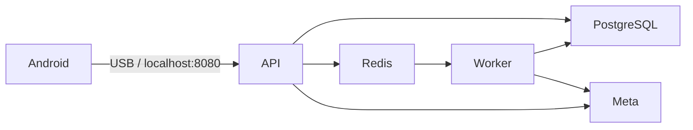

<a id="top"></a>
[English](../en/README.md) · [Documentation](INDEX.md)

# RealityOS

Evaluación local en Windows y Linux x64, con Android como única app. RealityOS conserva el procesamiento de evidencia, búsqueda visual, permisos de grupos y búsqueda facial aislada con consentimiento.


<a id="evaluate"></a>

## Empezar a probar

1. Descarga o clona el repositorio público e instala Docker. Sigue la [guía local](deployment/DEPLOYMENT_LOCALHOST.md).
2. Ejecuta `scripts/local/start.sh` en Linux o `scripts/local/Start-RealityOS.ps1` en Windows. Proporciona **solo tu `MODEL_API_KEY` de Meta**. Los secretos internos se generan localmente.
3. Instala el APK Debug local en Android 12+, conecta USB y ejecuta `adb reverse tcp:8080 tcp:8080`.
4. Elige una cuenta local. Explora galería y expedientes; publica, edita, elimina y consulta datos locales. Espera a que el worker termine la indexación real con Meta antes de comprobar la búsqueda visual.

El primer inicio prepara **3 grupos, 9 usuarios, 47 expedientes, 27 adjuntos y 48 escenas existentes con licencia**. Reiniciar conserva cambios y eliminaciones. Los expedientes ficticios están marcados como simulados; respuestas e índices IA usan modelos reales. No se precargan enrolamientos ni consentimientos biométricos.

**[Descargar APK Android local](https://github.com/Luxisoft/realityos-spatial-memory/releases/download/local-evaluation/app-debug.apk)** — descarga pública, sin iniciar sesión en GitHub.

El archivo instalable es `android/app/build/outputs/apk/debug/app-debug.apk`. [Compilación y conexión USB](deployment/DEPLOYMENT_LOCALHOST.md#android). Debug usa localhost por defecto; las credenciales de proveedores nunca van en el APK.

Importa la [colección Postman](../postman/RealityOS.postman_collection.json), elige **No environment** y abre **Localhost requests → 00 Quick start** o **00 Local scenarios**. El acceso y la renovación de sesión son automáticos. **Server requests** está desactivado, sin endpoint ni contraseñas configuradas. [Guía API](api/API.md#quick-start).

<a id="cases"></a>

## Escenarios existentes

| Escenario | Grupo | Cuentas |
| --- | --- | --- |
| Policía | Pacific Ridge Police Department | Alex Rivera, Maya Johnson, Daniel Kim |
| Enfermería | California Valley Medical Center | Elena Marquez, Mateo Rios, Sarah Chen |
| Memoria | Sonoran Neurological Institute | Noah Brooks, Lucia Vega, Owen Patel |

Galería es la vista principal. Publicar requiere un grupo existente, una categoría y al menos una etiqueta. El propietario administra el catálogo del grupo. Filtros, perfiles, expedientes, adjuntos y búsqueda conservan comportamiento y permisos. [Recorrido](guides/DEMO.md#access) · [Clasificación](guides/PUBLICATION_CLASSIFICATION.md).

<a id="biometrics"></a>

## Reconocimiento facial y contexto

InsightFace sigue aislado y sujeto a consentimiento. Autoriza y enrola expresamente a una persona antes de usar búsqueda biométrica. Elegir una cuenta local omite la verificación facial de ingreso, pero no omite consentimiento de búsqueda, autorización del grupo ni enrolamiento. Los resultados son candidatos con evidencia, no garantía de identidad. [Arquitectura](architecture/ARCHITECTURE.md) · [Seguridad](architecture/SECURITY.md).

<a id="architecture"></a>

## Arquitectura local

Cuatro servicios Docker: **PostgreSQL + Redis + API + worker**. PostgreSQL es la única base de datos de la aplicación y guarda los originales como BYTEA; Redis conserva la cola de procesamiento. Los recursos públicos iniciales son carpetas normales del repositorio bajo `simulator/`. Las publicaciones y cambios de cuentas/grupos quedan en el volumen local de la base de datos.

Este recorrido no requiere gateway, proxy, scheduler, R2/S3, importadores remotos, login Facebook, SMTP ni ElevenLabs. No hay observadores de carpetas ni adaptadores de sincronización. Los instaladores locales no actúan sobre los hosts históricos; el despliegue automático a producción está desactivado.

Muse Spark, SAM y Muse Voice Transcribe mantienen su lógica actual y usan directamente tu clave Meta. La voz de salida usa voces instaladas sin conexión en Android; si falta una voz, queda el texto. Se necesita internet para Meta y las descargas iniciales de dependencias/modelos.



<a id="deploy"></a>

## Iniciar con Docker

Windows:

```powershell
powershell.exe -NoProfile -ExecutionPolicy Bypass -File .\scripts\local\Start-RealityOS.ps1
```

Linux:

```bash
bash scripts/local/start.sh
```

Mantén privado `.env.local`. `.env.example` y `.env.local.example` contienen campos vacíos, no credenciales. Consulta [requisitos, persistencia, diagnóstico y detención](deployment/DEPLOYMENT_LOCALHOST.md). macOS queda fuera del alcance soportado.

<a id="hackathon"></a>

## Evaluación y validación

Usa las instrucciones del repositorio público y un video de tres minutos que muestre las funciones reales. No publiques claves de proveedores, secretos de base de datos/JWT ni archivos privados. Este recorrido local no requiere el sistema alojado. Consulta el [estado verificado](project/IMPLEMENTATION_STATUS.md) para distinguir pruebas ejecutadas de validaciones de dispositivo/proveedor pendientes; la interpretación final de las reglas corresponde a los organizadores.

[Apache 2.0](../../LICENSE) · [Third parties](project/THIRD_PARTY.md) · [Test checklist](testing/IMPLEMENTATION_CHECKLIST.md)
