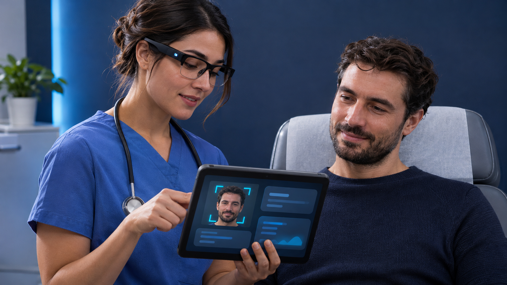
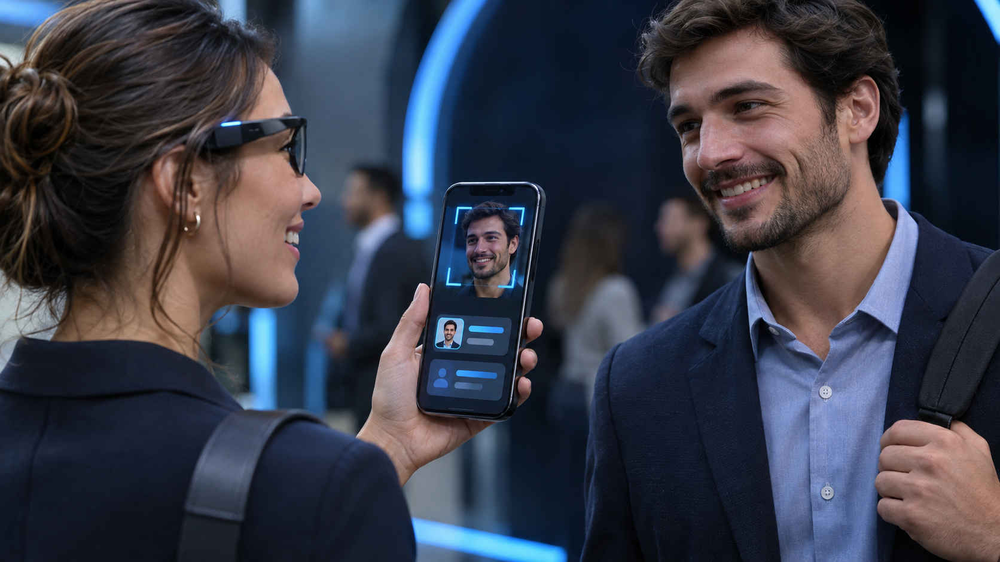
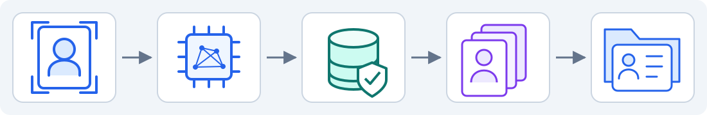
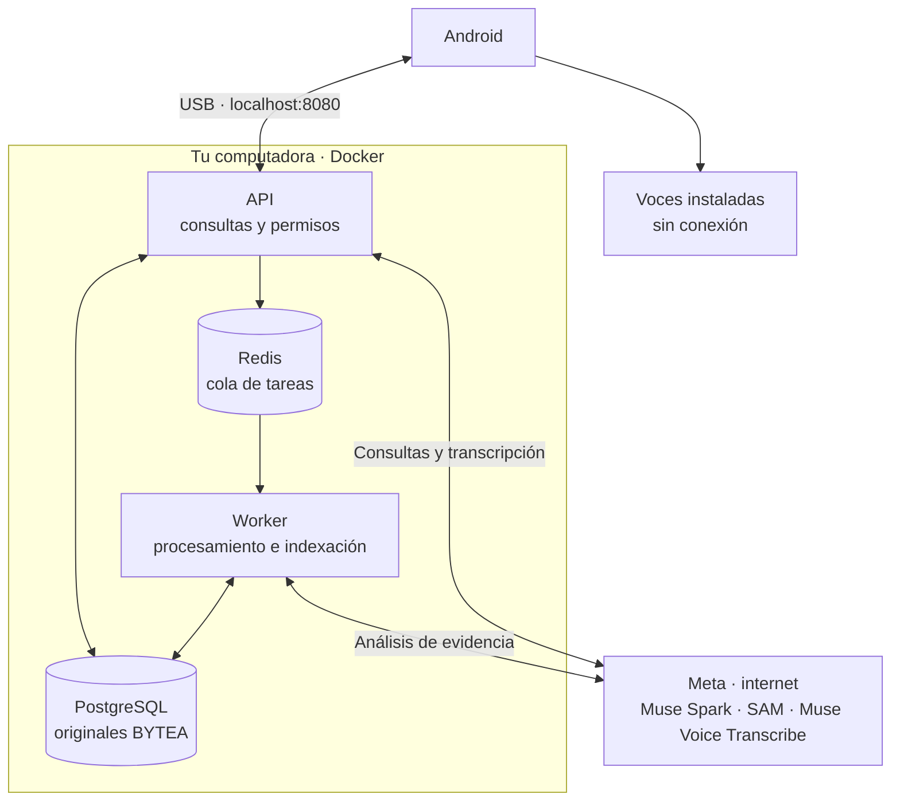

<a id="top"></a>

<p align="center">
  <a href="README.md"></a>
  <a href="../en/README.md"></a>
</p>

# RealityOS

<p align="center">
  
</p>

App Android para guardar fotos, videos y expedientes en grupos y consultar evidencia con IA. El servidor local ejecuta PostgreSQL, Redis, API y worker en Docker.

<p align="center">
  <a href="deployment/DEPLOYMENT_LINUX.md"></a>
</p>

## Windows · Git Bash

Ejecuta esta guía en **Git Bash**, desde la carpeta del proyecto. Copia los comandos sin el símbolo `$` y sin añadir `\` al final. La guía de Linux está en el botón superior.

### Preparar una vez

- Instala [Git for Windows](https://gitforwindows.org/) con su componente Git LFS. Git obtiene el proyecto y LFS obtiene el APK incluido.
- Instala [Docker Desktop](https://docs.docker.com/desktop/setup/install/windows-install/) con WSL2 y completa su primer inicio. Usa contenedores Linux y asigna **4 CPU, 8 GiB de RAM y 25 GiB libres**.
- Extrae [Platform Tools para Windows](https://dl.google.com/android/repository/platform-tools-latest-windows.zip) en `C:\`, de modo que exista **`C:\platform-tools\adb.exe`**. Si ya tienes esa carpeta, este paso está terminado. Los comandos usan esa ruta directamente.
- Conecta un celular Android 12+ por USB, activa la depuración USB y acepta la autorización en su pantalla.
- Ten tu clave Meta `MODEL_API_KEY` con acceso a Muse Spark, SAM y Muse Voice Transcribe.

Verifica ADB en Git Bash:

```bash
/c/platform-tools/adb.exe version
```

Debe mostrar su versión. Usar la ruta completa evita el error `adb: command not found` sin modificar el `PATH`.

<a id="evaluate"></a>
<a id="deploy"></a>

## 1. Obtener e iniciar el proyecto

**Solo si todavía no tienes el repositorio**, abre Git Bash en la carpeta donde lo guardarás:

```bash
git lfs install &&
git clone https://github.com/Luxisoft/realityos-spatial-memory.git &&
cd realityos-spatial-memory
```

Si ya lo tienes, abre Git Bash en la raíz del proyecto, donde está `README.md`, y continúa aquí. Actualiza el código y el APK:

```bash
git lfs install &&
git pull --ff-only &&
git lfs pull
```

Espera a que termine sin errores. Si Git informa un conflicto con cambios locales, resuélvelo antes de continuar; conserva tus archivos privados.

Para iniciar manualmente, ejecuta desde la carpeta del proyecto:

**Windows — Git Bash**

Instala Docker Desktop primero. En su primer inicio, abre la aplicación y completa su configuración, usando contenedores Linux con WSL2. El siguiente comando abre Docker Desktop si está instalado y el motor no está disponible, y espera hasta dos minutos a que responda.

```bash
powershell.exe -NoProfile -ExecutionPolicy Bypass -File ./scripts/local/Start-RealityOS.ps1
```

Si aparece `docker_engine` / `The system cannot find the file specified` o se agota la espera, abre Docker Desktop y resuelve los avisos de inicio o WSL2. Ejecuta `docker info`: debe mostrar la sección **Server** sin errores de conexión. Revisa `docker context ls` si sigue fallando y selecciona tu contexto local de Docker Desktop antes de repetir el comando. Tener instalada la terminal de Docker no basta; el motor debe estar funcionando.

Introduce tu clave Meta cuando se solicite. El instalador genera `.env.local`; mantenlo privado. La primera ejecución descarga dependencias y prepara los datos. Reiniciar conserva cambios y eliminaciones.

Los comandos de inicio, diagnóstico y parada muestran una barra de progreso en inglés basada en etapas completadas. La consola se limita a resúmenes, advertencias, errores y confirmaciones de éxito; oculta las líneas de descarga de paquetes. Una etapa larga puede mantener el mismo porcentaje mientras trabaja. El 100 % indica que terminó el comando; la indexación en segundo plano puede continuar después.

<a id="deploy-muse"></a>

<details>
<summary><strong>Muse · ejecutar esta instalación</strong></summary>

Pega este prompt en Muse con acceso a la terminal:

```text
Instala RealityOS en Windows siguiendo docs/es/README.md desde este repositorio.
Lee AGENTS.md y MUSE.md. Usa C:\platform-tools\adb.exe y el APK incluido en
android/app/build/outputs/apk/debug/app-debug.apk, obtenido con Git LFS.
Ejecuta scripts/local/Start-RealityOS.ps1 y Test-RealityOS.ps1 con PowerShell.
Pídeme la clave Meta solo en la terminal o .env.local, nunca en el chat.
Conserva mis cambios, credenciales, datos y otros servicios. No operes servidores
remotos. Comprueba el teléfono autorizado antes de instalar y abrir la app.
Informa las comprobaciones realizadas y cualquier paso pendiente.
```

</details>

<a id="android"></a>

## 2. Instalar y abrir Android

El APK ya viene en `android/app/build/outputs/apk/debug/app-debug.apk`, preparado para `http://localhost:8080/v1`. Para instalar esta compilación no necesitas Java ni Android Studio.

Con el backend iniciado y el teléfono conectado, comprueba:

```bash
/c/platform-tools/adb.exe devices
```

Debe aparecer **un solo teléfono** con estado `device`. Si aparece `unauthorized`, desbloquéalo y acepta la autorización. Si no aparece, revisa la depuración, el cable y el [controlador USB de Windows](https://developer.android.com/studio/run/oem-usb). Desconecta otros dispositivos o emuladores antes de continuar.

Desde la raíz del proyecto:

```bash
/c/platform-tools/adb.exe reverse tcp:8080 tcp:8080 &&
/c/platform-tools/adb.exe install -r android/app/build/outputs/apk/debug/app-debug.apk &&
/c/platform-tools/adb.exe shell am start -n com.luxisoft.realityos.local/com.luxisoft.realityos.MainActivity
```

Espera `Success` en la instalación. Los `&&` impiden ejecutar el siguiente comando si falla el anterior. Repite el comando `reverse` al reconectar el USB; puedes abrir la app tocando su icono.

<a id="android-build"></a>
<a id="java-windows"></a>

Si modificas Android, sigue la [guía de compilación](integrations/ANDROID.md#build). Docker solo compila el backend.

<a id="android-updates"></a>

**Para cada actualización:**

| Qué cambió | Qué ejecutar |
| --- | --- |
| Código o recursos Android | El servidor compila y sube el APK al repositorio. Repite los comandos de actualización e instalación anteriores; para cambios propios, sigue la [guía de compilación](#android-build). |
| Código del backend o configuración del servidor | Ejecuta `Start-RealityOS.ps1` para reconstruir/iniciar los servicios locales. Se conservan los datos existentes. |
| Contrato de la API que utiliza Android | Actualiza tanto el backend como el APK. |
| Solo documentación | No hace falta reconstruir la app ni los contenedores. |

`/c/platform-tools/adb.exe install -r` conserva los datos con el mismo identificador y firma. Las compilaciones publicadas desde este servidor mantienen esa firma; una compilación de otra computadora o CI puede usar otra. No desinstales automáticamente ante un conflicto. Consulta [instalación con ADB](https://developer.android.com/tools/adb#move).

`git pull` trae el APK actualizado con Git LFS activo; `/c/platform-tools/adb.exe install -r` actualiza el celular. La versión Debug incluye la fecha de compilación. Cada cambio Android requiere compilar y subir el APK junto con el código.

<a id="cases"></a>

Abre la app y elige una de las **9 cuentas de los 3 grupos: policía, enfermería y memoria**. Explora galería y expedientes; para publicar, selecciona grupo, categoría y etiqueta. Espera a que termine la indexación para buscar.

| Vista / video | Uso |
| --- | --- |
| <a href="../../demo-video/policial_case.mp4"></a> | **Policía:** consultar expedientes y evidencia del grupo. |
| <a href="../../demo-video/nurse_case.mp4"></a> | **Enfermería:** revisar registros, notas y adjuntos autorizados. |
| <a href="../../demo-video/memory.mp4"></a> | **Memoria:** encontrar dónde y cuándo se vio un objeto por última vez. |
| <a href="../../demo-video/profile_found.mp4"></a> | **Perfiles:** abrir la información autorizada de un candidato facial. |

Las imágenes y los videos son [ilustraciones conceptuales](project/GRAPHICS.md). Pulsa una miniatura para abrir su video.

<a id="biometrics"></a>

### Búsqueda facial

La búsqueda facial requiere consentimiento y enrolamiento explícitos. InsightFace devuelve candidatos para revisión humana; se abre su perfil o expediente según los permisos.



Para las respuestas habladas, instala una voz ES/EN sin conexión en Android. Repite `/c/platform-tools/adb.exe reverse tcp:8080 tcp:8080` al reconectar el teléfono.

<a id="architecture"></a>

### Arquitectura local



## 3. Diagnóstico, detención y Postman

Desde la carpeta del proyecto:

| Acción | Git Bash |
| --- | --- |
| Diagnóstico | `powershell.exe -NoProfile -ExecutionPolicy Bypass -File ./scripts/local/Test-RealityOS.ps1` |
| Detener | `powershell.exe -NoProfile -ExecutionPolicy Bypass -File ./scripts/local/Stop-RealityOS.ps1` |

API: [documentación](http://localhost:8080/docs) · [salud](http://localhost:8080/health/ready). Detener conserva los datos; `down -v` los elimina. Si falla la clave Meta, corrige `MODEL_API_KEY` en `.env.local` y vuelve a iniciar.

**Postman:** importa la [colección](../postman/RealityOS.postman_collection.json), elige **No environment → Localhost requests → 00 Quick start** o **00 Local scenarios**. El acceso es automático; para escribir, activa `enable_write_requests=true`. **Server requests** está desactivado, sin URL ni credenciales.

<a id="hackathon"></a>

[](https://github.com/Luxisoft/realityos-spatial-memory/actions/workflows/ci.yml)

[Referencia técnica](INDEX.md) · [Estado verificado](project/IMPLEMENTATION_STATUS.md) · [Licencias de terceros](project/THIRD_PARTY.md) · [Apache 2.0](../../LICENSE)
