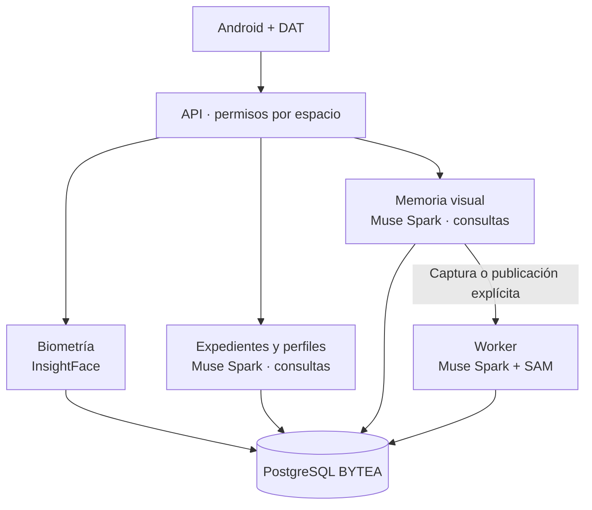

<p align="center"><a href="../../en/architecture/ARCHITECTURE.md"></a> <a href="ARCHITECTURE.md"></a></p>

# Arquitectura

[← Documentación](../INDEX.md) · [API / Postman](../api/API.md)

## Guía de lectura

| Tema | Qué debes saber |
| --- | --- |
| **Cliente** | Android Kotlin/Compose y Display nativo DAT; panel web y Display web retirados. |
| **API** | FastAPI aplica autenticación, roles y pertenencia. API y worker comparten contratos y modelos SQLAlchemy. |
| **Memoria visual** | Captura explícita → original BYTEA → Celery/Redis → hechos y evidencia. Muse Spark también interpreta consultas desde la API, sin iniciar captura ni indexación de evidencia. |
| **Biometría** | Brazo aislado InsightFace: consentimiento, enrolamientos, candidatos y contexto autorizado. No se mezcla con procesamiento de objetos. |
| **Expedientes y perfiles** | Muse Spark responde preguntas sobre contexto previamente autorizado desde la API. La lectura/importación de registros sigue su contrato propio y no requiere siempre IA. |
| **Módulos** | `app.http`, `app.providers`, `app.processing`, `app.social_features`, `app.accounts`, `app.workspaces` y `app.storage`; las fachadas conservan compatibilidad. |
| **Escala** | SQLAlchemy síncrono en handlers async; evaluar réplicas o controlador async para concurrencia alta. |



## Comandos

Ejecutar desde la raíz, con dependencias instaladas. Migraciones y procesamiento requieren el entorno elegido y autorización de sus datos.
```bash
make architecture-check
make lint
make test
```

[DATABASE ](DATABASE.md) · [META INTEGRATION ](../integrations/META_INTEGRATION.md) · [WEARABLES ](../integrations/WEARABLES.md)

Los buckets conectados son fuentes privadas por cuenta. El módulo `app.storage` autoriza descargas/importaciones; los originales importados siguen en BYTEA. Celery Beat (`scheduler`) programa sincronizaciones y el worker reutiliza el análisis de publicaciones. [Flujo de conexión](../guides/STORAGE_CONNECTIONS.md).
