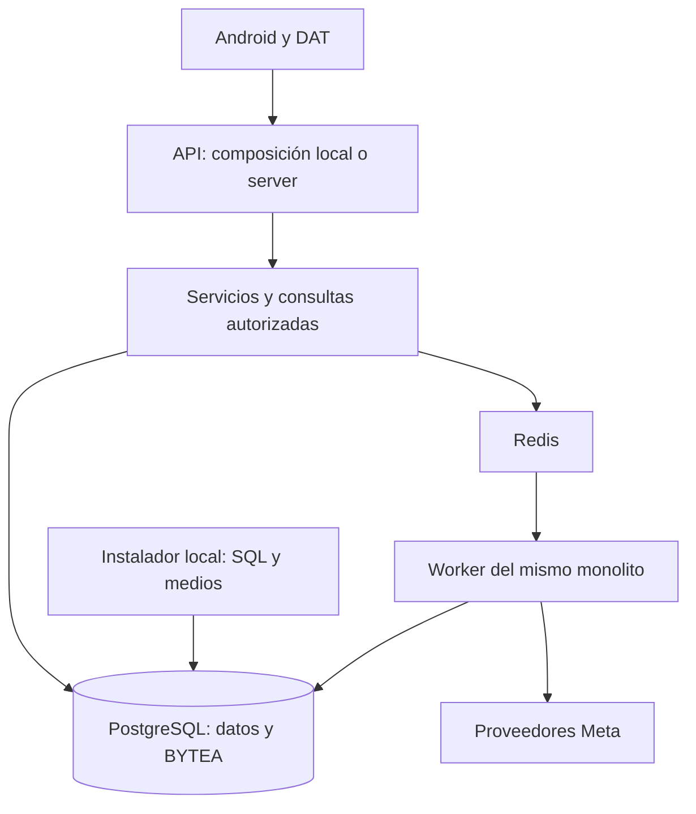

# Arquitectura

[English](../../en/architecture/ARCHITECTURE.md) · [Documentación](../INDEX.md) · [API / Postman](../api/API.md)

RealityOS mantiene un monolito modular con dos composiciones explícitas: **local**, instalada en el PC Windows/Linux del jurado, y **server**, para el servidor RealityOS. API y worker ejecutan el mismo código, contratos, servicios y modelos; separarlos en procesos no crea otras fuentes de datos. FRONTEND es el gateway remoto independiente y restringido de Meta.

## Composición y dependencias

| Capa | Responsabilidad |
| --- | --- |
| `app.runtime` | Selecciona routers y tareas por entorno; inicializa el esquema PostgreSQL. |
| `app.http`, routers de cuentas/social/expedientes | Autenticación, validación HTTP y adaptación de respuestas. |
| `app.processing`, servicios de `app.social_features`, `app.workspaces` | Operaciones, consultas y autorización por grupo. No dependen de handlers HTTP. |
| `app.providers` | Contratos y clientes de modelos; no importan la fachada `app.meta`. |
| Modelos SQLAlchemy y `app.db` | Persistencia compartida por API y worker. |
| `app.local` | Acceso local respaldado por BD y módulos de instalación separados del recorrido operativo. |
| `android/` | Única app, Kotlin/Compose y Display nativo DAT; repositorios de acceso a datos y componentes compartidos. |

`app.runtime.routers` compone las rutas sin filtrar nombres ni fragmentos de URL. El worker local no registra importadores Facebook, sincronización de buckets ni planificación remota. El servidor incorpora sus routers y tareas mediante composición explícita. Los contratos OpenAPI se verifican por entorno.

## Fuente única de datos

Las consultas de cuentas, grupos, expedientes, publicaciones y clasificación leen PostgreSQL. `simulator/database/*.sql` se consume durante la inicialización local; `simulator/media/` guarda imágenes, videos y procedencia para esa instalación. El runtime no consulta catálogos JSON paralelos. El manifiesto CSV describe archivos, licencias y hashes, no sustituye registros operativos. Los originales importados permanecen en BYTEA.

Capturar o publicar es explícito; Query no registra evidencia. La pertenencia al grupo se comprueba al leer, modificar o descargar recursos. Los servicios comparten las consultas de galería, clasificación, permisos y respuestas de medios. Las fachadas existentes conservan importaciones compatibles donde son necesarias.

El brazo biométrico `faces.py` / `face_setup.py` permanece aislado y protegido, con sus consentimientos y referencias privadas. No se integra en el procesamiento de objetos.

## Configuración y distribución

No se lee `.env` implícitamente. Los comandos seleccionan un archivo privado con `REALITYOS_ENV_FILE`; Compose inyecta variables al contenedor. `make api`, `make migrate` y `make seed` usan `ENV_FILE`, cuyo valor predeterminado es `.env.local`. Un archivo seleccionado inexistente produce un error. FRONTEND sigue la misma regla con `META_GATEWAY_ENV_FILE`; `make gateway-api` selecciona explícitamente el `runtime.env` privado del gateway.

La imagen Docker `local` incluye SQL y medios de instalación; la imagen `server` no incluye `simulator/`. Localhost tiene cuatro servicios: PostgreSQL, Redis, API y worker. Usa Meta directo con la clave privada del jurado y voces instaladas en Android. El servidor puede habilitar Facebook, buckets, correo, scheduler y ElevenLabs según su configuración privada; FRONTEND continúa como gateway permitido de respaldo.

`make architecture-check` comprueba dependencias mediante AST, prohíbe catálogos operativos JSON y limita el tamaño de los módulos. Las excepciones del código biométrico protegido y las migraciones históricas son explícitas. Las pruebas verifican los límites y la composición de cada entorno. Los handlers de consultas síncronas seleccionados usan el thread pool de FastAPI; esto no constituye una prueba de carga.

[Datos](DATABASE.md) · [Instalación local](../deployment/DEPLOYMENT_LOCALHOST.md) · [Estado verificado](../project/IMPLEMENTATION_STATUS.md)
