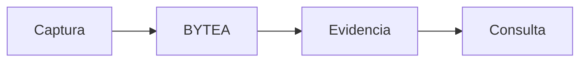

<p align="center"><a href="../../en/architecture/DATABASE.md"></a> <a href="DATABASE.md"></a></p>

# Datos y persistencia

[← Documentación](../INDEX.md) · [API / Postman](../api/API.md)

## Guía de lectura

| Tema | Qué debes saber |
| --- | --- |
| **Originales** | `media_assets.original_bytes`; videos grandes en `media_asset_chunks.content`, ordenados y con hash completo. |
| **Objetos** | `tracked_objects` representa identidad lógica; `object_observations` conserva evidencia y fecha. La ubicación se deriva de observaciones verificadas. |
| **Geometría** | Cajas Muse y máscaras SAM enlazan derivados con el original; tracks guardan PTS y máscaras RLE. |
| **Rostros** | `face_enrollments`, `biometric_consents` y `face_record_enrollments` conservan autorización, versión del modelo y evidencia. |
| **Publicaciones** | `gallery_evidence` conserva versiones inmutables; runs de indexación activan una generación completada. Traducciones EN/ES quedan persistidas. |
| **Perfiles** | El CV es privado y reemplazable; reemplazarlo limpia derivados. La proyección pública no expone archivo ni texto extraído. |
| **Migraciones** | Alembic define el esquema. La revisión desplegada se comprueba en cada release; las fechas del historial no son el estado actual del servidor. |



## Comandos

Ejecutar desde la raíz, con dependencias instaladas. Migraciones y procesamiento requieren el entorno elegido y autorización de sus datos.
```bash
make migrate
```

[ARCHITECTURE ](ARCHITECTURE.md) · [WORKSPACE DATA ](../guides/WORKSPACE_DATA.md) · [SECURITY ](SECURITY.md)

La revisión `20261103_0035` añade `storage_connections`, `storage_imports` y `storage_syncs`: conexión privada con claves cifradas, procedencia/estado de importaciones y reglas de sincronización. El bucket no sustituye los originales BYTEA. [Operación y conservación](../guides/STORAGE_CONNECTIONS.md).

## Revisión de privacidad por grupo

La revisión `20261103_0036` añade procedencia de copias (`shared_from_id`, único por original/grupo), revisión y grupo de conexión, `storage_objects` inmutables, `seen_keys` del recorrido y `biometric_setups`. La cuarentena de publicaciones biométricas conserva un diario de visibilidad para revertir la migración. Las copias comparten original, con comentarios/reacciones independientes. Los originales de enrolamiento siguen privados; solo se exponen avatares normalizados.

## Contrato único de publicaciones

La revisión `20261103_0038` hace obligatorio el grupo de cada publicación y elimina `audience` de publicaciones, candidatos, importaciones y sincronización. `GET /v1/gallery/page` es la única lista paginada, con cursor y filtros; `/me/publication-uploads` concentra la subida y revisión. Se retiran la lista por desplazamiento y las rutas de medios/publicación del perfil. Los clientes deben actualizarse. Las conexiones pueden utilizar su grupo previamente configurado, siempre revalidando la pertenencia.

Por decisión del propietario se eliminan los registros de los antiguos destinos personal/público y sin grupo. Las copias válidas en grupos conservan sus IDs, originales e interacciones. Solo se eliminan bytes sin referencias vigentes; avatares, referencias biométricas y medios de expedientes se conservan. Retirar un grupo revoca membresías e invitaciones, cancela sus operaciones pendientes y oculta sus publicaciones; se conserva su identidad histórica para mantener los enlaces de evidencia. La reversión de esquema no recupera datos eliminados: requiere la instantánea técnica temporal de la entrega.
