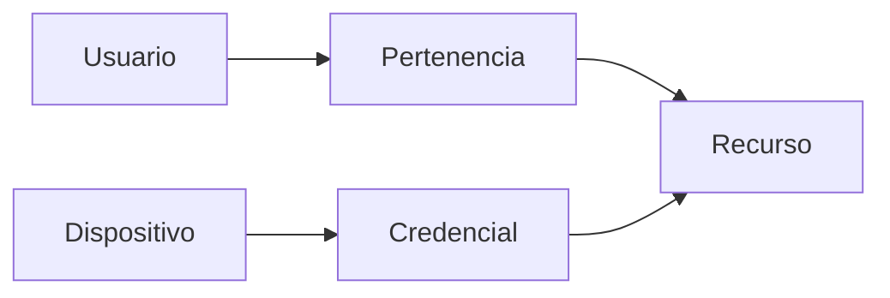

 

# Seguridad y privacidad

[← Documentación](../INDEX.md) · [API / Postman](../api/API.md)

## Guía de lectura

| Tema | Qué debes saber |
| --- | --- |
| **Sesiones** | Contraseñas con scrypt y sal; access tokens vencen y refresh tokens rotan con revocación persistida. |
| **Autorización** | Comprobar pertenencia y rol también al servir medios. Los enlaces firmados tienen alcance y vigencia limitados. |
| **Secretos** | Claves Meta/ElevenLabs, JWT, SMTP, DB e integraciones solo en runtime privado. La selección local usa cuentas autorizadas de la base de datos sin contraseñas. Los archivos Postman publicados no contienen credenciales ni URL activa del servidor. Los tokens y claves privadas quedan fuera de Git. |
| **Dispositivos** | ID público y clave independiente; solo hash con pepper en servidor. Enrolamiento, rotación y revocación auditados. |
| **Biometría** | Consentimiento y autorización por espacio; revocar consentimiento elimina enrolamientos de usuario. Candidatos requieren confirmación. |
| **Retención** | Existen bajas de recursos y borrado de CV/consentimiento; no equivalen a una política integral de retención, exportación y borrado de clientes. |
| **Operación** | TLS, CORS restringido, claves rotadas y copias privadas verificadas. SHA-256 aporta integridad, no cifrado en reposo. |

[API](../api/API.md) · [Cuentas y expedientes](../guides/WORKSPACE_DATA.md) · [Entrega del hackathon](../project/HACKATHON.md)
