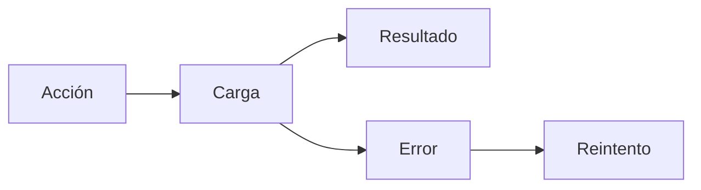

 

# Diseño e interacción

[← Documentación](../INDEX.md) · [API / Postman](../api/API.md)

## Guía de lectura

| Tema | Qué debes saber |
| --- | --- |
| **Sistema visual** | Android mantiene tema gris/azul, tipografía del sistema y controles nativos; DAT usa estilos y capacidades admitidos. |
| **Estados** | Carga, vacío, error, progreso y reintento separados; no anunciar una lista vacía antes de terminar la consulta. |
| **Evidencia** | Imagen completa señalada con fecha, fuente y confianza; detalles extensos en acciones separadas. |
| **Formularios** | Errores junto al campo, foco en el primero, teclado adecuado, autofill y contraseña visible opcional; carga bloquea doble envío. |
| **Accesibilidad** | Objetivos táctiles de 48 dp, texto hasta 200 %, controles etiquetados y gráficos decorativos fuera del lector. ES/EN. |
| **Evaluación** | Capturas Robolectric y pruebas Compose cubren estados y anchos; no sustituyen teclado, cámara ni gafas físicas. |

[WEARABLES ](../integrations/WEARABLES.md) · [DEMO ](../guides/DEMO.md) · [IMPLEMENTATION STATUS ](../project/IMPLEMENTATION_STATUS.md)

Editar perfil incorpora información personal con iconos nativos, errores junto al campo y calendario de nacimiento para las cuentas por correo. Facebook muestra esos mismos datos de solo lectura con una explicación de sincronización; biografía, contacto, enlaces y CV conservan su edición. Se mantiene el tema, teclado y texto al 200 %, y los campos se bloquean durante el guardado.
