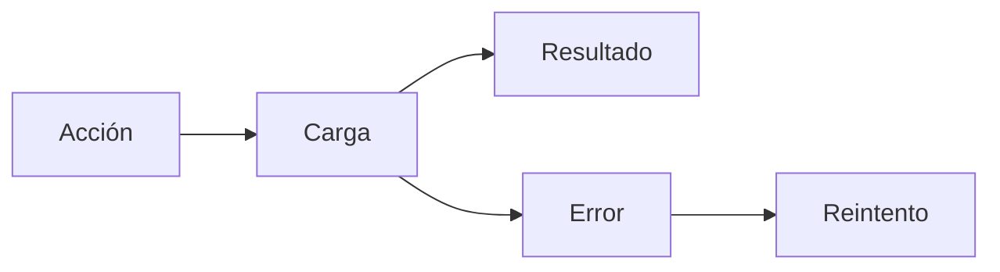

 

# Diseño e interacción

[← Documentación](../INDEX.md) · [API / Postman](../api/API.md)

## Guía de lectura

| Tema | Qué debes saber |
| --- | --- |
| **Sistema visual** | Android mantiene tema gris/azul, tipografía del sistema y controles nativos; DAT usa estilos y capacidades admitidos. |
| **Estados** | Carga, vacío, error, progreso y reintento separados; no anunciar una lista vacía antes de terminar la consulta. |
| **Evidencia** | Imagen completa señalada con fecha, fuente y confianza; detalles extensos en acciones separadas. |
| **Formularios** | Errores junto al campo, foco en el primero, teclado adecuado, autofill y contraseña visible opcional; carga bloquea doble envío. |
| **Accesibilidad** | Objetivos táctiles de 48 dp, texto hasta 200 %, controles etiquetados y gráficos decorativos fuera del lector. ES/EN. |
| **Evaluación** | Capturas Robolectric y pruebas Compose cubren estados y anchos; no sustituyen teclado, cámara ni gafas físicas. |

## Uniformidad obligatoria en toda la app

Preferencia permanente del propietario (3 de noviembre de 2026): cada pantalla,
vista y componente debe mantener la misma calidad y lenguaje visual sin que sea
necesario volver a pedirlo. Antes de implementar, comparar las vistas cercanas y
reutilizar `RealityOsTheme` y los componentes compartidos. Conservar la tipografía
del sistema, la paleta gris/azul, los radios de 12 dp, los márgenes y la jerarquía
de acciones; no crear un estilo independiente por pantalla.

En el acceso y la configuración de cuenta, usar `EntryBrandHeader`,
`EntryPrimary` y los colores compartidos `AccountMuted` y `AccountFieldSurface`.
El contenido tiene 24 dp de margen y hasta 528 dp de ancho; los botones principales
crecen desde 56 dp y los controles táctiles desde 48 dp. El contenido largo debe
desplazarse y adaptarse al texto ampliado, sin alturas de texto fijas.

El perfil de reconocimiento presenta tres pasos reales: consentimiento, foto de
perfil y referencias privadas. Resalta el paso actual, resume los completados y
muestra cuántas fotos aceptadas faltan para llegar al mínimo de tres, hasta un
máximo de 25. La foto visible se distingue de las referencias privadas. Carga,
error recuperable y envío tienen estados explícitos, sin habilitar acciones antes
del consentimiento ni completar el registro automáticamente.

Antes de entregar cambios de interfaz, revisar capturas de los estados relevantes
en español e inglés, a 320–480 dp y con texto al 200 %, además de las pruebas de
interacción y la compilación del APK. Las capturas de esta pantalla se generan con
`AccountBiometricSetupTest` en `android/app/build/outputs/recognition-design/`.

[WEARABLES ](../integrations/WEARABLES.md) · [DEMO ](../guides/DEMO.md) · [IMPLEMENTATION STATUS ](../project/IMPLEMENTATION_STATUS.md)

Editar perfil incorpora información personal con iconos nativos, errores junto al campo y calendario de nacimiento para las cuentas por correo. Facebook muestra esos mismos datos de solo lectura con una explicación de sincronización; biografía, contacto, enlaces y CV conservan su edición. Se mantiene el tema, teclado y texto al 200 %, y los campos se bloquean durante el guardado.

## Corrección de interacción del 3 de noviembre

El visor muestra progreso de carga/buffering e información expandida y desplazable sobre la navegación del sistema. Skeleton representa solo la carga inicial de datos del servidor. Buscador y conexiones administran teclado/insets en el panel raíz. Administrar grupo ocupa la ventana y cerrar sin cambios no recarga la galería. Barra: añadir grupo y selector a la izquierda; historial y acciones a la derecha; invitaciones con compartir de Android. Menú derecho: Conexiones sobre About y ES/EN sobre cerrar sesión. Cada dato de perfil muestra icono, etiqueta y valor (`-` si falta). Los avisos transitorios usan una alerta inferior con cierre inmediato, 4 segundos para información/éxito u 8 para advertencia/error, ampliados por accesibilidad. La validación de campos y los estados persistentes permanecen junto a sus controles.
