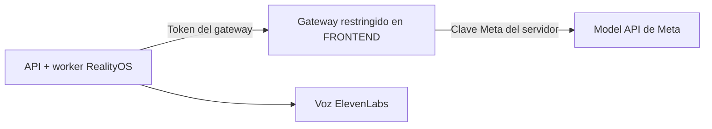

<p align="center">
  <a href="../../en/deployment/DEPLOYMENT_GATEWAY.md"></a>
  <a href="DEPLOYMENT_GATEWAY.md"></a>
</p>

# Desplegar con un gateway Meta restringido

**Envía las solicitudes Meta por un servidor de salida autorizado o úsalo como respaldo.**

[← Proyecto](../README.md) · [Servidor directo](DEPLOYMENT_DIRECT.md) · [Windows local](DEPLOYMENT_LOCALHOST.md)



**FRONTEND es el nombre del host del gateway.** Es independiente de las aplicaciones web retiradas. Este servicio sigue activo y no es un proxy de propósito general.

## Elige la ruta

| Modo | Ajustes del `.env` privado del servidor |
| --- | --- |
| Solo gateway | `META_CONNECTION_MODE=gateway` y `META_GATEWAY_FALLBACK_ENABLED=false` |
| Directo con respaldo | `META_CONNECTION_MODE=direct` y `META_GATEWAY_FALLBACK_ENABLED=true` |

```dotenv
META_CONNECTION_MODE=gateway
META_GATEWAY_FALLBACK_ENABLED=false
META_API_BASE_URL=https://api.meta.ai/v1
META_GATEWAY_BASE_URL=https://meta.luxisoft.com/v1
MODEL_API_KEY=<tu-clave-meta-privada>
META_GATEWAY_TOKEN=<tu-token-independiente-del-gateway>
```

Instala la misma clave Meta activa de forma privada en RealityOS y en el gateway para que los archivos temporales pertenezcan a la misma cuenta. Mantén independiente el token del gateway. Reinicia API/worker tras cambiar su entorno; CI conserva la ruta configurada.

## Solo se reenvían estas rutas

| Ruta | Finalidad |
| --- | --- |
| `GET /v1/models` | Verificación del catálogo de modelos. |
| `POST /v1/responses` | Solicitudes Muse Spark y SAM. |
| `POST /v1/asr/transcribe` | Muse Voice Transcribe. |
| `POST /v1/files` | Subidas temporales de video. |
| `DELETE /v1/files/{id}` | Eliminación de archivos temporales. |

Nginx exige una lista de IP permitidas **y** el servicio comprueba su token. Las solicitudes se transmiten hasta el límite configurado de 1 GiB sin guardar sus cuerpos. RealityOS consulta la síntesis ElevenLabs directamente, fuera de este gateway.

<details>
<summary><strong>Comportamiento ante fallos y reintentos</strong></summary>

El respaldo aplica a fallos de conexión, 401/403/404, 408/429 y 5xx. Las respuestas 400/422 se conservan. Cada solicitud nueva comienza por la ruta primaria configurada.

Las operaciones de archivos/video solo pueden repetirse tras un rechazo inequívoco o un fallo anterior al envío. Los envíos aceptados o ambiguos quedan como `uncertain`; no se repiten silenciosamente.

</details>

<a id="production"></a>

## Configuración productiva

Apunta `meta.luxisoft.com` al host autorizado del gateway. El [workflow productivo](../../../.github/workflows/deploy-production.yml) instala su servicio limitado a loopback, las IP permitidas en Nginx y el certificado TLS. Los trabajos de despliegue API/worker y gateway son independientes.

| Grupo de secretos de GitHub `production` | Nombres |
| --- | --- |
| Proveedores y salida | `MODEL_API_KEY`, `META_GATEWAY_TOKEN`, `GATEWAY_ALLOWED_CIDRS` |
| SSH del gateway | `FRONTEND_SSH_HOST`, `FRONTEND_SSH_USER`, `FRONTEND_SSH_PRIVATE_KEY`, `FRONTEND_SSH_KNOWN_HOSTS` |
| SSH de RealityOS | `REALITYOS_SSH_HOST`, `REALITYOS_SSH_USER`, `REALITYOS_SSH_PRIVATE_KEY`, `REALITYOS_SSH_KNOWN_HOSTS` |
| Instalación | `REALITYOS_DEPLOY_PATH`, `ACME_EMAIL` |

Son nombres de ajustes, no valores para publicar. `GATEWAY_ALLOWED_CIDRS` debe incluir la dirección de salida de RealityOS. Si usas Cloudflare, confía únicamente en sus rangos publicados y utiliza **Full (strict)** cuando exista el certificado del origen.

Comprueba las rutas permitidas, el rechazo de tokens y el reenvío multipart antes de cambiar el despliegue del gateway. La reversión selecciona un `release_tag` inmutable existente; no recupera datos. Consulta el [contrato completo del gateway](../integrations/GATEWAY.md) y la [guía operativa](DEPLOYMENT.md).

[← Proyecto](../README.md) · [English](../../en/deployment/DEPLOYMENT_GATEWAY.md)
