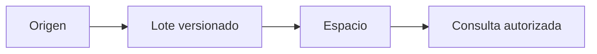

 

# Cuentas, expedientes e importaciones

[← Documentación](../INDEX.md) · [API / Postman](../api/API.md)

## Guía de lectura

| Tema | Qué debes saber |
| --- | --- |
| **Cuenta** | Registro con usuario, correo, nombre y contraseña; confirmar correo antes del acceso. El inicio de sesión acepta correo o usuario en `email`. |
| **Corregir correo** | `POST /v1/auth/change-pending-email` acepta el usuario o correo actual en `username` y verifica la contraseña de la cuenta pendiente; conserva su ID e invalida enlaces anteriores. No modifica cuentas confirmadas, activas o provisionadas. |
| **Información personal** | Las cuentas por correo editan nombre, ubicación actual, localidad de origen, fecha de nacimiento y género en `PATCH /v1/me/profile`. Facebook mantiene estos campos de solo lectura y los actualiza en cada ingreso. Fecha en `AAAA-MM-DD`; edad calculada. Los campos omitidos del PATCH se conservan. |
| **Conexión** | Un administrador crea una conexión; la clave de integración se muestra una vez y se envía por `X-RealityOS-Integration-Key`. |
| **Lote** | Hasta 100 registros y 2 MiB; versiones crecientes, relaciones por IDs externos y transacción atómica. Misma clave/contenido devuelve el resultado original; contenido distinto da 409. |
| **Tipos** | `person` (persona), `case` (caso), `event` (evento), `object` (objeto). Los registros en borrador (`draft`) o eliminados (`deleted`) no aparecen en consultas. |
| **Biometría** | Importar una persona no crea usuario ni enrolamiento. Requiere autorización trazable y enrolamiento explícito del retrato. |

[API](../api/API.md) · [Evaluación local](DEMO.md) · [Datos y persistencia](../architecture/DATABASE.md)

Para incorporar fotos, videos o un CV desde R2/S3, utiliza [Mis conexiones](STORAGE_CONNECTIONS.md). Esa conexión de medios pertenece a la cuenta; las integraciones de expedientes descritas arriba importan registros estructurados al espacio. Ambas conservan sus permisos.

## Datos locales y selección de cuenta

La composición local inicializa dos grupos, seis cuentas de acceso, 16 expedientes y 25 publicaciones mediante el SQL versionado de `simulator/database/`. La inicialización social separada añade trece perfiles sintéticos buscables mediante el flujo protegido existente. Los gráficos originales se organizan en `simulator/media/` y se importan a PostgreSQL BYTEA.

`GET /v1/auth/local-accounts` y `POST /v1/auth/local-select` consultan las cuentas autorizadas y membresías en la base de datos. La selección está restringida al ámbito local; no se publican contraseñas ni credenciales activas del servidor. El registro del servidor y las integraciones externas de expedientes pertenecen a la composición del servidor.

Todos los grupos utilizan las mismas tablas de expedientes, publicaciones y medios. Los textos preparados son descripciones operativas naturales; los campos bilingües y la procedencia interna se conservan en la base de datos. Los recibos de inicialización preservan ediciones y eliminaciones al reiniciar. No hay bases JSON por funcionalidad, listas de cuentas ni manifiestos de publicaciones atendiendo consultas de la aplicación.
