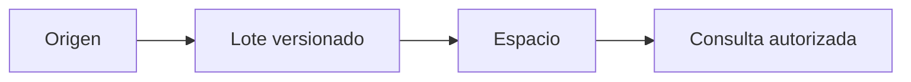

 

# Cuentas, expedientes e importaciones

[← Documentación](../INDEX.md) · [API / Postman](../api/API.md)

## Guía de lectura

| Tema | Qué debes saber |
| --- | --- |
| **Cuenta** | Registro con usuario, correo, nombre y contraseña; confirmar correo antes del acceso. Login acepta correo o usuario en `email`. |
| **Corregir correo** | `POST /v1/auth/change-pending-email` acepta el usuario o correo actual en `username` y verifica la contraseña de la cuenta pendiente; conserva su ID e invalida enlaces anteriores. No modifica cuentas confirmadas, activas o provisionadas. |
| **Información personal** | Las cuentas por correo editan nombre, ubicación actual, localidad de origen, fecha de nacimiento y género en `PATCH /v1/me/profile`. Facebook mantiene estos campos de solo lectura y los actualiza en cada ingreso. Fecha en `AAAA-MM-DD`; edad calculada. Los campos omitidos del PATCH se conservan. |
| **Conexión** | Un admin crea una conexión; la clave de integración se muestra una vez y se envía por `X-RealityOS-Integration-Key`. |
| **Lote** | Hasta 100 registros y 2 MiB; versiones crecientes, relaciones por IDs externos y transacción atómica. Misma clave/contenido devuelve el resultado original; contenido distinto da 409. |
| **Tipos** | `person`, `case`, `encounter`, `event`, `object`, `prescription`, `allergy`, `administration`. Registros draft/deleted no aparecen en consultas. |
| **Biometría** | Importar una persona no crea usuario ni enrolamiento. Requiere autorización trazable y enrolamiento explícito del retrato. |
| **Comparación clínica** | Compara campos explícitos, vigencia, alergias y antecedentes relacionados. No calcula dosis, convierte unidades, prescribe ni registra administración. |

[API ](../api/API.md) · [DEMO ](DEMO.md) · [DATABASE ](../architecture/DATABASE.md)

Para incorporar fotos, videos o un CV desde R2/S3, utiliza [Mis conexiones](STORAGE_CONNECTIONS.md). Esa conexión de medios pertenece a la cuenta; las integraciones de expedientes descritas arriba importan registros estructurados al espacio. Ambas conservan sus permisos.

Los datos preparados usan títulos y descripciones naturales, sin prefijos «Demo»
ni etiquetas de prueba en las vistas de registros y publicaciones. Se conserva
su procedencia interna. `scripts/normalize_scenario_text.py` revisa las correcciones
pendientes sin escribir; `--apply --journal <ruta-privada.json>` guarda los valores
anteriores y aplica la corrección. `--rollback --journal <ruta-privada.json>` la
revierte solo si esos campos no cambiaron después. No crea grupos, modifica
originales ni cambia versiones de evidencia o autorizaciones biométricas.
