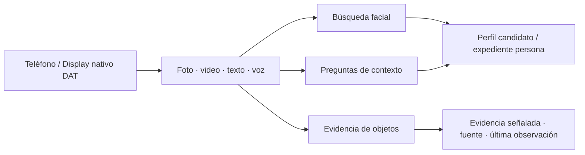

<a id="top"></a>

<p align="center">
  <a href="../../en/integrations/ANDROID.md"></a>
  <a href="ANDROID.md"></a>
</p>

# RealityOS para Android y gafas

[API / Postman](../api/API.md) · [Todas las guías](../INDEX.md)

**Reconocimiento facial, expedientes, contexto social y memoria visual en una app Android.**
El teléfono y el Display nativo de Meta conectan un rostro con su contexto autorizado, abren expedientes y recuperan evidencia visual fechada.

[← Proyecto](../README.md) · [Compilar](#build) · [Vista previa](#preview) · [Gafas físicas](#glasses) · [Windows local](../deployment/DEPLOYMENT_LOCALHOST.md)



| Capacidad | Qué permite abrir |
| --- | --- |
| **Búsqueda facial biométrica** | Elegir espacio y foto/video; revisar la evidencia del candidato y abrir su perfil o expediente autorizado. |
| **Expedientes de Trabajo** | Casos, personas, atenciones, notas y adjuntos; comparación explícita de campos de medicación. |
| **Perfiles sociales** | Información autorizada del perfil, publicaciones y contexto del grupo; el CV tiene privacidad independiente. |
| **Memoria visual** | Preguntar por texto o voz y revisar una foto/fotograma guardado con su fuente y fecha de última observación. |

[Recorridos policial, enfermería, social y memoria →](../guides/DEMO.md). La búsqueda facial usa el servicio aislado InsightFace; separa las coincidencias de usuarios y expedientes, ambas sujetas a confirmación humana.

## Elige una experiencia

| App Android habitual | Vista previa Debug en teléfono | Meta Ray-Ban Display físicas |
| --- | --- | --- |
| Perfil, Trabajo, Buscar y expedientes por espacio. | Mock Device Kit oficial con cámara y micrófono del teléfono. | Integración DAT oficial con hardware compatible emparejado. |
| Acceso por correo o Facebook. | Disponible en el Debug habitual; excluida de Release. | Requiere emparejamiento, configuración de desarrollo y permisos DAT. |

**Android es la única app.** El panel del navegador y la web Display alojados están retirados. La experiencia de las gafas sigue siendo nativa de Android.

## Entrar con una cuenta de prueba

Recibe el APK, usuario, contraseña y grupo en una sola [ficha de acceso](../guides/DEMO.md#handoff). Entra por **Continuar con correo → Iniciar sesión**. Las nueve cuentas de escenario ya tienen avatar, publicaciones y grupo asignado; los retratos de personas están en sus expedientes. [Pasos para instalar y entrar →](../README.md#evaluate)

Al abrir **Mis conexiones**, las consultas del perfil, los recursos y las subidas comparten una sola renovación de sesión. Un error temporal o de permisos conserva el acceso; una renovación rechazada por credenciales vencidas o revocadas exige iniciar sesión de nuevo. Las respuestas pendientes de una cuenta anterior se descartan al cambiar de cuenta o cerrar sesión.

Al restaurar una cuenta guardada, la app ofrece **Reintentar** si la verificación no está disponible, sin admitir una cuenta sin verificar ni borrar sus credenciales. Salir de la pantalla cancela la verificación sin cerrar sesión. Las descargas y el audio de respuesta también comparten la renovación. Si un recurso sigue rechazando el acceso tras una renovación correcta, muestra un error sin borrar toda la sesión. Las respuestas atrasadas del inicio o cierre de sesión no pueden borrar una cuenta nueva.

Las regresiones Android cubren consultas simultáneas, acceso vencido y revocado, errores de permisos y servidor, cambio de cuenta, cancelación de la restauración, descargas, subidas y audio. `RestoredAccountSessionTest` comprueba los controles de recuperación en ES/EN, a 320 dp y con texto al 200 %; la batería completa se ejecuta con `./gradlew :app:testDebugUnitTest` desde `android/`. Estas pruebas no sustituyen la aceptación en teléfono o gafas físicas.

<a id="build"></a>

## Compilar e instalar

Requisitos: **Java 21**, **Android SDK 36**, un teléfono o emulador Android 12+ y ADB para instalar. Desde la raíz del repositorio:

```bash
cd android
ANDROID_HOME=/opt/android-sdk ANDROID_SDK_ROOT=/opt/android-sdk ./gradlew :app:assembleDebug
adb install -r app/build/outputs/apk/debug/app-debug.apk
```

El único APK Debug instalable está en `android/app/build/outputs/apk/debug/app-debug.apk`. La fecha de compilación aparece en el nombre de versión, no en copias adicionales del archivo.

También puedes descargar `realityos-android-debug-apk` de una [ejecución de CI aprobada](https://github.com/Luxisoft/realityos-spatial-memory/actions/workflows/ci.yml). Los artefactos duran 14 días y pueden exigir acceso a GitHub. La firma de Release se configura por separado.

<details>
<summary><strong>Dirección del servidor y configuración privada</strong></summary>

La URL de la API se elige al compilar: primero `REALITYOS_API_BASE_URL`, después la propiedad Gradle `realityosApiBaseUrl` y finalmente `https://realityos.luxisoft.com/v1`. No es un ajuste editable de la cuenta.

Para el modo de desarrollo local de DAT, el archivo ignorado `android/local.properties` puede contener:

```properties
sdk.dir=/opt/android-sdk
mwdat_application_id=0
mwdat_client_token=0
```

Para un canal de publicación Meta, utiliza los valores del Wearables Developer Center en ese archivo privado. Las claves de Model API y las credenciales de dispositivos RealityOS permanecen fuera de Git y de este README. El servidor entrega las credenciales del dispositivo virtual en tiempo de ejecución.

</details>

<a id="preview"></a>

## Prueba el Display en tu teléfono

| Paso | Acción |
| --- | --- |
| **1 · Entra** | Instala el APK Debug habitual, inicia sesión y abre Meta Ray-Ban Display. |
| **2 · Vista previa** | Elige la vista previa dentro de la app e inicia las gafas virtuales. El servidor debe usar `META_MODE=live` para aprovisionar el dispositivo virtual. |
| **3 · Captura** | Concede permisos de cámara y audio cuando se soliciten. La vista previa usa fotos/video reales de CameraX y servicios de voz del teléfono. |
| **4 · Consulta** | Busca evidencia existente mediante foto o voz. El resultado conserva su fuente y la fecha en que se vio por última vez. |

El transporte virtual simula las gafas; las entradas de sensores y el procesamiento autorizado del servidor son reales. Solo se suben capturas tras una acción explícita. La variante Debug local aislada no habilita el arranque automático del dispositivo virtual ni su vista previa.

<details>
<summary><strong>Vista previa del SDK en Chrome y ciclo de la cámara</strong></summary>

Si la vista previa Debug ofrece Chrome, selecciónalo, conecta el teléfono por USB y ejecuta el reenvío de puerto que muestra la app:

```bash
adb forward tcp:<port> tcp:<port>
```

Abre la URL localhost indicada con Meta Ray-Ban Display Simulator habilitado. Es la vista de desarrollo local del SDK, independiente de la web Display alojada que se retiró. Al detener Developer Preview se cierra su servidor local.

Buscar y Capturar mantienen disponible la navegación de la app. Cerrar el visor libera sensores; las respuestas tardías no deben reabrir una cámara anterior. Las cargas pendientes pertenecen a su cuenta, conservan su destino y usan el flujo existente de confirmación de duplicados y reintentos.

</details>

<a id="glasses"></a>

## Utiliza gafas físicas

1. Solicita a un administrador que aprovisione la identidad del dispositivo mediante el flujo admitido.
2. Empareja unas Meta Ray-Ban Display compatibles, habilita Meta AI Developer Mode y concede los permisos DAT.
3. Registra con Meta AI y conecta Display para usar sus pantallas nativas de captura, consulta y evidencia.

Las gafas físicas usan las capacidades de cámara y voz de DAT; la vista previa Debug usa sensores del teléfono. Las respuestas habladas usan el flujo autenticado de voz del servidor y se reproducen en la salida activa del teléfono o Bluetooth. Consulta la [guía de gafas](WEARABLES.md) para conocer el comportamiento completo y la validación física pendiente.

<details>
<summary><strong>Navegación, visor de evidencia e idiomas</strong></summary>

La navegación inferior del teléfono agrupa **Perfil / Trabajo / Buscar**. El menú lateral ofrece Meta Display, ajustes y cierre de sesión. Perfil contiene publicaciones y el CV privado; Trabajo contiene expedientes del espacio.

El visor mantiene visible la imagen completa y limita su panel de información desplegable al 45% de la altura. La fecha de publicación y la confianza visual preceden al título y las notas; los resultados se ordenan por confianza visual.

La información en español e inglés se guarda con las publicaciones y se reutiliza en búsqueda e historial. Abrir un resultado lee la información preparada. Los textos antiguos que falten tienen un flujo explícito de preparación y reintento, con estado de pendiente o error visible. El idioma seleccionado no debe sustituirse silenciosamente por otro.

</details>

## Verifica una compilación

Desde la raíz del repositorio:

```bash
make android-check
```

Con un emulador o dispositivo adecuado conectado, desde `android/`:

```bash
./gradlew :app:connectedDebugAndroidTest
./gradlew :app:testDebugUnitTest --tests com.luxisoft.realityos.PhoneCaptureTouchTest
```

Mock Device Kit y las pruebas Compose/Robolectric no reemplazan la validación física de cámara, micrófono, Bluetooth o gafas. Las comprobaciones realizadas constan en el [estado de implementación](../project/IMPLEMENTATION_STATUS.md).

## Instalación Windows independiente

Utiliza [Windows + Docker Desktop](../deployment/DEPLOYMENT_LOCALHOST.md). La variante local usa `-PlocalDevelopment=true`, HTTP de loopback y el identificador independiente `com.luxisoft.realityos.local`. Exige que el backend confirme su entorno local y permite entrar con contraseña local. Las cuentas locales y productivas permanecen separadas; las funciones faciales conservan su autorización propia.

[← Proyecto](../README.md) · [English](../../en/integrations/ANDROID.md) · [↑ Volver arriba](#top)
