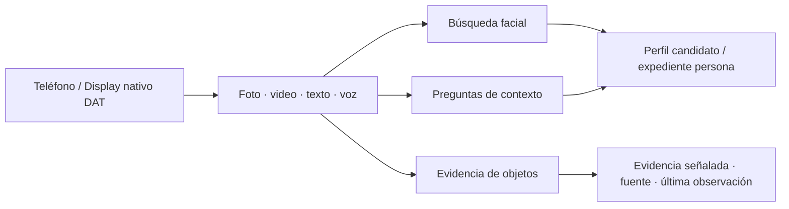

<a id="top"></a>

<p align="center">
  <a href="../../en/integrations/ANDROID.md"></a>
  <a href="ANDROID.md"></a>
</p>

# RealityOS para Android y gafas

[API / Postman](../api/API.md) · [Todas las guías](../INDEX.md)

**Reconocimiento facial, expedientes, contexto social y memoria visual en una app Android.**
El teléfono y el Display nativo de Meta conectan un rostro con su contexto autorizado, abren expedientes y recuperan evidencia visual fechada.

[← Proyecto](../README.md) · [Compilar](#build) · [Vista previa](#preview) · [Gafas físicas](#glasses) · [Windows local](../deployment/DEPLOYMENT_LOCALHOST.md)



| Capacidad | Qué permite abrir |
| --- | --- |
| **Búsqueda facial biométrica** | Elegir espacio y foto/video; revisar la evidencia del candidato y abrir su perfil o expediente autorizado. |
| **Expedientes de Trabajo** | Casos, personas, eventos, notas y adjuntos del grupo seleccionado. |
| **Perfiles sociales** | Información autorizada del perfil, publicaciones y contexto del grupo; el CV tiene privacidad independiente. |
| **Memoria visual** | Preguntar por texto o voz y revisar una foto/fotograma guardado con su fuente y fecha de última observación. |

[Recorridos de Policía y Meta Social Media →](../guides/DEMO.md). La búsqueda facial usa el servicio aislado InsightFace; separa las coincidencias de usuarios y expedientes, ambas sujetas a confirmación humana.

## Elige una experiencia

| App Android habitual | Vista previa Debug en teléfono | Meta Ray-Ban Display físicas |
| --- | --- | --- |
| Perfil, Trabajo, Buscar y expedientes por espacio. | Mock Device Kit oficial con cámara y micrófono del teléfono. | Integración DAT oficial con hardware compatible emparejado. |
| Acceso por correo o Facebook. | Disponible en el Debug habitual; excluida de Release. | Requiere emparejamiento, configuración de desarrollo y permisos DAT. |

**Android es la única app.** El panel del navegador y la web Display alojados están retirados. La experiencia de las gafas sigue siendo nativa de Android.

## Entrar con una cuenta de prueba

Instala el APK Debug canónico y abre el selector local. Sus seis cuentas pertenecen a Policía o Meta Social Media; los avatares y publicaciones de grupo están preparados en la base local. Los retratos siguen enlazados a expedientes policiales. No se publica ninguna contraseña. [Pasos para instalar y entrar →](../README.md#evaluate)

Al abrir **Mis conexiones**, las consultas del perfil, los recursos y las subidas comparten una sola renovación de sesión. Un error temporal o de permisos conserva el acceso; una renovación rechazada por credenciales vencidas o revocadas exige iniciar sesión de nuevo. Las respuestas pendientes de una cuenta anterior se descartan al cambiar de cuenta o cerrar sesión.

Al restaurar una cuenta guardada, la app ofrece **Reintentar** si la verificación no está disponible, sin admitir una cuenta sin verificar ni borrar sus credenciales. Salir de la pantalla cancela la verificación sin cerrar sesión. Las descargas y el audio de respuesta también comparten la renovación. Si un recurso sigue rechazando el acceso tras una renovación correcta, muestra un error sin borrar toda la sesión. Las respuestas atrasadas del inicio o cierre de sesión no pueden borrar una cuenta nueva.

Las regresiones Android cubren consultas simultáneas, acceso vencido y revocado, errores de permisos y servidor, cambio de cuenta, cancelación de la restauración, descargas, subidas y audio. `RestoredAccountSessionTest` comprueba los controles de recuperación en ES/EN, a 320 dp y con texto al 200 %; la batería completa se ejecuta con `./gradlew :app:testDebugUnitTest` desde `android/`. Estas pruebas no sustituyen la aceptación en teléfono o gafas físicas.

<a id="build"></a>

## Compilar e instalar

<a id="android-build"></a>

Si modificas Android, genera un APK nuevo en el servidor o en una computadora con [JDK 21 y Android SDK 36](#java-windows). Un APK descargado solo contiene el código de su compilación; Docker prepara el backend. Desde la raíz del repositorio:

**Windows — PowerShell**

```powershell
$env:REALITYOS_API_BASE_URL = "http://localhost:8080/v1"
.\android\gradlew.bat -p android -PlocalDevelopment=true :app:assembleDebug
if ($LASTEXITCODE -ne 0) { throw "Android build failed. Do not install an older APK." }
```

Espera a **BUILD SUCCESSFUL**. Se reemplaza `android/app/build/outputs/apk/debug/app-debug.apk`. Instálalo y ábrelo desde la raíz del repositorio:

En Git Bash, usa los [comandos de instalación del README](../README.md#android).

<a id="java-windows"></a>

### Entrega del APK por Git LFS (mantenimiento)

Para la entrega oficial, compila en un directorio aislado del servidor con su firma existente; consulta `.runtime/apk-build-connection.json` en el PC que inicia el build. No cambies servicios ni datos del servidor. Desde Windows, sube un script Bash con `scp` y ejecútalo con `ssh … 'bash /ruta/script.sh'`; evita anidar comandos Bash y comillas dentro de PowerShell.

Si se interrumpe la publicación, reutiliza el APK terminado cuando las fuentes Android coincidan con `origin/main`, las pruebas hayan pasado, la configuración sea local y `apksigner verify --print-certs` confirme la firma anterior. No hace falta recompilar por un error de comillas. Descarga el APK al checkout de entrega actualizado en `main`, en su única ruta canónica. No cambies de rama dentro del build con fuentes modificadas.

La ruta ya está configurada en `.gitattributes`; no repitas `git lfs track`. Desde Git Bash en el checkout de entrega:

```bash
git lfs install
git add android/app/build/outputs/apk/debug/app-debug.apk
git diff --cached --stat
git show :android/app/build/outputs/apk/debug/app-debug.apk
git commit -m "build(android): refresh canonical Debug APK"
git push origin main
```

Antes del commit, `git show` debe mostrar un puntero LFS con `oid sha256` y `size`, no bytes del APK. Comprueba que ese OID coincida con `sha256sum` del APK validado. El hook de LFS sube el archivo durante `git push`; verifica después el puntero remoto y la descarga LFS. Los usuarios ejecutan `git pull --ff-only` y `git lfs pull` antes de instalar.

### Java y Android SDK — solo para compilar

Para [compilar desde código](#android-build), usa **JDK 21 LTS** y **Android SDK 36**. Si instalas el APK publicado, puedes omitir esta sección. En Windows:

1. Instala [Temurin 21 x64](https://adoptium.net/temurin/releases/?version=21&os=windows&arch=x64&package=jdk), paquete **JDK**, instalador MSI.
2. En **Variables de entorno**, configura `JAVA_HOME` con la carpeta instalada, sin comillas ni `\bin`. **La variable de usuario tiene prioridad sobre la del sistema**: si existen ambas, usa la misma ruta válida. Corrige también `JDK_HOME` si apunta a una instalación vieja.
3. Coloca `%JAVA_HOME%\bin` primero entre las entradas de Java del `Path`. Cierra completamente el editor y las terminales; abre una PowerShell nueva:

```powershell
$env:JAVA_HOME
Test-Path "$env:JAVA_HOME\bin\java.exe"
& "$env:JAVA_HOME\bin\java.exe" -version
java -version
javac -version
```

Debe aparecer `True` y versión **21**. Si el editor conserva una ruta vieja, elimínala de `java.home` o `java.jdt.ls.java.home`. En Android Studio, selecciona JDK 21 en **Settings → Build, Execution, Deployment → Build Tools → Gradle → Gradle JDK**.

Instala Android SDK Platform 36, Build-Tools 36.0.0 y Platform Tools desde SDK Manager de Android Studio. Configura `ANDROID_HOME` con la carpeta del SDK, o `sdk.dir` en el archivo ignorado `android/local.properties`. Para instalar usa `C:\platform-tools\adb.exe`, como indica el README.

Con esas herramientas listas, sigue [Compilar desde código](#android-build). Gradle utiliza el Wrapper del repositorio; no necesitas instalar Gradle por separado.

<details>
<summary><strong>Dirección del servidor y configuración privada</strong></summary>

La URL de la API se elige al compilar: primero `REALITYOS_API_BASE_URL` y después la propiedad Gradle `realityosApiBaseUrl`. Debug usa `localDevelopment=true` por defecto y, sin URL explícita, `http://localhost:8080/v1`. Con `localDevelopment=false`, el valor predeterminado es `https://realityos.luxisoft.com/v1` y se exige HTTPS. No es un ajuste editable de la cuenta.

Para el modo de desarrollo local de DAT, el archivo ignorado `android/local.properties` puede contener:

```properties
sdk.dir=/opt/android-sdk
mwdat_application_id=0
mwdat_client_token=0
```

Para un canal de publicación Meta, utiliza los valores del Wearables Developer Center en ese archivo privado. Las claves de Model API y las credenciales de dispositivos RealityOS permanecen fuera de Git y de este README. El servidor entrega las credenciales del dispositivo virtual en tiempo de ejecución.

</details>

<a id="preview"></a>

## Prueba el Display en tu teléfono

| Paso | Acción |
| --- | --- |
| **1 · Entra** | Instala el APK Debug, selecciona una cuenta local o inicia sesión según el entorno y abre Meta Ray-Ban Display. |
| **2 · Vista previa** | Tras conceder Bluetooth, la vista previa inicia las gafas virtuales automáticamente si no hay un Display físico disponible. El menú Controles permite reintentar o cambiar el modo. Localhost usa el perfil emitido al seleccionar la cuenta; el entorno servidor requiere `META_MODE=live` para aprovisionar el dispositivo virtual. |
| **3 · Captura** | Concede permisos de cámara y audio cuando se soliciten. La vista previa usa fotos/video reales de CameraX y servicios de voz del teléfono. |
| **4 · Consulta** | Busca evidencia existente mediante foto o voz. El resultado conserva su fuente y la fecha en que se vio por última vez. |

El transporte virtual simula las gafas; las entradas de sensores y el procesamiento autorizado del servidor son reales. Solo se suben capturas tras una acción explícita. La variante Debug local inicia el mismo simulador del Display, conservando sus cuentas y API locales. Abrir la vista previa no inicia la cámara, el micrófono ni una captura.

<details>
<summary><strong>Vista previa del SDK en Chrome y ciclo de la cámara</strong></summary>

Si la vista previa Debug ofrece Chrome, selecciónalo, conecta el teléfono por USB y ejecuta el reenvío de puerto que muestra la app:

```bash
adb forward tcp:<port> tcp:<port>
```

Abre la URL localhost indicada con Meta Ray-Ban Display Simulator habilitado. Es la vista de desarrollo local del SDK, independiente de la web Display alojada que se retiró. Al detener Developer Preview se cierra su servidor local.

Buscar y Capturar mantienen disponible la navegación de la app. Cerrar el visor libera sensores; las respuestas tardías no deben reabrir una cámara anterior. Las cargas pendientes pertenecen a su cuenta, conservan su destino y usan el flujo existente de confirmación de duplicados y reintentos.

</details>

<a id="glasses"></a>

## Utiliza gafas físicas

1. Solicita a un administrador que aprovisione la identidad del dispositivo mediante el flujo admitido.
2. Empareja unas Meta Ray-Ban Display compatibles, habilita Meta AI Developer Mode y concede los permisos DAT.
3. Registra con Meta AI y conecta Display para usar sus pantallas nativas de captura, consulta y evidencia.

Las gafas físicas usan las capacidades de cámara y voz de DAT; la vista previa Debug usa sensores del teléfono. Las respuestas habladas usan el flujo autenticado de voz del servidor y se reproducen en la salida activa del teléfono o Bluetooth. Consulta la [guía de gafas](WEARABLES.md) para conocer el comportamiento completo y la validación física pendiente.

<details>
<summary><strong>Navegación, visor de evidencia e idiomas</strong></summary>

La navegación inferior del teléfono agrupa **Perfil / Trabajo / Buscar**. El menú lateral ofrece Meta Display, ajustes y cierre de sesión. Perfil contiene publicaciones y el CV privado; Trabajo contiene expedientes del espacio.

El visor mantiene visible la imagen completa y limita su panel de información desplegable al 45% de la altura. La fecha de publicación y la confianza visual preceden al título y las notas; los resultados se ordenan por confianza visual.

La información en español e inglés se guarda con las publicaciones y se reutiliza en búsqueda e historial. Abrir un resultado lee la información preparada. Los textos antiguos que falten tienen un flujo explícito de preparación y reintento, con estado de pendiente o error visible. El idioma seleccionado no debe sustituirse silenciosamente por otro.

</details>

## Verifica una compilación

Desde la raíz del repositorio:

```bash
make android-check
```

Con un emulador o dispositivo adecuado conectado, desde `android/`:

```bash
./gradlew :app:connectedDebugAndroidTest
./gradlew :app:testDebugUnitTest --tests com.luxisoft.realityos.PhoneCaptureTouchTest
```

Mock Device Kit y las pruebas Compose/Robolectric no reemplazan la validación física de cámara, micrófono, Bluetooth o gafas. Las comprobaciones realizadas constan en el [estado de implementación](../project/IMPLEMENTATION_STATUS.md).

## Instalación Windows independiente

Utiliza [Windows + Docker Desktop](../deployment/DEPLOYMENT_LOCALHOST.md). La variante local usa `-PlocalDevelopment=true`, HTTP de loopback y el identificador independiente `com.luxisoft.realityos.local`. Exige que el backend confirme su entorno local y permite entrar con contraseña local. Las cuentas locales y productivas permanecen separadas; las funciones faciales conservan su autorización propia.

[← Proyecto](../README.md) · [English](../../en/integrations/ANDROID.md) · [↑ Volver arriba](#top)
