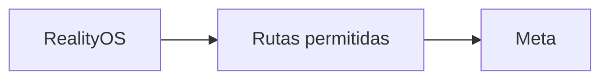

<p align="center"><a href="../../en/integrations/GATEWAY.md"></a> <a href="GATEWAY.md"></a></p>

# Gateway Meta

[← Documentación](../INDEX.md) · [API / Postman](../api/API.md)

## Guía de lectura

| Tema | Qué debes saber |
| --- | --- |
| **Función** | Egreso restringido en FRONTEND; no es un proxy general ni la antigua interfaz web. |
| **Rutas** | Solo `GET /v1/models`, `POST /v1/responses`, `POST /v1/asr/transcribe`, `POST /v1/files`, `DELETE /v1/files/{id}`. |
| **Credenciales** | `X-RealityOS-Gateway-Token` independiente y allowlist IP. El gateway añade Bearer Meta; no guarda cuerpos. |
| **Selección** | `META_CONNECTION_MODE=direct` o `gateway`; `META_GATEWAY_FALLBACK_ENABLED=true` habilita respaldo. Reiniciar API/worker tras cambiar runtime. |
| **Reintentos** | No repetir streams aceptados ni subidas ambiguas. Fallos 400/422 se devuelven; revisar origen antes de reenviar. |
| **Subidas** | Hasta 1 GiB en gateway; un CDN puede imponer menos. Para archivos grandes, usar ruta privada o DNS directo autorizado. |



## Comandos

Ejecutar desde la raíz, con dependencias instaladas. Migraciones y procesamiento requieren el entorno elegido y autorización de sus datos.
```bash
make gateway-api
```

El gateway lee variables de entorno inyectadas y no descubre `.env`. `make gateway-api` selecciona explícitamente `infrastructure/gateway/runtime.env`; `GATEWAY_ENV_FILE=/ruta/gateway.env` permite elegir otro archivo privado. Uvicorn directo puede seleccionarlo con `META_GATEWAY_ENV_FILE`. Un archivo seleccionado inexistente impide el arranque. Compose usa `META_GATEWAY_ENV_FILE` para elegir su archivo del host e inyecta los valores, sin leer archivos adicionales dentro del contenedor. Copia el `runtime.env.example` versionado solo al preparar un entorno gateway autorizado y conserva privado el archivo completo.

[DEPLOYMENT GATEWAY ](../deployment/DEPLOYMENT_GATEWAY.md) · [DEPLOYMENT DIRECT ](../deployment/DEPLOYMENT_DIRECT.md) · [TTS ](TTS.md)
