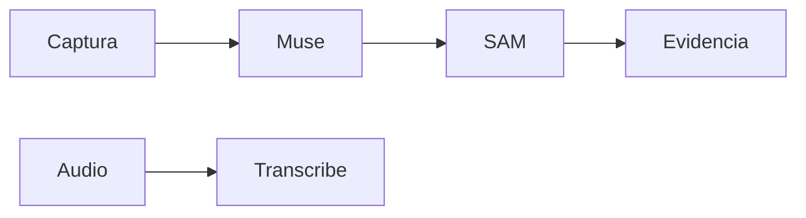

 

# Integración Meta

[← Documentación](../INDEX.md) · [API / Postman](../api/API.md)

## Guía de lectura

| Tema | Qué debes saber |
| --- | --- |
| **Muse Spark 1.3** | Análisis de hechos visibles, interpretación de consultas y preparación de textos EN/ES con contexto autorizado. |
| **Expedientes y perfiles** | Muse Spark responde consultas contextuales desde la API mediante `answer_profile_question`; también prepara contexto privado del CV con `extract_profile_context`. El almacenamiento y las importaciones no dependen de una respuesta generada. |
| **IA biométrica independiente** | InsightFace detecta y representa rostros para comparar candidatos autorizados. No es un modelo Meta ni pasa por el worker de segmentación de objetos. |
| **SAM 3.1** | Segmentación explícita y análisis de publicaciones en worker. Grupos de hasta 16 objetos; conservar geometría y evidencia originales. |
| **Video** | Files API temporal y streaming SAM; conservar PTS y RLE. Envíos ambiguos quedan inciertos, sin repetición automática. |
| **Traducciones** | Se preparan y guardan al publicar o mediante una acción explícita. Abrir información de evidencia lee textos preparados. |
| **Conexión** | `.env` selecciona `direct` o `gateway`; FRONTEND puede ser respaldo. Clave Meta privada en ambos servidores. |
| **Mock / Live** | Mock determinista y rotulado; Live no cae a mock silenciosamente. Las verificaciones pasadas no prueban un nuevo request Live. |

[GATEWAY ](GATEWAY.md) · [TTS ](TTS.md) · [IMPLEMENTATION STATUS ](../project/IMPLEMENTATION_STATUS.md)
