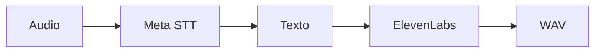

> **Corrección vigente: localhost principal.** Windows/Linux x64 ejecutan PostgreSQL, Redis, API y worker. Meta usa la clave propia del jurado; voz de salida instalada en Android. Gateway, buckets, Facebook, SMTP, scheduler y ElevenLabs están fuera del recorrido local. La configuración remota que aparece en esta guía es histórica. [Instalación vigente](../deployment/DEPLOYMENT_LOCALHOST.md).

 

# Voz y transcripción

[← Documentación](../INDEX.md) · [API / Postman](../api/API.md)

## Guía de lectura

| Tema | Qué debes saber |
| --- | --- |
| **Entrada** | Muse Voice Transcribe convierte audio a texto; Muse Spark interpreta contexto. |
| **Salida** | `POST /v1/tts`, `{text, language}` con `en`/`es`, devuelve WAV PCM mono de 24 kHz. Usuario o dispositivo autenticado. |
| **Proveedor** | ElevenLabs exclusivamente para síntesis, en servidor y Windows. No hay pesos ni modelo de voz local. |
| **Configuración** | `ELEVENLABS_API_KEY` privada; selección por `ELEVENLABS_VOICE_ID`, `ELEVENLABS_MODEL_ID`, `TTS_TIMEOUT_SECONDS`. |
| **Límites** | Dos generaciones simultáneas por proceso; presupuesto HTTP de 30 s, hasta 300 s de audio y 16 MiB WAV. |
| **Persistencia** | La síntesis no guarda capturas, mensajes ni cachés. Sin reintento automático ambiguo; no confundir con rutas que guardan audio de chat. |

[API ](../api/API.md) · [META INTEGRATION ](META_INTEGRATION.md) · [DEPLOYMENT LOCALHOST ](../deployment/DEPLOYMENT_LOCALHOST.md)
