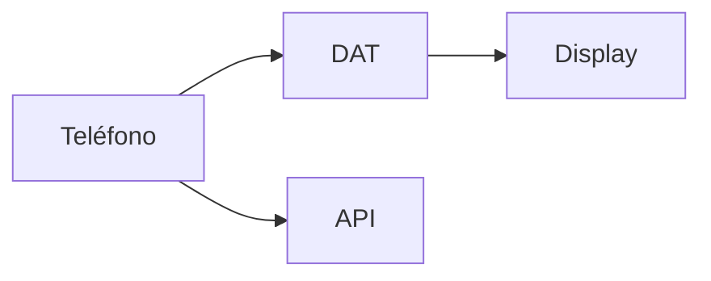

<p align="center"><a href="../../en/integrations/WEARABLES.md"></a> <a href="WEARABLES.md"></a></p>

# Android y gafas Meta

[← Documentación](../INDEX.md) · [API / Postman](../api/API.md)

## Guía de lectura

| Tema | Qué debes saber |
| --- | --- |
| **Host** | Android gestiona Bluetooth, permisos, red y estado. DAT 1.0.1 ofrece cámara, voz y Display nativo. |
| **Buscar** | Foto de objeto o rostro y consulta de voz; sondas efímeras y resultados autorizados. No abre una sesión de captura. |
| **Capturar** | Foto/video explícitos; original privado en Perfil y flujo de revisión de duplicados. La captura de gafas no hereda un grupo anterior. |
| **Debug** | Mock Device Kit simula hardware; CameraX y voz usan el teléfono. Procesamiento Live puede ser real. Release excluye Mock Device Kit. |
| **Evidencia** | Enlaces temporales autorizados, imagen señalada, fecha de última observación y confianza visual. Mostrar estados parciales/simulados. |
| **Validación física** | Comprobar registro Meta, permisos denegados, cámara, micrófono, audio Bluetooth, desconexión y recuperación en hardware real. Compilar no acredita esas pruebas. |



## Comandos

Ejecutar desde la raíz, con dependencias instaladas. Migraciones y procesamiento requieren el entorno elegido y autorización de sus datos.
```bash
make android-check
```

[API](../api/API.md) · [Diseño e interacción](../architecture/UI_DESIGN.md) · [Estado de implementación](../project/IMPLEMENTATION_STATUS.md)
