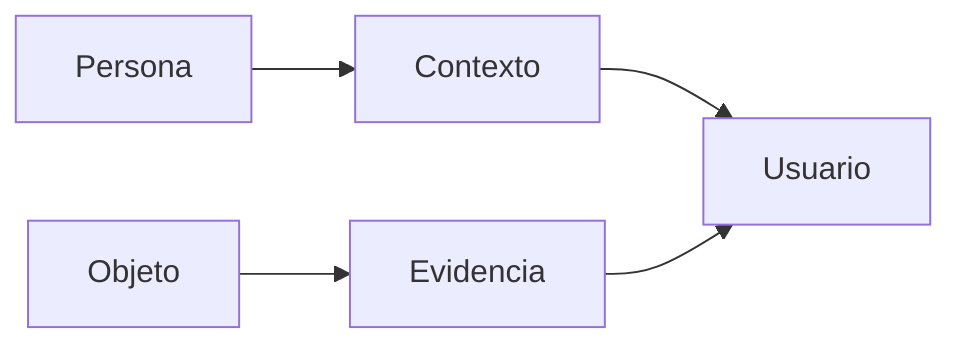

 

# Propósito y capacidades

[← Documentación](../INDEX.md) · [API / Postman](../api/API.md)

## Guía de lectura

| Tema | Qué debes saber |
| --- | --- |
| **Propósito** | Reconocimiento facial, contexto autorizado y memoria visual para múltiples entornos. |
| **Ejemplos** | Policial, enfermería, social y memoria son usos independientes y no exhaustivos; no comparten datos automáticamente. |
| **Evidencia** | Responder con fuente, fecha y geometría; decir visto por última vez y reconocer ausencia o ambigüedad. |
| **Biometría** | Función deliberada con consentimiento, autorización y confirmación humana. No sustituye el flujo de objetos. |
| **Alcance actual** | Android y Display nativo; Muse/SAM/STT y ElevenLabs. No reactivar panel web, web Display ni síntesis local retirados. |
| **Entrega** | Identificar base y aportaciones del evento, mostrar ejecución real y revisar requisitos de hackathon. |

[API ](../api/API.md) · [DEMO ](../guides/DEMO.md) · [HACKATHON ](HACKATHON.md)
