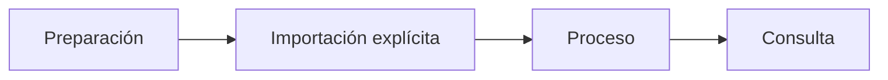

<p align="center"><a href="../../en/testing/MANUAL_PHOTO_TEST.md"></a> <a href="MANUAL_PHOTO_TEST.md"></a></p>

# Prueba con fotos propias

[← Documentación](../INDEX.md) · [API / Postman](../api/API.md)

## Guía de lectura

| Tema | Qué debes saber |
| --- | --- |
| **Preparar** | `make runtime-dirs` crea carpetas privadas; colocar un archivo no registra, captura ni llama a Meta. |
| **Elegir** | Usar solo material autorizado para una prueba de objetos, sin secretos ni datos privados ajenos. JPEG, PNG, WebP; videos según contrato. |
| **Importar** | El importador solicita contraseña y consentimiento; usa API normal y abre/cierra sesión explícita. |
| **Procesar** | `--process` inicia análisis Muse; SAM por observación es un refinamiento explícito posterior. `--wait-seconds` ajusta espera. |
| **Comprobar** | Consultar desde Android o Postman; repetir con otro lugar para probar historial. Confirmar fecha, fuente y sin afirmar ubicación actual. |



## Comandos

Ejecutar desde la raíz, con dependencias instaladas. Migraciones y procesamiento requieren el entorno elegido y autorización de sus datos.
```bash
make runtime-dirs
.venv/bin/python scripts/import_manual_photos.py --help
```

[API ](../api/API.md) · [DEMO ](../guides/DEMO.md) · [SECURITY ](../architecture/SECURITY.md)

## Ejemplo de importación explícita

Coloca una foto propia/autorizada en la carpeta privada y usa una cuenta con permiso de registro. El script solicita su contraseña; el consentimiento se confirma explícitamente.

```bash
make runtime-dirs
.venv/bin/python scripts/import_manual_photos.py \
  --api-url https://realityos.luxisoft.com \
  --email your-registered-account --workspace "Your workspace" --zone "QA" \
  --confirm-consent --process --wait \
  .runtime/manual-captures/incoming/photo.jpg
```
