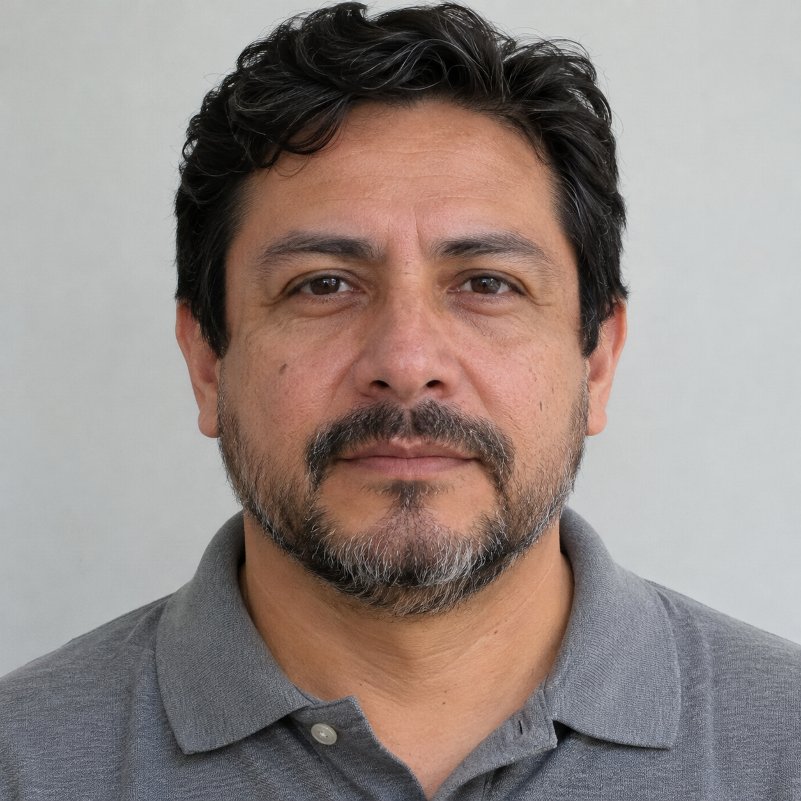
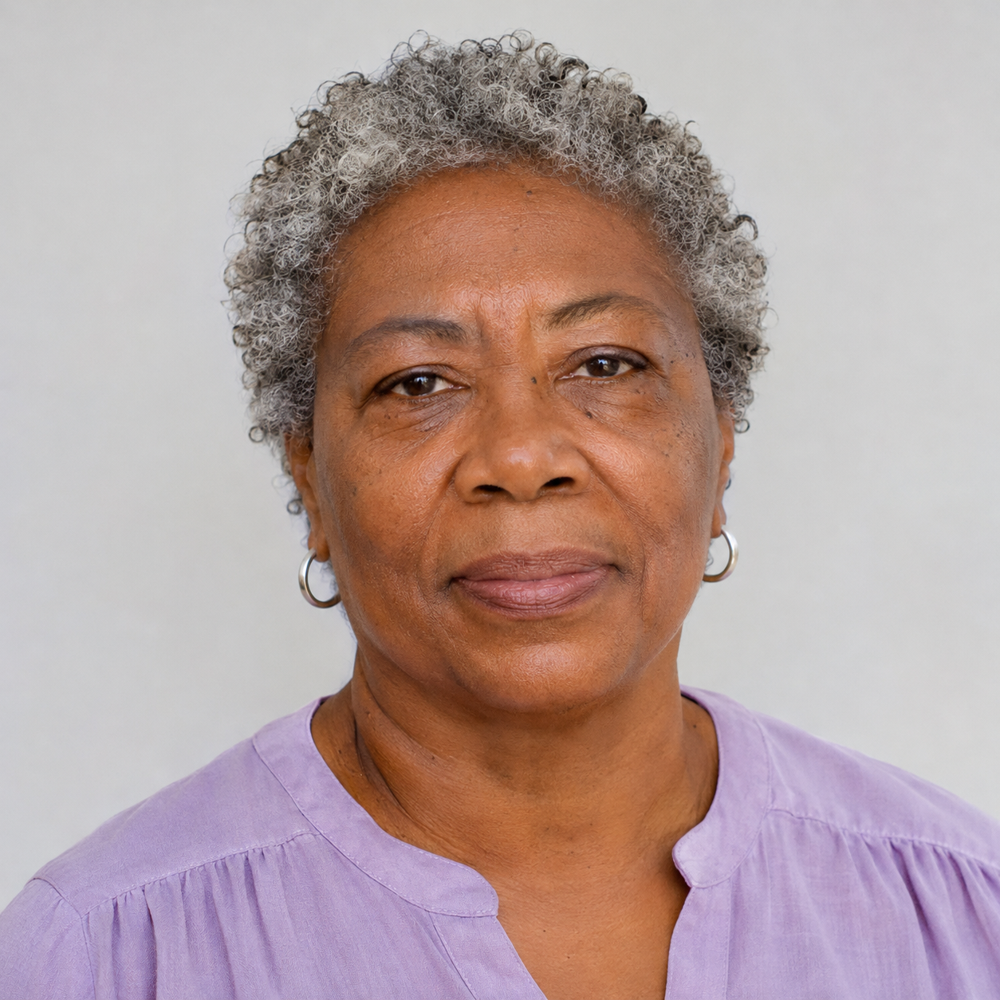
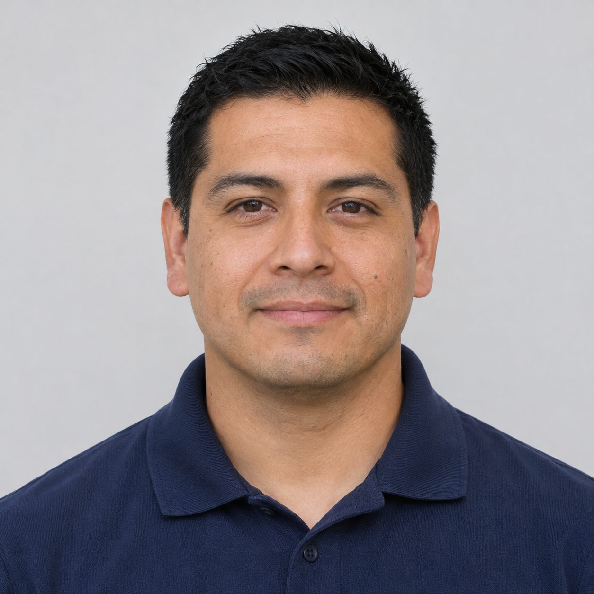
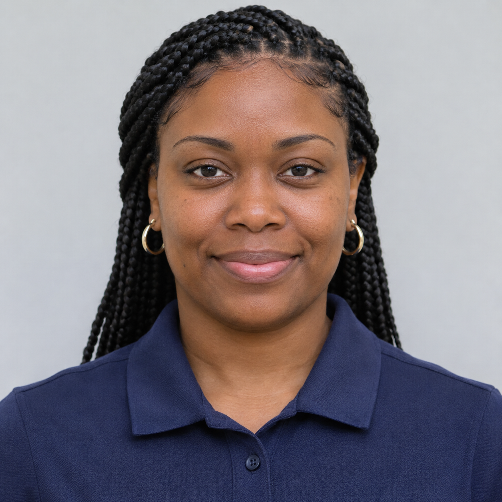

# Láminas de prueba — abrir en la computadora
[Checklist](IMPLEMENTATION_CHECKLIST.md) · [English](../../en/testing/QA_VISUAL_FIXTURES.md) · [Español](QA_VISUAL_FIXTURES.md)

Abre esta página renderizada en GitHub en la computadora. Haz clic en una imagen para ampliarla; apunta la cámara del teléfono a la pantalla. No descargues retratos al teléfono. Para tres caras, muestra la tabla completa con zoom suficiente. Evita reflejos y encuadra solo las fotos.

**Datos sintéticos.** Reutilizar un retrato enrolado verifica integración, no precisión representativa. Se mantienen todos los permisos y controles de calidad. Estas imágenes no se usan para suplantar el login Facebook; ese recorrido usa tu propia cuenta y rostro.

## Meta Social Media

Meta Social Media empieza vacío. Elena Marquez, Mateo Rios y Sarah Chen conservan sus perfiles; los expedientes y medios del antiguo hospital se eliminaron.

### Fotografías para consultar perfiles

Estas tres fotos se generaron a partir de los avatares existentes. Cada una muestra una sola persona, con el rostro visible en un encuadre cercano. Abre una foto en la computadora y úsala como entrada de una búsqueda explícita. **Son archivos de consulta: no se publican, no se adjuntan a registros y no se cargan al iniciar el entorno local.**

| Cuenta de referencia | Foto para buscar | Avatar original |
| --- | --- | --- |
| Elena Marquez | [Exterior de cafetería](../../../simulator/search-cases/meta-social/elena-marquez.png) | [Avatar](../../../simulator/workspaces/assets/elena-marquez.png) |
| Mateo Rios | [Paseo junto al río](../../../simulator/search-cases/meta-social/mateo-rios.png) | [Avatar](../../../simulator/workspaces/assets/mateo-rios.png) |
| Sarah Chen | [Entrada de librería](../../../simulator/search-cases/meta-social/sarah-chen.png) | [Avatar](../../../simulator/workspaces/assets/sarah-chen.png) |

La cuenta indicada es la referencia de generación, no una coincidencia verificada. Tener un avatar no crea un enrolamiento: la prueba facial requiere sus permisos, consentimiento y preparación explícita. Este material no habilita una búsqueda global de Facebook. No se ha ejecutado una búsqueda en dispositivo ni una validación de reconocimiento con estas imágenes.

## Policía: escenas para probar búsquedas

Las cuatro escenas de `Personas/cases` se conservan completas y sin cambios. Según el propietario, cada una incluye tres personajes de `Personas/profile`, además de otras personas del entorno. Los diez retratos de referencia ya pertenecen a los expedientes policiales; las escenas nuevas son **solo entradas de consulta**, fuera de publicaciones y registros de cualquier grupo.

| Escena | Abrir imagen |
| --- | --- |
| Parque costero visto por una sola lente | [Caso 01](../../../simulator/search-cases/police/case-01.png) |
| Parque urbano tras la lente derecha | [Caso 02](../../../simulator/search-cases/police/case-02.png) |
| Parque urbano tras una lente derecha | [Caso 03](../../../simulator/search-cases/police/case-03.png) |
| Vida urbana junto al río | [Caso 04](../../../simulator/search-cases/police/case-04.png) |

Selecciona el grupo Policía con una cuenta autorizada y abre una escena en la computadora para la captura de consulta. No uses Publicar ni Registrar. No se asignaron identidades a las personas de cada escena: esa correspondencia no venía con los archivos. El [manifiesto](../../../simulator/search-cases/manifest.json) conserva procedencia, hashes y separación del contenido inicial; no otorga permisos ni consentimiento ni crea enrolamientos.

## Memoria / Memory
**noah-brooks → Sonoran Neurological Institute**

Resultado esperado: candidatos de expediente de este espacio, con similitud y enlace al expediente. El consentimiento del usuario que busca sigue siendo necesario.

### Luis Moreno

### Grace Wilson

### Hiro Tanaka

### Tres rostros en una captura

| Luis Moreno | Grace Wilson | Hiro Tanaka |
| --- | --- | --- |
|  |  |  |

## Usuarios QA — candidato de perfil

**qa-hackathon-admin → QA Hackathon — disposable tests**

El responsable prepara dos enrolamientos explícitos. La foto del miembro representa a Maya sintética; no es una cuenta Facebook. qa-hackathon-reader conserva la ausencia de consentimiento para la prueba negativa.

### qa-hackathon-admin

### qa-hackathon-member

## Escenas de objetos y negativo sin rostro

### Pacific Ridge Police Department

Diez expedientes de personajes ficticios reemplazan las escenas anteriores. Un retrato proporcionado por el propietario por expediente. Las tres cuentas de acceso se conservan.

| Person / Persona | Portrait / Retrato | Status / Estado |
| --- | --- | --- |
| Adrián Salcedo | [PRP-0001](../../../simulator/workspaces/police-people/person-01.png) | Orden vigente y proceso judicial |
| Esteban Pardo | [PRP-0002](../../../simulator/workspaces/police-people/person-02.png) | Orden vigente y proceso judicial |
| Valeria Navarro | [PRP-0003](../../../simulator/workspaces/police-people/person-03.png) | Orden vigente; sin proceso activo registrado |
| Lucía Cárdenas | [PRP-0004](../../../simulator/workspaces/police-people/person-04.png) | Sin antecedentes, órdenes ni procesos |
| Tomás Beltrán | [PRP-0005](../../../simulator/workspaces/police-people/person-05.png) | Sin antecedentes, órdenes ni procesos |
| Nicolás Acosta | [PRP-0006](../../../simulator/workspaces/police-people/person-06.png) | Sin antecedentes, órdenes ni procesos |
| Mariana Solano | [PRP-0007](../../../simulator/workspaces/police-people/person-07.png) | Sin antecedentes, órdenes ni procesos |
| Rafael Méndez | [PRP-0008](../../../simulator/workspaces/police-people/person-08.png) | Sin antecedentes, órdenes ni procesos |
| Camila Fuentes | [PRP-0009](../../../simulator/workspaces/police-people/person-09.png) | Sin antecedentes, órdenes ni procesos |
| Asha Mehta | [PRP-0010](../../../simulator/workspaces/police-people/person-10.png) | Sin antecedentes, órdenes ni procesos |

### noah-brooks → Sonoran Neurological Institute
Carpeta roja / red folder; llaves de latón / brass keys; cuaderno azul / blue notebook

## Archivos solo para la prueba de sustitución de CV

[CV sintético v1](../../../simulator/acceptance/cv-v1.pdf) · [CV sintético v2](../../../simulator/acceptance/cv-v2.pdf). Para F03/K11 ya están en **Menú → Mis conexiones → Demo qa**: marca un PDF y pulsa **Usar como CV**. Los enlaces son solo de referencia; no necesitas descargarlos al teléfono. La versión 1 dice “Inventory assistant”; la versión 2 “Equipment coordinator”. No contienen información real.
