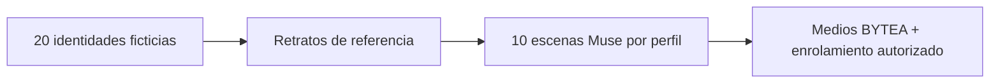

  
  

# Directorio social sintético

[API / Postman](../api/API.md) · [Todas las guías](../INDEX.md)

**Identidades ficticias para evaluar el sistema, procesadas mediante el flujo real autorizado.**

[← Proyecto](../README.md) · [Escenarios de evaluación](../README.md#evaluate) · [Estado de implementación](../project/IMPLEMENTATION_STATUS.md)

| Ubicación | Contenido |
| --- | --- |
| [`source/`](../../../simulator/social-directory/source/) | Referencias sintéticas de identidad. |
| `muse/` — ignorado | Diez escenas distintas por perfil, ancladas con Muse y validadas con InsightFace. |
| `generated/` — ignorado | Avatares generados. |
| [`workshop/`](../../../simulator/social-directory/workshop/) | Quince vistas del mismo taller: nueve diurnas y seis nocturnas, además de su video original. |

[`PROFILE_ROWS`](../../../scripts/seed_social_directory.py) define las 20 identidades de prueba deterministas. El [generador de fotos](../../../scripts/generate_directory_photos.py) crea sus escenas; el importador usa el flujo BYTEA e InsightFace de los medios sociales autorizados. Los perfiles del directorio no incluyen videos sintéticos.

El escenario «Mechanic Workshop» tiene cinco miembros con turnos diurnos y nocturnos. Todas las identidades son ficticias y deben seguir identificadas como simuladas. La pertenencia al espacio, la autorización y los permisos biométricos continúan vigentes; los datos sintéticos no los omiten.

[English](../../en/testing/SOCIAL_DIRECTORY.md)
